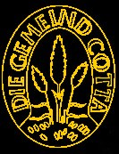

**Gemeindesiegel von Cotta**

Das Gebiet um den heutigen Stadtteil Cotta war bereits in der Steinzeit besiedelt. Eine umfangreiche archäologische Ausgrabung fand in den Jahren 1994/95 an der Mobschatzer Straße statt, bei der als
Aufsehen erregenster Fund das Skelett einer jungen Frau entdeckt wurde. Verschiedene Indizien deuten auf eine Schwangerschaft der Toten hin, da diese statt in der üblichen Hockstellung in ausgestreckter Lage beerdigt
wurde und zudem einen Stein im Beckenbereich trug. Die Steinzeitfrau “Rebekka” gilt als einer der bedeutendsten archäologischen Funde in Sachsen in den letzten Jahren. Die Grabungen in Cotta, bei denen außerdem mehrere
Kinderskelette, verschiedene Keramikgefäße und Steinwerkzeuge gefunden wurden, belegen die Existenz einer frühgeschichtlichen Siedlung an diesem Platz.

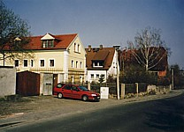Das slawische Gassendorf Cotta wurde 1328 erstmals als Cottowe urkundlich
erwähnt. Der Name ist von einem slawischen Personennamen abgeleitet (Dorf des Chot). In diesem Jahr verkaufte Hermann der Ältere von Kottowe einen Teil des
Ortes an das Domstift Meißen. Weitere Güter gehörten zu diesem Zeitpunkt verschiedenen weltlichen Besitzern, wurden jedoch bis 1512 ebenfalls vom Stift
angekauft. Nach Auflösung des Vorwerks verteilte man Mitte des 16. Jahrhunderts dessen Fluren an die ortsansässigen Bauern. Abgabenpflichtig war Cotta zunächst
nach Briesnitz, ab 1559 zum kurfürstlichen Amt Dresden. 1568 mussten die Bewohner des Dorfes fast die Hälfte ihrer Felder an das Kammergut Ostra
abgeben und wurden dabei mit Geld abgefunden. Infolgedessen veränderte sich die Sozialstruktur des Ortes, in dem
sich nun zahlreiche Häusler und Gärtner ohne oder mit nur geringem Landbesitz niederließen. Erschwert wurde die
Nutzung der verbliebenen Flächen durch die feuchte sumpfige Lage des Ortes, die Cotta im Volksmund den Spitznamen
“Frosch-Cotte” einbrachte. Einige Gehöfte aus der dörflichen Vergangenheit sind bis heute an der Hebbelstraße erhalten geblieben _(Foto)_.

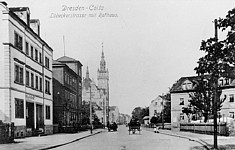Im 19. Jahrhundert entstanden in den Cottaer Nachbarorten Löbtau und Friedrichstadt zahlreiche Industriebetriebe, die zu einer deutlichen Zunahme der Bevölkerung
führten. Außerdem wurde 1837 der [Tiefe Elbstollen](../../west/cotta/strassen_cotta/meissner_landstrasse/tiefer_elbstollen/), ein
Entwässerungsstollen des Zauckeroder Steinkohlebergbaus, fertig gestellt. Obwohl Cotta selbst von der Industrialisierung nur wenig betroffen war, entwickelte sich das frühere Dorf zum Arbeiterwohnort. Rund um den
ehemaligen Dorfkern [Altcotta](../../west/cotta/strassen_cotta/) **_(Foto:_** _Lübecker Straße)_ wurde ein
schachbrettartiges Straßennetz angelegt und mit Mehrfamilien-Mietshäusern bebaut. Die auch als “Würfelhäuser” oder “Kaffeemühlen” bezeichneten
Gebäude in offener Bauweise sind bis heute typisch für Cotta und seine Nachbarstadtteile geblieben. Die neu entstandenen Straßen erhielten ihre Namen meist nach umliegenden Ortschaften bzw. nach bekannten Dichtern und
Schriftstellern. Nicht zuletzt durch den 1875 geschaffenen Eisenbahnanschluss wuchs die Einwohnerzahl bis zur
Jahrhundertwende auf über 10.000 Personen an, wodurch Cotta zu einer der größten Landgemeinden Sachsens wurde. Am 1. Januar 1903 kam der Ort als Stadtteil zu Dresden.

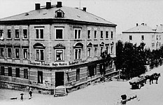Bereits in der zweiten Hälfte des 19. Jahrhunderts waren in Cotta einige neue
öffentliche Gebäude errichtet worden. An Stelle einer 1866 im Preußisch - Österreichischen Krieg aufgeworfenen Schanze entstand nach 1875 ein kleines Geschäftsviertel mit der Schanzen-Apotheke _(Foto)_
. Ab 1897 bildete Cotta eine eigene Parochie, für die nach dem Ersten Weltkrieg die evangelische [Heilandskirche](../../west/cotta/heilandskirche/) erbaut wurde. Bereits 1906 hatten die Katholiken eine eigene [katholische Kirche](../../west/cotta/st__marien-kirche/) erhalten. 1927 folgte an der Hühndorfer Straße die evangelisch-methodistische [Immanuelkirche](../../west/cotta/immanuelkirche/). 1899-1901 ließ sich die Gemeinde im Dorfkern ein repräsentatives Rathaus errichten, in welchem heute das
Ortsamt Cotta seinen Sitz hat. Außerdem erhielt der Ort zwei neue Schulgebäude und ein Hallenbad an der [Hebbelstraße](../../west/cotta/strassen_cotta/hebbelstrasse/). Bedeutendstes Bauvorhaben war jedoch die Verlegung der Weißeritzmündung nach Cotta im Jahr 1893,
wobei der Fluss ein neues Bett bekam. 1897 führte ein schweres Hochwasser der Weißeritz zu großen Schäden im Ort.
Zu den weit über die Ortsgrenzen hinaus beliebten Vergnügungsstätten gehörten die Ballhäuser “Constantia” und das [Schusterhaus](../../west/cotta/strassen_cotta/hamburger_strasse/schusterhaus/). Während letzteres 1945 dem Luftangriff zum Opfer fiel, dient die ehemalige Gaststätte “Constantia” seit
1950 als [Theater der Jungen Generation](../../west/cotta/strassen_cotta/meissner_landstrasse/theater_junge_generation/).

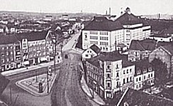

**_Foto:_** _Das Cottaer Ortszentrum mit der Schule in den Zwanziger Jahren_

Relativ spät, nämlich erst 1900, erhielt Cotta Anschluss an das Dresdner Straßenbahnnetz. Nachdem der Bau einer schmalspurigen Straßenbahn von Kötzschenbroda über Niederwartha - Cossebaude - nach Cotta aus finanziellen
Gründen aufgegeben worden war, begann die Dresdner Straßenbahngesellschaft 1899 mit der Verlängerung ihres
Gleisnetzes bis zum Schusterhaus. Am 22. April 1900 wurde diese Linie eingeweiht, 1906 folgte die Verlängerung bis
nach Cossebaude. Seit 1909 verkehrten dann auch Bahnen nach Löbtau, nachdem die Verbindungsstrecke von der [Hamburger Straße](../../west/cotta/strassen_cotta/hamburger_strasse/) über Altcotta zur [Kesselsdorfer Straße](../../sudwest/lobtau/strassen_lobtau/kesselsdorfer_strasse/) vollendet war.

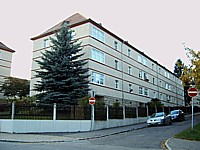Der hohe Anteil an Arbeitern machte Cotta nach 1900 zu einem Zentrum der
Arbeiterbewegung in Dresden, vor allem der Sozialdemokratie. Auf Anregung des SPD-Funktionärs Richard Gärtner entstand 1925 das [Volkshaus Cotta](../../west/cotta/strassen_cotta/hebbelstrasse/) an der
Hebbelstraße, finanziert vom Ortskartell “Arbeiterheim Cotta”. Auch das bereits bestehende Hebbelbad wurde 1929 erweitert. Im gleichen Jahr begann in Cotta der
Bau einer genossenschaflichen Siedlung an der Gottfried-Keller- / Omsewitzer Straße _(Foto)_ Bereits 1913 hatte der Naturheilverein Dresden-West an der Hebbelstraße ein kleines [Freibad](../../west/cotta/strassen_cotta/hebbelstrasse/freibad_cotta/) eingerichtet.

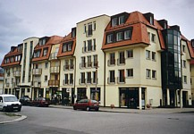Die Nachkriegszeit war in Cotta wie in vielen Dresdner Stadtvierteln vom zunehmenden Verfall der Altbausubstanz geprägt. Neben den über 100
Wohnungen, die bereits 1945 durch die Bomben zerstört worden waren, fielen weitere dem Abriss zum Opfer oder mussten wegen Baufälligkeit gesperrt
werden. Auch die Errichtung einiger Neubauten am Weidigtbach um 1965 konnte den Bevölkerungsrückgang in Cotta nicht dauerhaft aufhalten. Erst nach 1990
wurde mit der Sanierung des Stadtviertels begonnen. Neben der Modernisierung zahlreicher Wohnhäuser kamen 1993 einige moderne Büro- und Hotelbauten in
Cotta hinzu. An Stelle der 2002 abgerissenen alten Dorfschänke “Zum Frosch” entstand ein modernes Stadtteilzentrum. Das Foto zeigt ein modernes Wohn- und Geschäftshaus an der Leutewitzer Straße.

Cottaer Mühle:**Mühlen in Cotta**

Eine Wassermühle wurde in Cotta erstmals im Jahr 1338 erwähnt. Ihren Standort hatte die Mühle am Hacheschen Gut,
einem Gehöft in der Nähe der Eisenbahnüberführung über die Weißeritz. 1575 erwarb Kurfürst August die Mahlrechte,
ließ die Mühle stilllegen und zwang so die Bauern der Umgebung, die kurfürstliche Amtsmühle zu nutzen. Erst 1893
erhielt Cotta erneut eine Mühle. Diese Schneidemühle befand sich am Flügelweg und existierte nur wenige Jahre. Beim Weißeritzhochwasser am 30./31. Juli 1897 wurde sie zerstört und nicht wieder aufgebaut.

Rathaus Cotta:

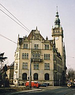
Das Rathaus Cotta entstand zwischen 1899 und 1901 als Verwaltungssitz der damals noch selbständigen Gemeinde an Stelle des früheren Dorfteichs und einiger für den Bau
abgetragener Wohnhäuser. Der erste Spatenstich erfolgte am 18. November 1899. Das Gebäude wurde vom Ortsbauinspektor Bernhard Seitz entworfen und vom Architekten Felix
Reinhold Voretzsch im Stil der Neorenaissance baukünstlerisch gestaltet. Ferner wirkten die Baumeister Georg Hermann Heinse und Hermann Speck mit. U.a. erhielt das Haus an der
Fassade verschiedene Wappenplastiken, Darstellungen mit Pflanzen- und Tiermotiven und einen knapp 50 Meter hohen Turm. Im Inneren befanden sich die Verwaltungsräume der
Gemeinde, ein mit Glasmalereien geschmückter Sitzungssaal und im Erdgeschoss die Arrestanstalt des Ortes.

Am 24. April 1901 erfolgte die feierliche Einweihung des Cottaer Rathauses. Auch nach der Eingemeindung des
Stadtteiles zu Dresden blieb das Rathaus Verwaltungsgebäude für die Bezirksverwaltung Dresden-Cotta und ab 1950
für den Stadtbezirk Dresden-West. Seit 1991 hat hier das Ortsamt Cotta seinen Sitz. Wenig später begann eine 2009
abgeschlossene umfangreiche Sanierung des Rathauses, welches bis heute ein Wahrzeichen des Dresdner Westens ist.

Schulen in Cotta:

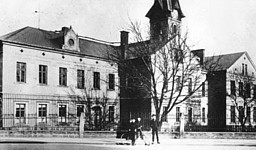Alte Schule: 1869 verließ Cotta den Briesnitzer Schulverband und
errichtete eine eigene Schule. Dieses Schulhaus musste bereits 1873 erstmals erweitert werden. 1880 erfolgte ein zweiter Anbau, der jedoch auch schon bald nicht mehr den Anforderungen genügte. Deshalb entstand
1889 ein zweites Schulgebäude, in seiner Nachbarschaft 1891 die erste Cottaer Turnhalle.

12\. Volksschule: Um der zunehmenden Einwohnerzahl Rechnung zu tragen,
ließ die Gemeinde 1897 ein weiteres Schulhaus an der Hebbelstraße 20 erbauen. Die Grundsteinlegung für die damalige 13. Bürgerschule erfolgte am 22. März 1897. Nach der Eingemeindung
wurde sie offiziell als 12. Volksschule bezeichnet, wegen ihrer Backsteinfassade im Volksmund jedoch  “Rote Schule”
genannt.  Zu DDR-Zeiten erhielt die 12. POS nach einem antifaschistischen Widerstandskämpfer den Namen “Arthur Weineck” . Nach Schließung der Mittelschule im Sommer 2003 wird das Gebäude heute nur noch von der 12.
Grundschule genutzt.

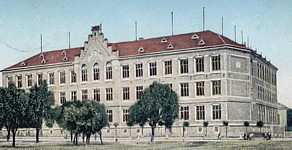

**_Foto:_** _Die “Rote Schule” an der Hebbelstraße um 1900_

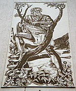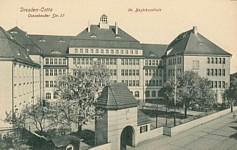Gymnasium Cotta: Das Gebäude an der Cossebauder Straße entstand 1909/10 nach Plänen des Stadtbaurates Hans Erlwein und war zum Zeitpunkt seiner Einweihung im Herbst 1911 größte Volksschule Sachsens mit Platz für über 3000 Kinder. Der nach modernen Gesichtspunkten projektierte Bau erhielt als künstlerischen Schmuck ein Freskobild des sagenhaften Berggeistes Rübezahl _(Foto)_ von Georg Lührig, welches der offiziell als 34. Bezirksschule bezeichneten Schule im Volksmund den Namen “Rübezahlschule” einbrachte. Ein Majolikarelief über dem Eingang an der Cossebauder Straße zeigt einen Stadtrat mit einer Schere, der symbolisch die Mittel für den Schulbau kürzen will, während der Architekt schützend seine Hand über seinen Entwurf ausbreitet. Im Inneren bot das Gebäude neben Klassenräumen und Fachkabinetten ein eigenes Bad mit Umkleideräumen, eine Lehrküche sowie eine gut ausgestatte Schulbibliothek. Glas- und Deckengemälde im Treppenhaus zeigten verschiedene Märchenfiguren des Malers Karl Schulz.

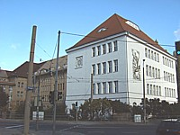Die Schule wurde beim Luftangriff am 17. April 1945 schwer beschädigt und nach dem vereinfachten Wiederaufbau ab September 1949 als Bezirksschule West,
später als 34. POS “Ernst Moritz Arndt” genutzt. Ernst Moritz Arndt (1769-1860) war Schriftsteller, antinapoleonischer Freiheitskämpfer und Abgeordneter der
Frankfurter Nationalversammlung. Außerdem war das Gebäude zeitweise Domizil der Hilfsschule West, der Kinder- und Jugendsportschule und des Pionierhauses
West. Außerdem gab es eine kinderstomatologische Praxis und ein Chemielabor im Gebäude. Seit 1992 hat hier das Cottaer Gymnasium seinen Sitz. Die zunächst
ebenfalls hier beheimatete 34. Grundschule schloss 1998.  In den vergangenen Jahren erfolgten einige Sanierungsarbeiten, eine grundhafte Erneuerung steht jedoch noch aus. 2014 wurde auf dem
Grundstück Dresdens größte Schulturnhalle eingeweiht. Die alte Sporthalle soll künftig zu Fachkabinetten umgebaut
werden. Im Obergeschoss des Hauoptgebäudes befindet sich einigen Jahren ein kleines Museum zur Geschichte der Cottaer Schule.

Kraftwerk Cotta:

Das Kraftwerk an der Cottaer Bahnstraße entstand 1894 zur Strom- und Wärmeversorgung des Bahnbetriebswerkes und einiger öffentlicher Gebäude. 1945 wurde das Werk schwer beschädigt, konnte jedoch 1954 wiederaufgebaut und
erneut in Betrieb genommen werden. Bis 1992 diente das Kohlekraftwerk der Energieerzeugung und wurde nach Anschluss der Betriebsgebäude an das Fernwärmenetz geschlossen.

Kleingartenverein “Wild West”:

Der Kleingartenverein “Wild West” wurde am 1. Oktober 1909 gegründet und gehört mit nur 34 Parzellen zu den kleinsten in Dresden. Die Namensgebung spielt auf das durch die Kleingärtner mühsam urbar gemachte Brachland im Westen Dresdens an. Zuvor befanden sich hier Felder und kleinere Teiche, an welche heute nur noch der Mitte der 1980er Jahre regulierte Weidigtbach erinnert, welcher das zweigeteilte Spartengelände durchfließt. Auf Druck der Behörden musste die Sparte 1950 in “Frohsinn 1” umbenannt werden. Erst 1991 erhielt sie ihren früheren Namen zurück.

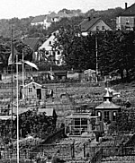Kleingartenverein “Immergrün”:

Die Kleingartensparte “Immergrün” an der Warthaer Straße wurde am 26. September 1909 gegründet und gehört zu den ältesten in Dresden. Einige Arbeiterfamilien hatten zuvor das Land aus dem Besitz des Spirituosenfabrikanten Bramsch erworben, um hier ihre Parzellen anzulegen _(Foto um 1910)_. Bereits 1911 gehörten dem Verein 75 Mitglieder an, zwei Jahre später schon 129. 1926 entstand ein Vereinsheim mit öffentlicher Gaststätte. Dieses war zugleich Treffpunkt der zum Verein “Immergrün” gehörenden “Schieß-Abteilung” , der “Musikgruppe” und der “Blumengruppe”, welche in den Zwanziger Jahren stadtbekannte Blumenschauen organisierte. Heute besteht die Anlage aus 148 Kleingärten.

Kleingartenverein "Gartenfreunde II":

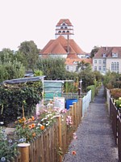Der Gartenverein an der Tonbergstraße wurde 1917 gegründet und nimmt einen Großteil des Areals hinter der Heilandskirche bis zur Gottfried-Keller-Straße ein. Möglicherweise gab es hier zuvor bereits einige Gärten, was jedoch nicht belegbar ist. Angrenzend gibt es mit dem Gartenverein "Gute Hoffnung" eine weitere Kleingartenanlage. Im unteren Teil lagen früher die sogenannten "Nasswiesen", ein sumpfiges Areal, welches erst mühevoll nutzbar gemacht werden konnte. Per Pachtvertrag vom 28. Januar 1919 wurden die der Cottaer Kirchgemeinde gehörenden Flächen an den "Evangelischen Arbeiterverein Dresden-Cotta und Umgebung" verpachtet. Ab 1937 wurden dessen Mitglieder in die Stadtgruppe der Dresdner Kleingartenvereine aufgenommen und die Anlage nun amtlich "Kleingärtnerverein des Deutschen Evangelischen Männerwerkes e.V." genannt. Nach dem Zweiten Weltkrieg wechselte mit der Trägerschaft auch der Name in "Gartenfreunde II". Die Anlage besteht heute aus 96 Parzellen und wurde 2016 als schönste Kleingartenanlage Dresdens ausgezeichnet.

Hungersteine:

Die “Hungersteine” befinden sich im Flussbett der Elbe im Cottaer Elbbogen und waren bereits im 16. Jahrhundert vorhanden. Die drei Feldsteine, von denen einer die Jahreszahl 1630
trägt, sind nur bei extremen Niedrigwasser zu sehen und erinnern an frühere Hungersnöte infolge großer Trockenheit. Im 19. Jahrhundert wurde der Cottaer Elbbogen zum beliebten Motiv für Maler und Zeichner.

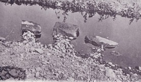

_Die “Hungersteine” auf einer historischen Ansichtskarte._

_**Aufschrift:** “Die mich sahen, die weinten. Die mich wieder sehen, werden wieder weinen.”_
