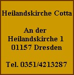
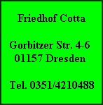
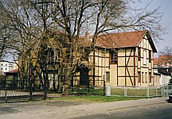
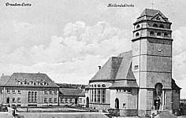
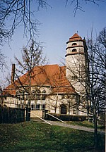
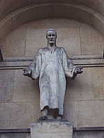

* * *

* * *

* * *

* * *

* * *

* * *

Interimskirche Hebbelstraße:

Die Geschichte der Cottaer Heilandskirche reicht bis ins 19. Jahrhundert zurück. Bereits 1895 entschlossen sich Cottaer Christen, die zuvor ihre Gottesdienste in
der Turnhalle der Schule abgehalten hatten, zur Errichtung einer kleinen Interimskirche an der Hebbelstraße 18. Der schlichte Fachwerkbau mit 600 Sitzplätzen _(Foto)_
entstand nach Plänen des Baumeisters Walter Weichard und erhielt sogar eine Orgel der Firma Jehmlich. Das Altarbild mit einer Darstellung des auferstandenen Christus stammte vom Dresdner Kunstprofessor Schönherr.
Um 1905 wurde neben dem Gebäude noch ein heute nicht mehr vorhandener kleiner Glockenturm mit drei Bronzeglocken der Firma Bierling aufgestellt.

Infolge der stark gewachsenen Einwohnerzahl schied Cotta 1897 aus dem Briesnitzer Kirchspiel aus und bildete eine
eigene Parochie. Obwohl bereits vor dem Ersten Weltkrieg mit dem Bau einer modernen Kirche begonnen worden
war, blieb die Interimskirche noch bis zu deren Fertigstellung 1927 in Betrieb. In den Dreißiger Jahren wurde das
Gebäude von der Gießerei Smolke & Riessner übernommen und gewerblich genutzt. Nach 1945 gehörte der Betrieb zum Dölzschener VEB Eisenhammerwerk. Heute dient die kleine Kirche als Firmensitz eines Handwerksbetriebes.

Heilandskirche:

Da sich das provisorische Kirchengebäude schon bald als zu klein für die gewachsene Vorstadt erwies, beauftragte der Kirchenvorstand 1903 den Architekten Woldemar Kandler mit dem Entwurf für einen größeren Neubau. Allerdings trafen dessen neugotische Entwürfe nicht den Geschmack der Gemeindemitglieder, weshalb sich diese 1908 zu einem Architektenwettbewerb entschloss. Aus den 68 eingegangenen Entwürfen wählte man den des jungen und noch weitgehend unbekannten Architekten Rudolf Kolbe aus. Kolbe entschied sich für einen im Stil der Reformbaukunst mit Jugendstilelementen gestalteten Bau auf quadratischem Grundriss mit einem 32 Meter hohen Kirchturm.

Mit dem Bau der Heilandskirche wurde im Mai 1914 begonnen. Bereits wenige Monate
nach der Grundsteinlegung am 7. Juni 1914 mussten die Arbeiten jedoch eingestellt werden, da der Erste Weltkrieg ausgebrochen war. Auch die Not und Inflation der
Nachkriegszeit verhinderte zunächst einen Weiterbau des bis in Höhe der Empore vollendeten Rohbaus. So wurde zeitweise sogar dessen Umwandlung in eine Schule bzw. für gewerbliche Zwecke erwogen.

Erst eine Landeskollekte der Evangelischen Kirche und ein Darlehen der Stadt Dresden
ermöglichten schließlich die Fertigstellung des Gotteshauses zwischen 1925 und 1927. Die Bauleitung oblag dabei dem Baumeister Otto Kolb. Für den baukünstlerischen Schmuck
zeichnete Karl Albiker verantwortlich, der auch Schöpfer der Heilandsfigur am Eingang war _(Foto)_. Am 26. Mai 1927 erfolgte die feierliche Weihe des Gotteshauses. Teile der
Innenausstattung wurden von Cottaer Einwohnern gestiftet; die Turmuhr ist ein Geschenk der Lukaskirchgemeinde. Bemerkenswert sind zwei Buntglasfenster von Karl Schulz, die
die Taufe Christi und die wundersame Heilung eines Gichtbrüchigen darstellen. Die wenigen Schmuckelemente im Kirchensaal stammen aus der Werkstatt des Bildhauers Rudolf Born.
Nach dem Zweiten Weltkrieg kam in der sogenannten “Winterkirche” ein Altar von Friedrich Press hinzu. Die Orgel stammt aus der Werkstatt Jehmlich und besitzt seit ihrer
Erweiterung 1935 42 Register, vier Manuale und ca. 5000 Pfeifen.

Die Cottaer Heilandskirche blieb im Zweiten Weltkrieg unzerstört und erhielt nach 1945 die drei Stahlglocken der
Jakobikirche, die dem Luftangriff zum Opfer gefallen war. Zwei ursprünglich vorhandene Bronzeglocken hatte die Gemeinde zuvor für Rüstungszwecke abgeben müssen. 1960 erfolgte eine Sanierung des Innenraums, der in diesem
Zusammenhang nach Plänen von Helmar Helas farblich neu gestaltet wurde. Seit 2012 befindet sich in den ehemaligen Konfirmandenräumen des Kirchengebäudes eine Kindertagesstätte.

Cottaer Friedhof:

Der Cottaer Friedhof wurde 1897/98 an der Gorbitzer Straße angelegt. Zuvor musste die Cottaer Bevölkerung ihre
Verstorbenen nach Briesnitz transportieren, woran noch die früheren Straßennamen Oberer und Unterer Leichenweg
erinnern. Gleichzeitig mit dem Bau des Friedhofes, der eine Gesamtfläche von ca. 3,6 Hektar umfasst, wurde eine noch heute erhaltene Feierhalle errichtet. Dank seiner zahlreichen Buchen- und Ahornbäume
hat der Friedhof einen parkartigen Charakter.

Historisch interessant sind einige Familiengrabstätten aus der Zeit vor dem Ersten Weltkrieg, in denen frühere Cottaer
Geschäftsinhaber und Fabrikbesitzer ruhen. Sehenswert sind u.a. die Familiengrabstätten der Familien Borth und Kurfürst, das Grab des Baumeisters Max Rexhausen (1918) sowie die Gräber von Friedrich Wilhelm Walter (1906)
und Franz Eduard Stöhr (1901). Zu den wenigen prominenten Persönlichkeiten, die auf dem Cottaer Friedhof
beerdigt wurden, gehört die Kammersängerin Elfriede Trötschel (1913-1958), welche viele Jahre dem Ensemble der Semperoper angehörte. Ein monumentales Gedenkkreuz erinnert an die Opfer des Ersten und des Zweiten
Weltkrieges. Nach 1990 wurden von der deutschen Kriegsgräberfürsorge außerdem 73 Granitsteine für diese Opfer aufgestellt.

* * *

 \[ [Home](../../../index.html)\] \[ [Nord](../../../nord/)\] \[ [Nordwest](../../../nordwest/)\] \[ [Neustadt](../../../neustadt/)\] \[ [Nordost](../../../nordost/)\] \[ [West](../../../west/)\] \[ [Zentrum](../../../zentrum/)\] \[ [Südwest](../../../sudwest/)\] \[ [Süd](../../../sud/)\] \[ [Südost](../../../sudost/)\] \[ [Ost](../../../ost/)\] \[ [Register](../../../Register/register.html)\] \[ [Kontakt](../../../Kontakt/kontakt.html)\] \[ [Impressum](../../../impressum/)\]
