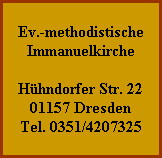
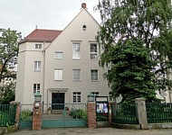
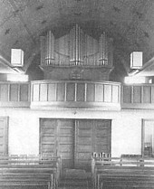

* * *

* * *

Die Geschichte der evangelisch-methodistischen Kirche reicht bis ins 18. Jahrhundert
zurück. Die von John und Charles Wesley gegründete Erneuerungsbewegung innerhalb der anglikanischen Kirche wurde später von Auswanderern in die USA mitgenommen,
wo sich erste methodistische Gemeinden bildeten. Der ursprünglich spöttisch genutzte Name geht auf die streng geordnete Lebensweise der Anhänger dieser Glaubensrichtung
zurück. Zwischen 1830 und 1850 bildeten sich auch in Deutschland erste Gemeinden, vor allem in Württemberg und Norddeutschland.

Mitte des 19. Jahrhunderts kamen einige
Prediger auch nach Sachsen und gründeten hier eigene Gemeinden. Besonders im Erzgebirge und im Vogtland entstanden methodistische Kirchgemeinden, die heute
insgesamt ca. 64.000 Mitglieder zählen. In Dresden wurde die erste methodistische Gemeinde im Jahr 1873 durch einen
aus der USA in seine Heimat zurück gekehrten Pastor gegründet. Ihre erste evangelisch-methodistische Kirche erhielt die
Stadt  im Jahr 1901, als im Hinterhof eines Gebäudes an der Katharinenstraße in der Neustadt ein Gemeindezentrum errichtet wurde. Weitere methodistische Kirchen befinden sich in [Bühlau](../../../nordost/buhlau/ev_-methodistische_friedenskir/) und Striesen.

In Cotta wurden die ersten Gottesdienste ab 1897 in einem Nebenraum der Drogerie “Zur Schanze” durchgeführt. 1906
bezog die Gemeinde einen Saal im Hintergebäude des Cottaer Postamts an der Cossebauder Straße 3, bevor 1927 das
neue Gemeindehaus an der Hühndorfer Straße 22 bezogen werden konnte. Die neue Immanuelkirche entstand auf einem
1924 erworbenen Grundstück nach Plänen des Architekten Alexander Tandler. Äußerlich ist das im Bauhausstil gestaltete
Gebäude nicht als Kirche erkennbar, da staatliche Bauvorschriften den Freikirchen keine öffentliche Repräsentation bei
Kirchenbauten erlaubten. Die feierliche Weihe erfolgte am 18. Dezember 1927. Seit 1992 steht das Gebäude unter Denkmalschutz.

Im Inneren befindet sich neben den Räumen für die Gemeindearbeit ein Kirchsaal mit 150
Plätzen. Gemäß den Regeln der evangelisch-methodistischen Kirche ist dieser weitgehend schmucklos gestaltet, besitzt allerdings ein Ende des 19. Jahrhunderts entstandenes Altarbild
mit einer Darstellung von Jesus im Tempel. 1947 ließ die Gemeinde eine Orgel der Dresdner Firma Jehmlich einbauen, erster Orgelneubau nach dem Zweiten Weltkrieg _(Foto)_. Zuvor
diente ein preisgünstig von einer Nossener Schule erworbenes Instrument der musikalischen Begleitung der Gottesdienste. Die neue Orgel besitzt 17 Register und 1.127 Pfeifen.
Zwischen 1991 und 2007 wurde die Immanuelkirche umfassend saniert. In diesem Zusammenhang entstanden auch zwölf Glasfenster mit Darstellungen der kirchlichen
Feiertage. Schöpfer war der Dresdner Glasgestalter Wolfgang Korn.

* * *

 \[ [Home](../../../index.html)\] \[ [Nord](../../../nord/)\] \[ [Nordwest](../../../nordwest/)\] \[ [Neustadt](../../../neustadt/)\] \[ [Nordost](../../../nordost/)\] \[ [West](../../../west/)\] \[ [Zentrum](../../../zentrum/)\] \[ [Südwest](../../../sudwest/)\] \[ [Süd](../../../sud/)\] \[ [Südost](../../../sudost/)\] \[ [Ost](../../../ost/)\] \[ [Register](../../../Register/register.html)\] \[ [Kontakt](../../../Kontakt/kontakt.html)\] \[ [Impressum](../../../impressum/)\]
