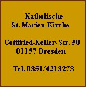
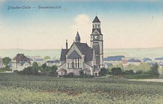
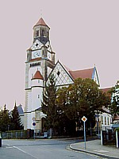

* * *

* * *

* * *

* * *

* * *

* * *

Die St. Marien-Kirche entstand 1905/06 auf einer Anhöhe an der Gottfried-Keller-Straße für die katholische Gemeinde der westlichen Dresdner Vororte. Zuvor besaß Cotta lediglich eine Außenstelle der Hofkirche für die seelsorgerische Betreuung der Bevölkerung. Da die Zahl der Katholiken jedoch ständig stieg, gründete sich 1887 in Cotta ein “Benno-Verein”, der sich für den Bau eines eigenen Gotteshauses einsetzte. Dieser organisierte ab 1893 den katholischen Religionsunterricht der Kinder und führte 1896 in einer Turnhalle auch Gottesdienste durch.

1898 bildete sich schließlich unter Leitung von Hofkirchenkaplan Franz Bodenburg ein “Kirchenbaukomitee”, welches sich vor allem dem Einwerben von Spenden für den Kirchenbau widmete. Befördert wurde das Vorhaben durch die kostenlose Überlassung eines Baugrundstücks am Rande des Ortes. Mit Zustimmung des sächsischen Königs Georg wurde am 8. April 1903 die Baugenehmigung erteilt, so dass am 1. Oktober 1905 der Grundstein gelegt werden konnte. Das Gebäude enstand nach Plänen des Paderborner Dombaumeisters Arnold Güldenpfennig und des Dresdner Architekten Heino Otto im neoromanischen Stil und wurde am 9. September 1906 von Bischof Dr. Aloys Schäfer geweiht. Dominiert wird die Kirche von einem 38 Meter hohen Glockenturm, in dem ursprünglich drei Bronzeglocken läuteten. Kriegsbedingt ist heute nur noch die kleinste von ihnen vorhanden.

Auch für den 200 Plätze fassenden Innenraum wählte Heino Otto romanische Bauformen, die der Kirche das Aussehen einer römischen Basilika verleihen. An den mächtigen Sandsteinpfeilern befinden sich Reliefs mit Darstellung der vier Evangelisten. Aus den Anfangsjahren stammen auch die Christusfigur an der Südseite der Kirche, eine geschnitzte Holzpietá und eine Stuckfigur der Heiligen Elisabeth. Ein aus Steinmasse gefertigter Kreuzweg stammt aus dem St.-Hedwig-Institut für kirchliche Kunst. 2006 wurde das ursprünglich 1911 gefertigte Kundstwerk wieder angebracht. 1910 erhielt die St.-Marien-Kirche eine noch heute vorhandene Jehmlich-Orgel mit 2 Manualen und 13 Registern. Eine umfassende Erneuerung des Innenraumes erfolgte 1970/71 unter Leitung von Gottfried Zawadzki, der in diesem Zusammenhang einen neuen Altar, eine Tabernakelstele, eine Darstellung des Kreuzweges und die farbigen Glasfenster schuf.

* * *

 \[ [Home](../../../index.html)\] \[ [Nord](../../../nord/)\] \[ [Nordwest](../../../nordwest/)\] \[ [Neustadt](../../../neustadt/)\] \[ [Nordost](../../../nordost/)\] \[ [West](../../../west/)\] \[ [Zentrum](../../../zentrum/)\] \[ [Südwest](../../../sudwest/)\] \[ [Süd](../../../sud/)\] \[ [Südost](../../../sudost/)\] \[ [Ost](../../../ost/)\] \[ [Register](../../../Register/register.html)\] \[ [Kontakt](../../../Kontakt/kontakt.html)\] \[ [Impressum](../../../impressum/)\]
