* * *

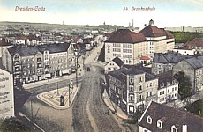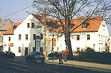Als Altcotta wird seit 1904 der frühere Dorfplatz bezeichnet. Durch den Bau des [Cottaer Rathauses](../../../west/cotta/) an Stelle des Dorfteiches und die baulichen Veränderungen im Umfeld sind nur noch Reste des alten Dorfkerns erhalten geblieben. Zu den ältesten Gebäuden gehörte der 1862 eröffnete Dorfgasthof, der in Anlehnung an den Spitznamen des Dorfes später den Namen “Zum Frosch” trug. 1926 wurde im Ballsaal ein Kino (Rathaus-Lichtspiele) mit 360 Plätzen eingerichtet. Noch bis 1964 fanden hier, zuletzt unter dem Namen Filmtheater West, Filmvorführungen statt. Außerdem befand sich in den Nebenräumen ein Techniklager der Bezirksfilmdirektion Dresden.

Die nach 1990 noch kurzzeitig als Spielothek genutzte Gaststätte stand viele Jahre leer und wurde 2002 abgerissen. An gleicher Stelle entstand ein modernes Stadtteilzentrum, welches sich am historischen Äußeren seines Vorgängerbaus orientiert _(Foto rechts)_. Hier befand sich seit Anfang 2008 die Cottaer Partykneipe “Jedermanns”, seit April 2009 die Café-Bar und Diskothek “Raimund´s”. 2014 übernahm die Sandwich-Kette “Subway” die Räumlichkeiten. 1998 wurde auf der Leutewitzer Straße 5 zudem das Lokal “Frosch à la card” eröffnet.

Die frühere Roßthaler Straße wurde 1904 nach dem preußischen Feldmarschall Bernhard Graf von Blumenthal in Blumenthalstraße umbenannt. Am 1. Juli 1946 erfolgte die Aufhebung dieser Bezeichnung und die Straße erhielt den Namen Arthur-Weineck-Straße. Weineck war bis 1933 Stadtteilleiter der KPD in der Inneren Neustadt und wurde nach mehrmaliger Verhaftung 1944 wegen seiner Mitgliedschaft in der Widerstandsgruppe um Kurt Schlosser und Otto Galle in der Haftanstalt am Münchner Platz hingerichtet.

Die Bahnstraße wurde 1903 als Verbindung zwischen Cossebauder und Hamburger Straße angelegt. Ihren Namen erhielt sie, da sie unmittelbar am Bahndamm des 1894 eröffneten Rangierbahnhofs entlangführt.

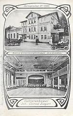Die Birkenhainer Straße wurde 1881 angelegt und nach den örtlichen Gegebenheiten zunächst Wiesenstraße genannt. Wenig später entstanden hier die ersten Wohnhäuser, von denen die Häuserzeile Nr. 12 bis 16 als Baudenkmal unter Schutz steht. Mit der Eingemeindung Cottas erhielt sie 1904 ihren neuen Namen nach dem westlich von Wilsdruff gelegenen Dorf Birkenhain.

Ballhaus "Zu den Linden": Das Lokal entstand um 1890 als "Concert- u. Balletablissement Zu den Linden" auf der Birkenhainer Straße 5 _(Bild)_. Erster Besitzer war Karl Krutzsch. Neben den Restaurationsräumen gehörte auch ein großer Ballsaal dazu. 1913 ließ der neue Eigentümer Max Rössel den Saal nach Plänen des Architekten Georg Herzog umbauen und erneuern und fortan als "Lichtprunksaal Die Linden" bewerben. Heute nutzt die Evangelisch-Freikirchliche Gemeinde (Baptisten) die Räume. Geplant ist jedoch ein Abriss und Neubau des Gebäudes.

Die Immermannstraße erhielt ihren Namen 1904 nach dem Schriftsteller und Dramaturgen Carl Immermann (1796-1840). Später setzte sich der vollständige Name Carl-Immermann-Straße durch. Der Schriftsteller nahm an den Befreiungskriegen gegen Napoleon teil und war ab 1834 Leiter des fortschrittlichen Düsseldorfer Theaters. Bekannt wurde er vor allem durch seine Dramen und den Roman “Münchhausen”. An der Carl-Immermann-Straße befindet sich noch heute eines der letzten Bauerngüter des Ortes.

Die 1893 angelegte Cottaer Oststraße erhielt 1904 den Namen Chamissostraße. Adalbert von Chamisso (1781-1838) entstammte einer französischen Adelsfamilie und war später Kustos des Botanischen Gartens in Berlin. Bekannt wurde er jedoch als Verfasser zahlreicher Balladen und Erzählungen. Im Eckhaus zur Pennricher Straße (Nr. 1) befand sich einst die Gaststätte "Zur Talschänke".

Die heutige Cossebauder Straße war bereits in früherer Zeit wichtigste Verkehrsverbindung des Ortes und wurde als Löbtauer Kirchweg bezeichnet, da die Bewohner der Dörfer Löbtau und Cotta diesen Weg bei ihrem Gang zur Briesnitzer Kirche benutzten. Erst 1881 baute man den Weg zur Fahrstraße aus und benannte ihn zunächst Briesnitzer Straße. Seit 1904 trägt er den Namen Cossebauder Straße.

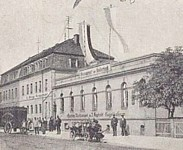Bedeutendstes Bauwerk ist die 1909/1910 errichtete [“Rübezahlschule”](../../../west/cotta/), die von Hans Erlwein entworfen wurde. Im Haus Nr. 3 befand sich bis 1991 das Cottaer Postamt. Das heute nur noch als Wohnhaus genutzte Gebäude Cossebauder Straße 21 _(Foto)_ beherbergte vor dem Ersten Weltkrieg die Schankwirtschaft "Zur Heiterkeit" mit einem heute nicht mehr vorhandenen Anbau. 1923 bezog die Chemische Fabrik Müller & Lehmann GmbH die früheren Gasträume und stellte hier unter dem Markennamen "Phakola" u.a. Kosmetika und Badezusätze her.

Nach 1990 entstanden an der Cossebauder Straße einige moderne Wohn- und Geschäftshäuser, darunter die “Residenz Alt-Dresden” und das “Cotta-Center” an der Ecke zur Mobschatzer Straße. Auf der Cossebauder Straße 15 befindet sich seit einigen Jahren die mit historischem Hausrat ausgestattete originelle Trödelkneipe “Oma”.

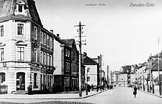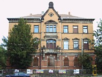

**_Fotos:_** _Blick in die Cossebauder Straße um 1900 (links) - ehem. Cottaer Postamt 2012 (rechts_

Die Straße erhielt 1891 zunächst den Namen Florastraße, wurde 1904 jedoch in Freiligrathstraße umbenannt. Der Dichter Ferdinand Freiligrath (1810-1876) nahm aktiv an der bürgerlich-demokratischen Revolution 1948/49 teil und musste wegen seiner kritischen Schriften ind Exil gehen. Zeitweise war er Mtglied des Bundes der Kommunisten und Mitarbeiter der revolutionären “Neuen Rheinischen Zeitung”.

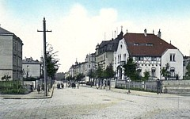Die um 1870 angelegte Straße, zunächst Südstraße genannt, erhielt 1904 den Namen Grillparzerstraße. Der österreichische Dramatiker Franz Grillparzer (1791-1872) verfasste zahlreiche Bühnenstücke, meist zu historischen Themen. 1826 besuchte er Dresden und äußerte sich im Anschluss an diesen Besuch ausgesprochen kritisch über Sprache und Lebensart der Dresdner. 1910 wurde ein neuangelegter Platz, in den Bauplänen als "Platz 2" bezeichnet, ebenfalls nach dem Dichter benannt. Die hier befindliche Wohnanlage entstand 1936 und wurde nach 1990 durch die WOBA saniert. Bereits zuvor hatte 1927 eine Dresdner Baugenossenschaft nach Entwurf von Curt Herfurt das Wohnhaus Grillparzerstraße 3-5 errichten lassen. Aus der Zeit um 1900 stammen die meisten älteren Häuser. In der Nr. 20 an der Ecke zur Tonbergstraße gab es um 1910 die Schankwirtschaft "Goldene Krone". Ein weiteres Lokal existierte in der Nr. 51. Das ursprünglich als “Turmhaus Cotta” bezeichnete Lokal wird bis heute gastronomisch genutzt, nach 1990 von der Wohngebietskneipe “Jolly´s” und der Nachtbar "Schlauch".

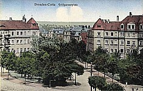

**_Foto:_** _Wohnhäuser am Grillparzerplatz um 1910 und heute_

In Anlehnung an die angrenzende Hebbelstraße wurde zwei Jahre später auch der Hebbelplatz am 9. Februar 1906 nach dem Dramatiker und Lyriker Friedrich Hebbel (1813-1863) benannt.

Die um 1900 angelegte Straße wurde zunächst Naußlitzer Straße, ab 1904 Abendrothstraße genannt. Heinrich von Abendroth (1819-1880) nahm als sächsischer Generalmajor am Deutsch-französischen Krieg teil und verfasste zudem mehrere militärische Schriften. Wegen ihres “militaristischen Namens” wurde die Straße 1946 in Heinz-Steyer-Straße umbenannt. Der Dresdner Heinz Steyer (1909-1944) war aktiver Fußballer und Arbeitersportler und schloss sich der kommunistischen Bewegung an. 1944 wurde er wegen seiner Unterstützung griechischer Partisanen zum Tode verurteilt und hingerichtet.

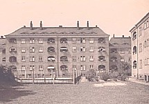Die frühere Straße H, ab 1899 Plauensche Straße, erhielt 1904 nach dem deutschen Dichter Friedrich Hölderlin (1770-1843) den Namen Hölderlinstraße. Hölderlin verfasste einige Gedichte und Romane, lebte ab 1806 jedoch bis zu seinem Tode in geistiger Umnachtung. Durch Umbau der ehemaligen Pianofortefabrik Reißhauer entstand 2008 im Gebäudekomplex Hölderlinstraße 9/9a eine moderne Loft-Wohnanlage. Neben dem Kontorhaus der denkmalgeschützen Fabrik blieb auch die einstige Fabrikantenvilla bis heute erhalten. Die Wohnhäuser Nr. 12-18 wurden 1927 von Paul Beck für den Spar- und Bauverein Cotta errichtet _(Foto)_.

Die Hörigstraße erinnert seit 1900 an den ehemaligen Schuldirektor Ernst Otto Hörig (1837-1898), der ab 1874 an der hiesigen Schule tätig war und auf dem Cottaer Friedhof seine letzte Ruhestätte fand. Ab 1928 befand sich hier der Endpunkt Cotta der Dresdner Straßenbahn, der mit Verlängerung der Straßenbahn nach Gorbitz aufgegeben wurde.

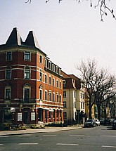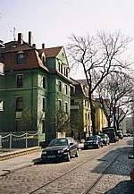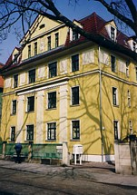

_Fotos: Die Hörigstraße in Cotta - links Ecke Gottfried-Keller-Straße, rechts Wohnhaus Nr. 24_

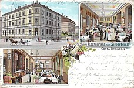Die 1893 als Bergstraße angelegte Straße erhielt 1904 ihren heutigen Namen Hühndorfer Straße nach dem in der Nähe von Wilsdruff gelegenen Ort Hühndorf, heute ein Ortsteil von Klipphausen. Im Eckhaus zur Lübecker Straße (Nr. 2) befand sich um 1910 die vom Gastwirt Julius Goldhammer betriebene Schankwirtschaft "Goldner Hammer". Ein weiteres Restaurant "Zum Silberblick" gab es in der Nr. 14 _(historische Postkarte)_. Nach dem Ersten Weltkrieg nutzte der Konsumverein Vorwärts die Räume als Fleischwarenverteilungsstelle.

1927 entstand an der Hühndorfer Straße 22 die evangelisch-methodistische [Immanuelkirche](../../../west/cotta/immanuelkirche/). Architekt war Alexander Tandler. 2008 wurde an der Ecke zur Rudolf-Renner-Straße in den Räumen einer ehemaligen Fleischerei die “Fatih Camii Moschee” der Türkisch-Islamischen Gemeinde zu Dresden eröffnet.

Die 1928 angelegte Klaus-Groth-Straße trug bis 1933 den Namen des Dichters Heinrich Heine. Da Heine wegen seiner
jüdischen Herkunft und seines Schaffens von den Nationalsozialisten abgelehnt wurde, erhielt die Straße 1935 den Namen des
norddeutschen Dichters Klaus Groth (1819-1899). Klaus Groth verfasste zahlreiche Gedichte in plattdeutscher Sprache und machte sich sehr um die Pflege und Erforschung der niederdeutschen Mundart verdient.

Die Klopstockstraße wurde um 1880 angelegt und nach den hier bestehenden Gärtnereien zunächst Gärtnerstraße genannt. Erst
1904 bekam sie ihren heutigen Namen nach dem Dichter Friedrich Gottlieb Klopstock (1724-1803), der zu den wichtigsten
Vertretern der deutschen Literatur Ende des 18. Jahrhunderts gehört. Nach dem Ersten Weltkrieg entstand zwischen Klopstock- und Hölderlinstraße eine kleine Wohnsiedlung.

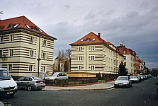

**_Foto:_** _Wohnanlage an der Klopstock-/Ecke Bramschstraße_

Die Leutewitzer Straße wurde 1895 in der Nähe des Dorfkerns angelegt und führt westlich in Richtung Leutewitz, weshalb sie
1904 ihren Namen erhielt. Zuvor wurde sie nach dem sächsischen Königshaus Wettinstraße genannt. Bemerkenswert ist ein in
den 1930er Jahren entstandener Wohnblock, über dessen Hauseingängen Relieftafeln mit tanzenden Kindern angebracht sind. Gegenüber wurden nach 1990 moderne Wohn- und Geschäftshäuser errichtet.

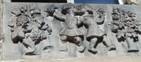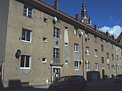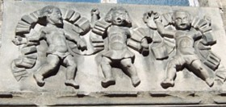

**_Fotos:_** _Wohnblock Leutewitzer Straße 2 - 6 mit Relieftafeln über den Hauseingängen_

Der Lönsweg wurde 1928 nach dem Heimatdichter der Lüneburger Heide Hermann Löns (1866-1914) benannt. Löns gehörte
um 1900 zu den beliebtesten Autoren, wurde jedoch wegen seiner teilweise nationalistischen Werke von den Nazis missbraucht. Bis heute sind seine naturnahen Schilderungen und Tiergeschichten bekannt.

Die Mobschatzer Straße wurde um 1870 angelegt und hieß bis 1904 Blumenstraße. Ihren heutigen Namen erhielt sie nach dem
nahegelegenen Ort Mobschatz. 1992 wurde an der Mobschatzer Straße das Hotel “Residenz Alt Dresden”, 1994 das Cotta-Hotel (heute Quintessenz-Forum)
eröffnet. Die beiden Hotelbauten mit verschiedenen Läden im Erdgeschoss setzten neue Akzente im Ortsbild des Stadtteils.

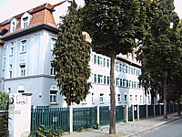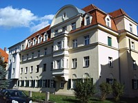

**_Fotos:_** _Blick in die Mobschatzer Straße (links) - Wohnanlage Mörikestraße 1-3 (rechts)_

Diese Straße wurde ab 1895 Lutherstraße genannt. Nach der Eingemeindung von Cotta erhielt sie den Namen Mörikestraße und
erinnert an den Dichter Eduard Mörike (1804-1875), der vor allem durch seineGedichte und Balladen bekannt wurde.

Die seit 1904 nach dem Dorf Ockerwitz benannte Ockerwitzer Straße wurde bis 1898 Leutewitzer Straße, danach Brauerstraße genannt. Dieser Name stand in Verbindung mit der Cottaer Brauerei im [Hofbrauhaus](../../../west/cotta/strassen_cotta/hamburger_strasse/) an der Hamburger Straße.

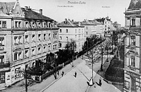
Die ursprünglich nach den hier gelegenen Plänersteinbrüchen Steinstraße genannte Straße wurde 1886 angelegt und 1904 nach dem bei Kesselsdorf gelegenen Ort Pennrich (heute
Ortsteil von Dresden) in Pennricher Straße umbenannt. Kurz nach dem Ersten Weltkrieg errrichtete der Kleinwohnungsbauverein Dresden zwischen Pennricher, Gohliser und
Unkersdorfer Straße eine größere Wohnanlage. Die Entwürfe stammen vom Architekten Otto Schubert. Dabei wurden die drei- und viergeschossigen Wohnhäuser durch kleine
Zwischenbauten mit Durchgangsbogen verbunden, um so den Eindruck einer geschlossenen Hofanlage zu vermitteln. Die 2002-04 sanierten Gebäude gehören heute zur Genossenschaft EWG.

1925 folgte in unmittelbarer Nähe ein weiterer Wohnkomplex, der neben den Gebäuden Pennricher Straße 2-6 auch die Häuser Gohliser Straße 38-50 einbezog. Diese städtischen Pflegewohnungen entstanden unter Regie des Stadthochbauamtes
und dessen Leiters Paul Wolf und weisen zum Teil expressionistisch beeinflusste Fassadengestaltungen auf.

Die frühere Friedrichstraße in Cotta wurde 1904 in Raimundstraße umbenannt. Ferdinand Raimund (1790-1836) war als
Regisseur, Schauspieler und Theaterdirektor in Wien tätig und verfasste auch einige Theaterstücke im “Altwiener Stil”.

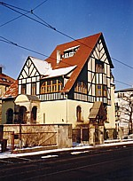Der Cottaer Teil der heutigen Rudolf-Renner-Straße wurde im 19. Jahrhundert Schanzenstraße
genannt. Dieser Name erinnerte an die 1866 im Preußisch-Österreichischen Krieg angelegte Schanze am Lerchenberg zwischen Cotta und Löbtau. Nach deren Abtragung 1875 entstanden auf dem
Gelände Wohnhäuser. Das Areal mit der Schanzenapotheke und der 1889 eröffneten Gaststätte “Zur Schanze” wird bis heute von den Anwohnern Schanzenviertel genannt. Nach der Eingemeindung
wurde die Schanzenstraße 1904 zu Ehren des späteren Königs Friedrich August III. in Kronprinzenstraße umbenannt. Ab 1909 verkehrte hier die Straßenbahn zwischen Cotta und Löbtau.

1945 erhielt die Kronprinzenstraße den Namen Rudolf Renners (1894-1940), der seit 1925 Chefredakteur der KPD-Zeitung “Arbeiterstimme” war. Renner gehörte zugleich als Abgeordneter
und Fraktionsvorsitzender der KPD dem Sächsischen Landtag an. Wegen seines Auftretens gegen das NS-Regime wurde er 1933 inhaftiert und verstarb 1940 im Konzentrationslager.

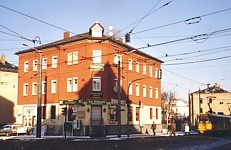Gaststätte “Zur Schanze”: Die Gastwirtschaft an der Ecke zur Pennricher Straße entstand
in einem vom Baumeister Weichard 1889 errichteten Wohn- und Geschäftshaus und befand sich zunächst im Besitz des Schlossers August Hermann Neumann. Gemeinsam
mit seiner Mutter betrieb dieser im Erdgeschoss eine kleine Lebensmittelhandlung und erhielt 1890 die Schankkonzession. In Anlehnung an den Straßennamen wurde das vor
allem von Cottaer Arbeitern gern besuchte Lokal “Zur Schanze” genannt. Trotz mehrfacher Besitzerwechsel blieb die Gaststätte bis heute geöffnet. Seit 1990 gibt es im Haus auch eine kleine Pension.

Die seit 1904 Steinbacher Straße genannte Straße verbindet Cotta mit dem Nachbarort Leutewitz und wurde ursprünglich als
Steinstraße bezeichnet. Grund waren einige Plänersteinbrüche in diesem Teil der Ortsflur. 1898 wurde der östliche Teil der Straße abgetrennt und
nun Dresdner Straße genannt. 1904 wechselte die Namensgebung erneut: aus der Dresdner Straße wurde die Pennricher Straße, aus der Steinstraße die Steinbacher Straße. Beide Namen weisen auf zwei Dörfer der Umgebung hin, die seit
1999 ebenfalls als Stadtteile zu Dresden gehören.

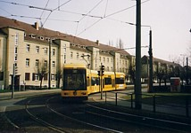

**_Foto:_** _Die Steinbacher Straße am Hebbelplatz_

Kleingartenverein “Steinbacher Höhe”:
Die Kleingartenanlage wurde 1963 auf dem Gelände des früheren Weinbergs der [Leutewitzer Windmühle](../../../west/leutewitz/) angelegt. Noch bis in die 1960er Jahre erinnerte ein Weinberghäuschen an die einstige Nutzung. Das
Grundstück war bereits nach dem Ersten Weltkrieg in den Besitz der Stadt Dresden gekommen, die es später an Leutewitzer
Bauern verpachtete. Nachdem mehrere Kleingärten in Cotta zugunsten von neuen Wohnhäusern aufgegeben werden  mussten,
entschloss man sich 1962 zur Anlage einer neuen Gartensparte mit 53 Kleingärten. Für den Aufbau kamen Trümmersteine aus der Innenstadt zum Einsatz, welche mühsam nach Cotta transportiert und dort verbaut wurden.

Die Straße erhielt ihren Namen 1881 nach den hier befindlichen Tonvorkommen, die zeitweise sogar abgebaut wurden. 1869
hatte die Gemeinde Cotta in der Nähe des Dorfplatzes ihr erstes Schulhaus errichtet, weshalb ein Teil der Tonbergstraße
zwischen 1887 und 1904 Schulstraße genannt wurde. Mit der Eingemeindung des Ortes wurden beide Straßenabschnitte
vereinigt. 1917 entstanden im oberen Abschnitt die Kleingartenanlagen “Gartenfreunde I und II”. Nach dem Ersten Weltkrieg folgte eine Wohnsiedlung in der Nähe der katholischen St.-Marien-Kirche _(Foto rechts)_

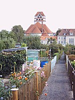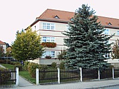

_Fotos: Blick über die Kleingartenanlagen an der Tonbergstraße zur Heilandskirche (links)_

Die auf einer leichten Anhöhe verlaufende Straße wurde 1891 angelegt und zunächst Hohe Straße genannt. Wenig später begann
die Bebauung mit den für Cotta und Löbtau typischen “Würfelhäusern”. Im Zusammenhang mit der Eingemeindung Cottas erfolgte
1904 die Umbenennung in Unkersdorfer Straße. Der kleine Ort gehört seit 1999 ebenfalls als Stadtteil zu Dresden.

Der Name Werkstättenstraße weist auf den früheren Werkstättenbahnhof der 1875 erbauten Berliner Eisenbahn hin, der 1895 eröffnet wurde.

Die Wilhelm-Franz-Straße wurde 1901 nach dem früheren Cottaer Gemeindevorstand Wilhelm Franz (1819-1903) benannt, der
sich große Verdienste um die Entwicklung des Ortes erwarb und deshalb auch zum Ehrenbürger Cottas ernannt wurde. Franz starb am 15. Oktober 1903 und wurde auf dem Cottaer Friedhof beigesetzt.

Die um 1900 nach dem früheren Gemeindevorstand Heinrich Wagner benannte Straße erhielt 1904 den Namen Alvenslebenstraße. Die Brüder Gustav und Konstantin von Alvensleben nahmen als Generäle der sächsischen Armee am
Deutsch-Französischen Krieg 1870/71 teil. 1946 erfolgte die Umbenennung in Zöllmener Straße.

[Cotta auf OpenStreetMap](https://www.openstreetmap.org/search?query=Dresden+Cotta)

* * *

 \[ [Home](../../../index.html)\] \[ [Nord](../../../nord/)\] \[ [Nordwest](../../../nordwest/)\] \[ [Neustadt](../../../neustadt/)\] \[ [Nordost](../../../nordost/)\] \[ [West](../../../west/)\] \[ [Zentrum](../../../zentrum/)\] \[ [Südwest](../../../sudwest/)\] \[ [Süd](../../../sud/)\] \[ [Südost](../../../sudost/)\] \[ [Ost](../../../ost/)\] \[ [Register](../../../Register/register.html)\] \[ [Kontakt](../../../Kontakt/kontakt.html)\] \[ [Impressum](../../../impressum/)\]
