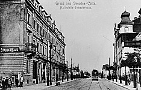
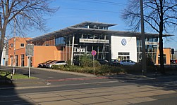
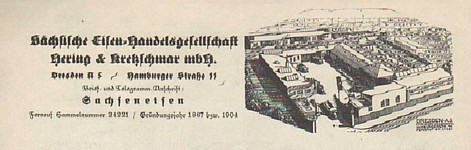
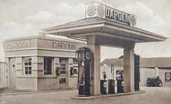
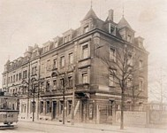
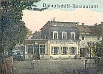
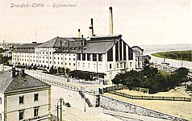
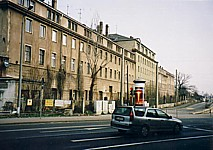
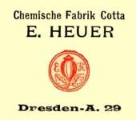

* * *

Die Hamburger Straße nimmt ihren Anfang in der Friedrichstadt und führt von dort über Cottaer Flur bis zur Meißner Landstraße. Bereits 1437 wurde sie als “Breßnitzer Straße” (Briesnitzer Straße) erwähnt. Über lange Zeit blieb sie weitgehend unbebaut. Die wenigen Gebäude wurden unter der Bezeichnung "Vor dem Briesnitzer Schlage" zusammengefasst. Der Briesnitzer Schlag, eine Zollstelle an der Stadtgrenze befand sich am Ende der heutigen Schäferstraße.

Nach dem Durchbruch der Wettiner Straße in der Wilsdruffer Vorstadt und dem Bau der Elbtalstraße nach Meißen erhielt sie ihre heutige Bedeutung als wichtige Verbindung zwischen der Innenstadt und den Westvororten. 1893 erfolgte die amtliche Benennung in Hamburger Straße. Bis 1904 wurde der auf Cottaer Flur verlaufende Teilabschnitt noch Meißner Straße genannt. Am 22. April 1900 fuhr erstmals eine Straßenbahn von der Friedrichstadt bis zum Schusterhaus an der Cottaer Flurgrenze. 1906 wurde diese Strecke bis nach Cossebaude verlängert.

An der Straße befinden sich bis heute zahlreiche gewerbliche Unternehmen und Einkaufsmärkte. Wichtigste Firma war ab 1884 die Nähmaschinenfabrik [Seidel & Naumann](../../../../west/cotta/strassen_cotta/hamburger_strasse/seidel___naumann/), die mit ihren Produkten Weltruf erwarb. Nach Einstellung der Produktion befand sich in den Gebäuden bis 2010 das Technische Rathaus. 1935 entstand das [Bahnbetriebswerk Dresden](../../../../zentrum/friedrichstadt/dresden_-_berlin/rangierbahnhof/) der Deutschen Reichsbahn mit seinen ausgedehnten Gleisanlagen und Richthallen. Zu den historisch bedeutenden Bauwerken der Hamburger Straße gehörten auch das 1945 zerstörte [“Schusterhaus”](../../../../west/cotta/strassen_cotta/hamburger_strasse/schusterhaus/) in der Nähe der Weißeritzmündung und das Hofbrauhaus. 1997 wurde das Hotel “Mercure Elbpromenade“ eröffnet, zweites Haus der Hotelkette Mercure in Dresden. Die 1893 entstandene Weißeritzbrücke, eine genietete Fachwerkbogen- Konstruktion, ersetzte man 2002 durch einen Neubau. Unweit davon überspannt eine Fußgängerbrücke den Fluss.

Einzelne Gebäude:

Vor allem im unteren Teil der Hamburger Straße siedelten sich seit Ende des 19. Jahrhunderts zahlreiche Gewerbebetriebe und Großhändler an. So gab es auf dem Grundstück Nr. 11 die Sächsische Eisen-Handelsgesellschaft Hering & Kretzschmar mbH _(Werbung)_, einem Großhändler für Metallwaren und Heiztechnik. Weitere Grundstrücke wurden von der Baustoffgroßhandlung Backstroh & Oelschläger (Nr. 27), als Hauptlager der Düngerhandels-Aktiengesellschaft zu Dresden (Nr. 35) und dem Baugeschäft von Georg Burgmüller (Nr. 37) eingenommen. Große Flächen nahm auch das Bahnbetriebswerk der Sächsischen Staatsbahn ein.

Agefko Kohlensäure-Werke GmbH (Nr. 28): Auf dem heute vom Dresdner Audi-Zentrum genutzten Areal befand sich die Dresdner Niederlassung der Agefko Kohlensäure-Werke GmbH mit Stammsitz in Berlin. Das Unternehmen befand sich teilweise im Besitz von Ernst Schneider (1900-1977), einem an zahlreichen Firmen beteiligten Großindustriellen. Neben der Agefko GmbH gehörten auch die Lingner-Werke und die Odol Werke GmbH, mehrere Stahlbaufirmen und Bergwerke zu seinem Besitz. Bekannt wurde er als Präsident des Deutschen Industrie- und Handelstages (ab 1963) sowie Besitzer der weltweit größten Privatsamlung Meißner Porzellans, die sich heute im Schloss Lustheim bei München befindet.

Everth & Co GmbH (Nr. 44): Die Firma wurde 1890 als Ausfahrgeschäft für Petroleum auf der Hamburger Straße 44, in unmittelbarer Nachbarschaft zur Deutsch-Amerikanischen Petroleum-Gesellschaft (D.-A.-P.-G.) gegründet. Geschäftsmodell war der Verkauf von Petroleum an Unternehmen und private Abnehmer, wobei die Ware direkt frei Haus geliefert wurde. Später firmierte das Unternehmen als Euco GmbH und gehörte seit den 1930er Jahren zur NITAG Deutsche Treibstoffe AG, einem der größten deutschen Mineralölkonzerne. Das Nachbargrundstück Nr. 46, unmittelbar an der Einmündung des Flügelwegs gelegen, war Standort einer Tankstelle der D.-A.-P.-G., die hier unter dem Markennamen DAPOLIN Benzin und Schmierstoffe verkaufte _(Foto)_.

Schifferheim (Nr. 56): Das Restaurant "Schifferheim" entstand noch vor dem Ersten Weltkrieg und befand sich im Erdgeschoss des noch heute erhaltenen Doppelhauses Nr. 56/58 unmittelbar hinter der Weißeritzbrücke. Die verkehrsgünstig gelegenene Gastwirtschaft warb mit gutem bürgerlichen Mittagstisch, verschiedenen Bieren und Weinen sowie einem Vereinszimmer mit Pianino. Das Lokal blieb bis in die Zeit nach dem Zweiten Weltkrieg geöffnet. Heute werden die Räume zu Wohnzwecken genutzt.

Bahnschänke (Nr. 80/82): Auf diesem Grundstück unmittelbar an der Bahnüberführung der Eisenbahnstrecke [Dresden - Berlin](../../../../zentrum/friedrichstadt/dresden_-_berlin/) befand sich ab ca. 1880 des Bahn- und Dampfschiff-Restaurant des Gastronomen Adolf Seidel. Das zweistöckige Gebäude besaß neben einem Warteraum für Eisenpassagiere des am 1. Juni 1881 eröffneten Haltepunkts Cotta mehrere Gast- und Vereinszimmer, eine Veranda sowie einen zur Elbe hin gelegenen Garten. Von hier führte ein kurzer Weg zur Anlagestelle der Dampfschiffe. Zugleich bot sich ein schöner Blick in Richtung Kaditz, wo nach der Eröffnung der Start und die Landung der Luftschiffe Ferdinand Albrecht geführte Lokal existierte bis Mitte der Zwanziger Jahre. Später wurden die Räume als Werkstatt eines Hutmachermeisters genutzt.

Unweit der heute nicht mehr vorhandenen Gaststätte steht am Elbufer das Bootshaus des Dresdner Ruderclubs. Auch dieses Haus wurde früher als Klublokal gastronomisch genutzt (Nr. 74).

Hofbrauhaus (Nr. 88): Das Hofbrauhaus entstand 1872 am Rande der Cottaer Flur und beschäftigte um 1900 ca. 250 Arbeiter. Besitzer war der Cottaer Unternehmer Ewald Bürstinghaus, der auch den [Briesnitzer Park](../../../../west/cotta/strassen_cotta/meissner_landstrasse/) an der Meißner Landstraße neu gestalten ließ. Die moderne Großbrauerei _(Foto)_ gehörte zu den zahlreichen Neugründungen, die nach Aufhebung des Bierzwanges und der Einführung der Gewerbefreiheit in der Dresdner Umgebung entstanden waren. Durch den starken Konkurrenzkampf und Rohstoffmangel in den Jahren des ersten Weltkrieges geriet das Hofbrauhaus Cotta in wirtschaftliche Schwierigkeiten und musste 1921 den Brauereibetrieb eingestellen. 1922 wurde auch die zugehörige Gaststätte "Hofbräu-Schänke" geschlossen. Im Keller befindet sich ein Einstieg in das erste Lichtloch des [Tiefen Elbstollens](../../../../west/cotta/strassen_cotta/meissner_landstrasse/tiefer_elbstollen/), der bei Cotta in die Elbe mündet.

Das Gebäude wurde daraufhin zum Wohnhaus umgebaut und später auch von einigen Gewerbebetrieben genutzt. Zeitweise unterhielt hier die Dresdner Pianofabrik Hupfeld - Zimmermann eine Niederlassung. Auf einem Teil des Geländes hatte nach 1945 der VEB Chemiehandel Dresden seine Filiale. 1992/93 wurde ein Großteil der Nebengebäude zugunsten einer Tankstelle abgerissen. Auch Teile des denkmalgeschützten Haupthauses fielen 1995 dem Abriss zum Opfer, der letzte Rest des Gebäudes verschwand 2008. Erhalten blieb lediglich ein historischer Schornstein. Heute befindet sich auf dem Gelände ein Einkaufsmarkt.

Chemische Fabrik Cotta:

Das Unternehmen wurde 1841 vom Dresdner Hofapotheker und Pharmazeut Hermann Heuer gegründet. Heuer hatte nach seiner Ausbildung in der Hofapotheke die ehemalige Knochenmühle Calberlas erworben und diese in eine Fabrik
zur Herstellung von Farbstoffen umgewandelt. Nach umfassenden Modernisierungen und Investitionen spezialisierte
sich der Betrieb auf die Produktion von Spritpräparaten, vor allem von Narkoseäther für den medizinischen Bedarf.
Der Sitz des zu den ersten industriellen Produzenten von Narkosemitteln gehörenden Unternehmens war auf der Hamburger Straße 73. 1872 gehörte Hermann Heuer zu den Mitbegründern der Deutschen Bank und war von 1874
bis 1879 deren Aufsichtsratsvorsitzender.

1880 übernahm sein Sohn Ernst die Fabrik, welche nun unter dem Namen “Chemische
Fabrik Cotta E. Heuer” firmierte. Fünf Jahre später entstand ein Zweigwerk im böhmischen Aussig (Usti nad Labem). Ernst Heuer und seinem Sohn Otto gelang es,
den Familienbetrieb durch Krieg und Weltwirtschaftskrise zu führen. Da das Werk beim Luftangriff 1945 glimpflich davongekommen war, konnte man die Produktion fortsetzen.
Zu Kriegsende war die Chemische Fabrik Cotta einziger arbeitsfähiger Produzent von Narkosemitteln in der Sowjetischen Besatzungszone. Politische Konflikte mit den neuen
Machthabern führten 1952 bzw. 1960 zur Flucht der Familie in die Bundesrepublik. Bereits 1952 wurde der Betrieb in treuhänderische Verwaltung überführt und 1959
geschlossen. Nach 1990 erhielten die Nachkommen Heuers ihr beschlagnahmtes Vermögen zurück und führten dieses 2009 in eine Stiftung für medizinische Forschung mit Sitz in Zell-Ebenhausen bei München über.

* * *

 \[ [Home](../../../../index.html)\] \[ [Nord](../../../../nord/)\] \[ [Nordwest](../../../../nordwest/)\] \[ [Neustadt](../../../../neustadt/)\] \[ [Nordost](../../../../nordost/)\] \[ [West](../../../../west/)\] \[ [Zentrum](../../../../zentrum/)\] \[ [Südwest](../../../../sudwest/)\] \[ [Süd](../../../../sud/)\] \[ [Südost](../../../../sudost/)\] \[ [Ost](../../../../ost/)\] \[ [Register](../../../../Register/register.html)\] \[ [Kontakt](../../../../Kontakt/kontakt.html)\] \[ [Impressum](../../../../impressum/)\]
