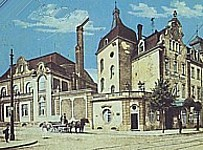
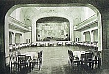

* * *

* * *

* * *

* * *

* * *

* * *

Das Schusterhaus entstand um 1890 in der Nähe der neuen Weißeritzmündung an
der [Hamburger Straße](../../../../../west/cotta/strassen_cotta/hamburger_strasse/) 65\. Beim Bau wurden dabei Spuren einer steinzeitlichen
Siedlung entdeckt. Am 31. Juli 1897 zerstörte das große Weißeritzhochwasser das Gebäude fast völlig. Bereits kurze Zeit später begann der Wiederaufbau des
Schusterhauses im neobarocken Stil als Concert- und Balletablissement _(Foto)_. Im Erdgeschoss befanden sich die Restaurationsräume sowie das Bräustübel im
bayrischen Stil, im Hintergebäude der Ballsaal mit zwei Seitenschiffen. Bis zum Beginn des Ersten Weltkrieges gehörte die Großgaststätte mit ihrem 2000
Besucher fassenden Saal zu den wichtigsten Vergnügungslokalen im Dresdner Westen. Während der Kriegsjahre musste der Gaststättenbetrieb vorübergehend eingestellt werden, da das
Schusterhaus nun industriellen Zwecken bzw. als Lazarett diente.

In den Zwanziger Jahren gelang es den Besitzern, an die Traditionen der Vorkriegszeit anzuknüpfen. Regelmäßig fanden wieder Tanzveranstaltungen,
Sommerfeste und Varietéaufführungen  im Schusterhaus statt. Ab 1940 wurden die Räume als Sammellager der Wehrmacht zweckentfremdet. Im März 1945 wurde das Gebäude bei einem Luftangriff schwer beschädigt und brannte
teilweise aus. Die zuletzt noch als Lagerräume genutzten Ruinen wurden in den 1950er Jahren beseitigt.
