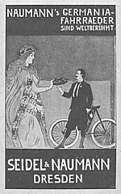
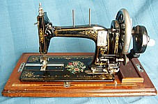
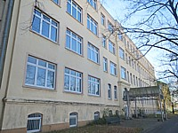

* * *

* * *

Das Unternehmen wurde 1868 von dem in Dresden geborenen Bruno Naumann (1844-1903) auf der Langen Gasse (heute Zinzendorfstraße) gegründet. Naumann hatte den Beruf eines Feinmechanikers erlernt und ließ sich
nach mehreren Wanderjahren wieder in Dresden nieder. Da sich seine “Werkstatt für Maschinenschlosserei” gut entwickelte, wurde der Betrieb wenig später zur Kleinen Plauenschen Gasse, dann auf die Ammonstraße verlegt.
Doch auch hier reichte der zur Verfügung stehende Platz schon bald nicht mehr aus, so dass sich Naumann zum Erwerb eines Grundstücks in der Friedrichstadt entschloss.

Gemeinsam mit seinem Geschäftspartner Emil Seidel ließ sich Bruno Naumann einen großzügigen Werkskomplex an der [Hamburger Straße](../../../../../west/cotta/strassen_cotta/hamburger_strasse/) 19 errichten, in dem 1884 die ersten Nähmaschinen, zunächst noch in Lizenzfertigung von Singer, entstanden. 1887 erweiterte das Unternehmen sein Profil und stellte nun auch
Fahrräder der Marke “Germania” her. Ab 1899 konzentrierte man sich auf den Bau von Schreibmaschinen nach amerikanischem Patent. Nach dem Tod des
Firmengründers 1903 wurde das Unternehmen von den Nachfolgern unter dem Traditionsnamen Seidel & Naumann fortgeführt und gehörte bis 1945 zu den
wichtigsten Dresdner Großbetrieben. 1910 liefen erstmals die später international berühmten Schreibmaschinen der Marke “Erika” vom Band. Zu diesem Zeitpunkt waren über 2700 Beschäftigte im
Werk angestellt, welches über eine eigene Krankenkasse, Betriebskantine und verschiedene soziale Einrichtungen verfügte.

Der beim Luftangriff am 7. April 1945 schwer beschädigte Betrieb fiel 1946 unter die
Enteignungsbestimmungen und wurde zwei Jahre später mit der [Clemens Müller AG](../../../../../neustadt/leipziger_vorstadt/grossenhainer_strasse/nahmaschinenwerk/)
zu den Mechanik Schreibmaschinenwerke Dresden zusamengeschlossen. Ab 1951 firmierte das Werk unter dem Namen VEB Schreibmaschinenwerk Dresden. In der
seit 1980 zum Kombinat Robotron gehörenden Firma wurden noch bis 1990 Schreib- und Rechenmaschinen hergestellt.

Nach Abwicklung des Unternehmens durch die Treuhand verkaufte diese das Areal
an einen Investor, der 1992/93 mit dem Abriss und der Rekonstruktion einiger Gebäude begann _(Foto)_. Später befand sich hier bis 2010 das Technisches Rathaus mit Sitz des Stadtplanungsamtes und
der Bauverwaltung (u. a. Hochbauamt, Vermessungs- und Katasteramt). Künftig sollen die Büroräume an private Interessenten vermietet werden. An der Fassade erinnert eine Gedenktafel an die 59 Betriebsangehörigen und
Zwangsarbeiter, welche beim Bombenangriff 1945 ums Leben kamen.

* * *

 \[ [Home](../../../../../index.html)\] \[ [Nord](../../../../../nord/)\] \[ [Nordwest](../../../../../nordwest/)\] \[ [Neustadt](../../../../../neustadt/)\]
 \[ [Nordost](../../../../../nordost/)\] \[ [West](../../../../../west/)\] \[ [Zentrum](../../../../../zentrum/)\] \[ [Südwest](../../../../../sudwest/)\]
 \[ [Süd](../../../../../sud/)\] \[ [Südost](../../../../../sudost/)\] \[ [Ost](../../../../../ost/)\] \[ [Register](../../../../../Register/register.html)\] \[ [Kontakt](../../../../../Kontakt/kontakt.html)\] \[ [Impressum](../../../../../impressum/)\]
