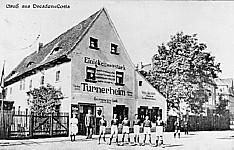
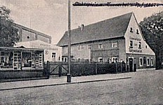
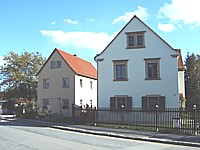
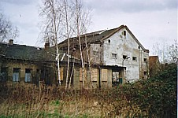
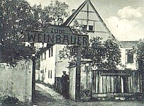
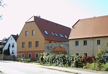
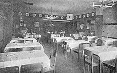
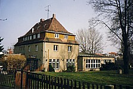

* * *

* * *

Die frühere Dorfstraße von Cotta erhielt 1887 zunächst den Namen Wölfnitzer Straße, bevor sie 1904 in Hebbelstraße umbenannt wurde. Ebenso wie der Name des benachbarten Hebbelplatzes erinnert sie an den deutschen Dichter Christian Friedrich Hebbel (1813-1863), der zahlreiche Dramen, Gedichte, Erzählungen und Novellen schuf und nicht zuletzt durch seine Tagebücher bekannt wurde. An der Hebbelstraße sind noch einige historische Gebäude aus der Vergangenheit Cottas erhalten geblieben, darunter das Faustsche Weingut (Nr. 26), die 1895 errichtete [Interimskirche](../../../../west/cotta/heilandskirche/), das zweite [Cottaer Schulhaus](../../../../west/cotta/) und einige Bauernhäuser. Außerdem existiert hier seit 1913 das kleine Cottaer [Freibad](../../../../west/cotta/strassen_cotta/hebbelstrasse/freibad_cotta/).

Einzelne Gebäude:

Nr. 10 (Hebbel-Lichtspiele): Das Gebäude im alten Cottaer Dorfkern diente bereits vor dem Ersten Weltkrieg unter dem Namen “Turnerheim”, “Schützenhaus” bzw. “Hebbelschänke” als Gaststätte. Zeitweise wurde das Haus auch als Varietébühne (Grellmanns Varieté) genutzt. Ab 1910 ist hier ein Kino mit 350 Plätzen nachweisbar. Erster Besitzer war Walter Jeschke. Zunächst wurde es als Kino- und Tonbildtheater Hebbelstraße, ab 1920 als Lichtspiele Cotta bezeichnet. Mehrfach wechselten die Betreiber des privaten Filmtheaters. 1930 erwarb der Gastwirt Max Röthig das Haus und benannte es in “Erstes Lichtspielhaus Dresden-Cotta” um. Ab 1937 findet es sich unter dem Namen Hebbel-Lichtspiele in den Adressbüchern, der bis zur Schließung 1958 erhalten blieb. Heute werden die Räumlichkeiten gewerblich genutzt.

**_Fotos:_** _Altcottaer Bauernhäuser auf der Hebbelstraße (links) - das ehemalige Hebbelbad im Frühjahr 2007_

Hebbelbad (Nr. 13): Das Bad entstand 1897/98 als Schwimm- und Reinigungsbad der stark angewachsenen Arbeitergemeinde und wurde am 30. März 1898 unter dem Namen Elisenbad offiziell eröffnet. 1921 übernahm die Stadt Dresden das Bad und ließ es 1922 in ein öffentliches Volksbad umwandeln. 1928/29 erfolgten größere Umbau- und Erneuerungsarbeiten des Hallenbades. Historische Unterlagen berichten von einem 8x 18 Meter großen Becken mit einer Tiefe von bis zu 2,70 m. In den Seitenräumen befanden sich die Duschräume, im Obergeschoss die Umkleideräume.

Eine letzte Erneuerung gab es 1966 mit einem Anbau für medizinische und physiotherapeutische Behandlungen. Wegen ihres schlechten Bauzustandes musste die Schwimmhalle Anfang der 1980er Jahre geschlossen werden. Die letzten Nutzer verließen das Areal nach 1990. 2011 wurde der als nicht sanierungsfähig geltende Bau abgerissen. An seiner Stelle ist der Bau einer kleinen Wohnanlage geplant.

Nr. 22: (Habichts Weinhandlung): Neben der Landwirtschaft war einst auch der Weinbau für Cotta von wirtschaftlicher Bedeutung. Die Weinberge lagen überwiegend im Cottaer Elbbogen in der Nähe der heutigen Meißner Landstraße. Eine von mehreren kleinen Weinschänken gab es vor dem Ersten Weltkrieg im Haus Hebbelstraße 22. Unter den Namen "Habichts Weinhandlung", "Zum Weinbauer" bzw. "Der fidele Weinbauer betrieb hier Heinrich Habicht sein Lokal _(Foto rechts)_.

Faustsches Weingut: Das Anwesen Hebbelstraße 26 gehört zu den letzten erhaltenen Alt-Cottaer Gehöften und entstand wahrscheinlich bereits im 14./15. Jahrhundert. Ein größerer Umbau erfolgte 1764. Lange Zeit befand es sich im Besitz der Familie Müller, ab 1884 der Familie Faust, der es auch seinen Namen verdankt. 1813 weilte hier Napoleon zu Besuch. Am Giebel erinnert eine Gedenktafel an die Geschichte des Gutes mit der Inschrift: _“Cotta kann gedenken dran, was der Krieg verwüsten kann”_. Der Ort wurde vor allem im Siebenjährigen Krieg schwer in Mitleidenschaft gezogen. Ein Rebstock am Türschlussstein weist auf den früheren Weinbau hin. Weitere Schrifttafeln "Erbaut mit Gott im Jahre 1805" und die Initialen J. G. M. (= Joh. Gottlieb Müller) dokumentieren spätere Umbauten. Der zugehörige Weinberg befand sich an der Meißner Straße. Zudem gehörten Ställe für Rinder und Pferde und eine Schrotmühle zum größten Cottaer Gut.

Nach dem Zweiten Weltkrieg verfiel der historische Vierseithof. Nutzer waren nun ein Schweinemastbetrieb, eine Nerzzucht sowie die Maler-PGH "Zukunft". Nach einem Brand 1990 und dem Einsturz von Gebäudeteilen stand das Gut viele Jahre in ruinösem Zustand leer. 2010 begannen Sanierungsarbeiten, wobei neben der denkmalgerechten Rekonstruktion des Herrenhauses und des Bauernhauses auch drei moderne Passivhäuser gebaut wurden, welche heute das Ensemble abrunden.

Nr. 34: Das Grundstück war einst Standort eines großen Bauerngehöfts, welches nach seiner Besitzerfamilie Schneider-Gutgenannt wurde. Die baufälligen Gebäude fielen später dem Abriss zum Opfer. Künftig ist hier ein neues Wohngebiet mit mehreren Doppel- und Reihenhäusern geplant.

Volkshaus Cotta (Nr. 35b): In den Zwanziger Jahren bemühten sich Cottaer Arbeiter, vor allem Mitglieder der SPD, um den Erwerb einer eigenen Versammlungsstätte. Nachdem der ursprünglich geplante Ankauf der Tanzgaststätte “Constantia” gescheitert war, entschloss man sich 1923 zum Bau eines “Volkshauses” auf der Hebbelstraße 35b. Der ausschließlich mit Spendenmitteln und freiwilligen Arbeitsstunden finanzierte Bau konnte 1926 eingeweiht werden. Architekt war Kurt Bärbig, als Bauherr trat das Ortskartell der freien Organisationen von Cotta e. V. auf.

1928 wurde das Gebäude nochmals erweitert und besaß neben Tagungs- und Versammlungsräumen auch eine öffentliche Gaststätte mit Saal, Kegelbahn und Jugendzimmer. Mit Machtübernahme der Nationalsozialisten bezogen NS-Organisationen das Haus und benannten es nach dem sächsischen Ministerpräsidenten Manfred von Killinger in "Killingerheim" um. Nach 1945 übernahm die Stadt Dresden das Arbeiterheim und richtete hier 1964 das Kulturhaus “Richard Gärtner” ein. Gärtner war aktives Mitglied der SPD und maßgeblich am Bau des Volkshauses beteiligt. Noch nach 1990 fanden im Kulturhaus verschiedene Veranstaltungen statt. Außerdem ist das Volkshaus Sitz der Verwaltung und der Werkstätten des städtischen Puppentheaters. Im August 2001 wurde mit “Hebbel\`s Schank- und Gartenwirtschaft” wieder eine Gaststätte eingerichtet, deren Räumlichkeiten derzeit jedoch nur noch für private Feiern vermietet werden.

* * *

 \[ [Home](../../../../index.html)\] \[ [Nord](../../../../nord/)\] \[ [Nordwest](../../../../nordwest/)\] \[ [Neustadt](../../../../neustadt/)\] \[ [Nordost](../../../../nordost/)\] \[ [West](../../../../west/)\] \[ [Zentrum](../../../../zentrum/)\] \[ [Südwest](../../../../sudwest/)\] \[ [Süd](../../../../sud/)\] \[ [Südost](../../../../sudost/)\] \[ [Ost](../../../../ost/)\] \[ [Register](../../../../Register/register.html)\] \[ [Kontakt](../../../../Kontakt/kontakt.html)\] \[ [Impressum](../../../../impressum/)\]
