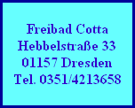
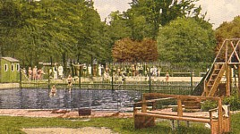
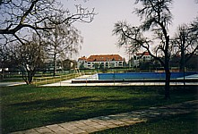

* * *

* * *

* * *

* * *

* * *

* * *

Das Cottaer Luftbad entstand 1913 auf Initiative des Naturheilvereins
Dresden-West. Ursprünglich befand sich an seiner Stelle ein Teich, welcher zur Wasserversorgung des [Marcolinischen Gartens](../../../../../zentrum/friedrichstadt/strassen_friedrichstadt/friedrichstrasse/marcolinipalais/) in der
Friedrichstadt diente. Mit Hilfe hölzerner Röhren wurde das Wasser in den Garten transportiert und dort zur Unterhaltung der Wasserspiele genutzt. Später verfiel die Anlage und der Teich trocknete aus.

Da der Verein nur über begrenzte Mittel verfügte, wurden an die Mitglieder Anteilsscheine zur Finanzierung des Baus ausgegeben.
Problematisch war, das das neu geschaffene Schwimmbecken weder über einen natürlichen Zu- noch Abfluss verfügte
und deshalb regelmäßig mit Leitungswasser gefüllt werden musste. Zur Deckung der dadurch entstehenden hohen Kosten
gewährte die Stadt Dresden ab 1925 eine jährliche Beihilfe und stellte außerdem eine Bürgschaft für aufgenommene Darlehen zur Verfügung, die den Unterhalt des Bades ermöglichten.

Mit Auflösung des Naturheilvereins übernahm die Stadt Dresden das Freibad und
unterstellte es 1950 dem Bäderamt. In den 1960er Jahren entstanden ein kleiner abgetrennter FKK-Bereich sowie ein neues Schwimmbecken _(Foto)_. Weitere
Modernisierungen wurden Ende der 80er Jahre vorgenommen. Zum Bad gehörten nun neben dem Schwimmbecken mit Wasserrutsche auch einige Sportanlagen und
eine Liegewiese. Da das kleine Bad wirtschaftlich schwierig zu betreiben ist, stand mehrfach die Schließung auf der Tagesordnung. 2003 gründete sich deshalb eine
Bürgervereinigung, um das Cottaer Freibad zu retten. 2004 übernahm schließlich die städtische Gesellschaft QAD das kleine Bad, womit die geplante Schließung
verhindert werden konnte. 2012/13 erfolgte eine umfassende Sanierung, wobei das Bad u.a. ein neues Schwimmbecken
mit drei 25-Meter-Bahnen und einem Sprungturm erhielt. Außerdem entstanden ein Erlebnisbereich mit Planschbecken, ein Beachvolleyballplatz und ein neues Funktionsgebäude.

* * *

 \[ [Home](../../../../../index.html)\] \[ [Nord](../../../../../nord/)\] \[ [Nordwest](../../../../../nordwest/)\] \[ [Neustadt](../../../../../neustadt/)\]
 \[ [Nordost](../../../../../nordost/)\] \[ [West](../../../../../west/)\] \[ [Zentrum](../../../../../zentrum/)\] \[ [Südwest](../../../../../sudwest/)\]
 \[ [Süd](../../../../../sud/)\] \[ [Südost](../../../../../sudost/)\] \[ [Ost](../../../../../ost/)\] \[ [Register](../../../../../Register/register.html)\] \[ [Kontakt](../../../../../Kontakt/kontakt.html)\] \[ [Impressum](../../../../../impressum/)\]
