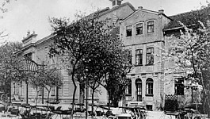
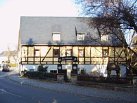
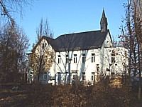
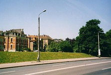
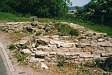
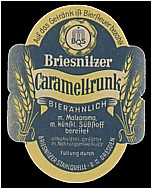

* * *

Die Meißner Landstraße verbindet die Dresdner Ortsteile Cotta, Briesnitz, Kemnitz und Stetzsch und gehört zu den wichtigsten Verkehrsverbindungen  im Westen der Stadt. Bereits im Mittelalter war diese
Straße als Fahrweg ausgebaut und wurde von den Bewohnern der angrenzenden Dörfer genutzt. Ihre heutige Bedeutung erlangte sie jedoch erst im 19. Jahrhundert nach dem Bau der Elbtalstraße nach Meißen, die den alten
Höhenweg über Brabschütz und Klipphausen ablöste. Wegen der zunehmenden Verkehrsbelastung forderten die Anliegergemeinden 1893 in einer Petition an den Sächsischen Landtag den Ausbau der Straße bis nach Niederwartha,
jedoch ohne Erfolg. Daraufhin entschieden sie, den Straßenausbau auf eigene Kosten durchzuführen und erhoben zur Finanzierung ab 1896 ein Wegegeld für alle Fahrzeuge. Dieses musste noch bis 1921 in einem eigens
errichteten Einnehmerhaus an der Einmündung der Merbitzer Straße bezahlt werden. 1926 erhielt die Straße offiziell ihren heutigen Namen (zuvor Meißner Straße). Der anschließende Abschnitt ab der Ortsgrenze zu Gohlis
heißt heute [Dresdner Straße](../../../../west/cossebaude/strassen_cossebaude/), im weiteren Verlauf wird sie von der Hauptstraße in Cossebaude bis zur Stadtgrenze in Niederwartha [Meißner Straße](../../../../west/niederwartha/strassen_niederwartha/) genannt.

1938 wurde die Meißner Landstraße als Autobahnzubringer zur neuen Auffahrt Dresden-Altstadt
ausgebaut und dabei teilweise neu trassiert. Im Ortskern von Briesnitz entstanden so ein alter und ein neuer Streckenteil, der seit 1993 Alte Meißner Landstraße genannt wird. Auch die am 27. September 1906
eröffnete Straßenbahnlinie nach Cossebaude nutzte ab 1941 bis zur Einstellung am 2. Dezember 1990 diese neue Strecke. Zuvor fuhren die Bahnen über Warthaer, Roquette- und Gottfried-Keller-Straße.

Cotta:

Tanzgaststätte “Constantia”: Das Lokal entstand 1886 als “Ballsaal Constantia”und gehörte zu den bekanntesten Dresdner Vergnügungsstätten im Westen der Stadt. Das 1945 unzerstörte Gebäude wurde ab 1947 als
Theaterspielstätte genutzt und 1950 zum [Theater der Jungen Generation](../../../../west/cotta/strassen_cotta/meissner_landstrasse/theater_junge_generation/)
umgebaut. 2004 entstand in einem Pavillon im Garten des Grundstücks wieder eine Gaststätte, die den traditionellen Namen “Constantia” weiterführt. Zwischen Theater und dem Gelände des früheren Hofbrauhauses führt ein
kleiner Weg zum Elbufer. An dessen Ende erinnert seit 1954 eine Gedenktafel an den Bau des [Tiefen Elbstollens](../../../../west/cotta/strassen_cotta/meissner_landstrasse/tiefer_elbstollen/), der zwischen 1836 und 1856
als Entwässerungsstollen des Zauckeroder Steinkohlenreviers angelegt wurde.

Briesnitz:

Seit 1938 verläuft die Meißner Landstraße im Ortskern von Briesnitz in zwei Teilen,
wobei der frühere Straßenverlauf seit 1993 als Alte Meißner Landstraße bezeichnet wird. Bemerkenswerteste Gebäude sind hier das frühere [Briesnitzer Schulhaus](../../../../west/briesnitz/) von 1685 (Alte Meißner Landstraße 67) und der ebenfalls unter Denkmalschutz stehende Pfarrhof von 1868 (Nr. 30). Oberhalb des Gutes entstand 1887 die [Ziegelei Nötzold](../../../../west/briesnitz/strassen_briesnitz/), die zu den größten Ziegeleien im Dresdner Westen gehörte und bis in die 1920er Jahre in Betrieb
war. Später wurden auf dem Gelände Wohnhäuser der Briesnitzer Eigenheimsiedlung errichtet. In der 1556 gegründeten früheren Briesnitzer Dorfschmiede wurde 1994 das rustikale Gasthaus “Alte Schmiede” _(Foto)_
eingerichtet (Alte Meißner Landstraße 36).

Volkspark Briesnitz (Bürstinghauspark): Das Areal der Parkanlage geht auf den sächsischen Oberst Joachim von Römer
zurück, der sich 1768 in der Nähe von Briesnitz ein Sommerhaus errichten ließ. Gleichzeitig entstand am Elbhang ein kleiner
Park mit Gartenhaus und einer romantischen Grotte. 1786 erwarb der sächsische Kabinettsminister Detlev Carl Graf von
Einsiedel das Grundstück für 6.500 Taler und ließ es erweitern und umgestalten. Der Einsiedelsche Garten mit einem
Neptuntempel am Elbufer erstreckte sich zwischen Dorfkern und Elbufer und gehörte zu den schönsten Landschaftsparks im
Dresdner Westen. Nach dem Verkauf 1828 gehörte das Grundstück verschiedenen Dresdner Kaufleuten, darunter ab 1840 der im Textilgroßhandel zu Wohlstand gekommenen Familie Schunck. Julius Schunck (1776-1843) war der
Schwager von John Daniel Souchay, Bauherr des [Schlosses Eckberg](../../../../nordost/loschwitz/albrechtsschlosser/). Verheiratet war er mit Julie Jeanrenaud, einer
Schwägerin des Komponisten Felix Mendelsohn-Bartholdy. Zu Ehren des jungen Paares hatte dieser seinen bekannten “Hochzeitsmarsch” komponiert. 1875 fielen Teile der Parkanlage, darunter auch der Neptuntempel, dem Bau der
Eisenbahnstrecke nach Cossebaude zum Opfer.

Die verbliebenen Reste erwarb 1893 der Cottaer Brauereiunternehmer Gustav Ewald
Bürstinghaus und ließ sie in einen öffentlichen Park umwandeln. Außerdem nahm er an den bestehenden Wohn- und Wirtschaftsgebäuden zahlreiche Veränderungen vor.
Neben der eigentlichen Parkanlage gehörten auch Obstbäume, 3000 m² Zier-und Gemüsegärten sowie Wiesen zur Viehhaltung zum Grundstück. 1921 kam dieses durch
Kauf in den Besitz der Stadt Dresden. Sieben Jahre später beschloss der Stadtrat, das Areal in einen Volkspark umzuwandeln und als öffentliche Fläche neu zu gestalten.
Nach umfangreichen Arbeiten konnte der Volkspark Briesnitz am 12. Mai 1929 eröffnet werden.

Leider wurde der Park durch den Ausbau der Meißner Landstraße 1938 geteilt und dabei teilweise zerstört. Weitere
Eingriffe brachte der Bau eines Sportplatzes an Stelle des früheren Obstgartens und der Neubau eines Kindergartens 1956.
Erhalten blieb bis heute das Gärtnerhaus, welches nach dem Willen einer Bürgerinitiative künftig ein kleines Ortsmuseum und
ein Kulturzentrum aufnehmen soll. In der früheren Villa der Parkbesitzer befindet sich heute das Kinder- und Jugendhaus “Insel” _(Foto)_
. Die Reste der Parkanlage zu beiden Seiten der Meißner Landstraße wurden 2009 neu gestaltet und rekonstruiert.

**_Foto:_** _Der Briesnitzer Park an der Meißner Landstraße, links einige Wohngebäude der Alten Landstraße_

Burgward Briesnitz:
In der Nähe der Einmündung der Zschonergrundstraße erinnern einige Mauerreste an den im 10. Jahrhundert entstandenen Burgward Briesnitz. Die an Stelle einer slawischen Wallanlage entstandene Burg war Vorposten der
Markgrafen von Meißen bei der Inbesitznahme des oberelbischen Raums durch deutsche Siedler. Die Wehranlage entwickelte sich zum politischen und religiösen
Zentrum und diente zugleich dem Schutz des Elbüberganges der “Eisernen Furt”. 1125 wurde an Stelle eines Vorgängerbaus eine steinerne Saalkirche errichtet.
Anlass war der Wandel des bisherigen reichsunmittelbaren Burgwardmittelpunkts zum rein kirchlichen Zentrum der Meißner Bischöfe. 1223 wurden die Wall- und
Befestigungsanlagen bei Erbstreitigkeiten der Wettiner von den Thüringer Landgrafen zerstört. Erhalten blieben zunächst Kirche und Friedhof, die noch bis um 1260 fortbestanden. Nach dem Bau der neuen [Kirche](../../../../west/briesnitz/briesnitzer_kirche/) nutzte man den Altbau als Scheune, bis er im 16. Jahrhundert endgültig abgetragen wurde.

Erst in den 30er Jahren des 20.
Jahrhunderts konnten beim Ausbau der Meißner Landstraße einige Mauerreste freigelegt werden. 1991 erfolgten erneut Grabungen, die zur Entdeckung von Fundamenten eines Wohnturmes und einer romanischen
Kirche führten. Diese wurden 1993 in eine kleine Freilichtanlage unmittelbar an der Straße einbezogen und so der Öffentlichkeit zugänglich gemacht _(Foto)_.

Ziegelei Ludewig:
Das Unternehmen wurde 1824 als erster größerer Gewerbebetrieb auf Briesnitzer Flur gegründet. Besitzer war der Bauer Johann George Ludewig, der mit seinem Betrieb den zunehmenden Bedarf an Baustoffen im
Dresdner Raum befriedigen wollte. Dafür entstanden nördlich der Meißner Landstraße die notwendigen Betriebsanlagen
sowie die Gruben für den Tonabbau. Um die Ziegel besser transportieren zu können, wurde um 1850 unmittelbar am
Elbufer sogar eine kleine Bucht angelegt, wo das Material auf Lastkähne verladen werden konnte. Dieser ausschließlich dem
Güterverkehr dienende Hafen blieb noch bis 1912 in Betrieb, zuletzt für den Transport böhmischer Braunkohle. Die Ziegelei
wechselte mehrfach ihren Besitzer und gehörte zuletzt dem Briesnitzer Gemeinderat Alexander Konrad Bierling. 1885 wurde sie geschlossen.

Briesnitzer Stahlquelle: Im Zuge von Erkundungsarbeiten für eine verbesserte Wasserversorgung des Ortes wurde 1904 bei Bohrungen an der Meißner Landstraße eine eisenhaltige Mineralquelle entdeckt. Chemische Untersuchungen wiesen einen hohen Mineralgehalt auf, was die Idee aufbrachte, Briesnitz zu einem Bade- und Sanatoriumsort zu entwickeln bzw. dieses Wasser abgefüllt zu verkaufen. Nachdem sich Pläne für den Bau einer Trinkhalle zerschlagen hatten, entschied man sich für die Gründung einer Gesellschaft zum Vertrieb des Wassers. Mit Genehmigung des sächsischen Königs erhielt das Unternehmen im Juli 1907 zunächst den Namen “König-Friedrich-August-Heilquelle Briesnitz G.m.b.H.”, musste diesen jedoch nach einem Rechtsstreit mit einem Bad Brambacher Unternehmen wenig später wieder aufgeben.

Ende 1910 erfolgte schließlich die Gründung der “Briesnitzer Stahlquelle GmbH”. 1911 übertrug die Gemeinde Briesnitz den Betrieb auf Pachtbasis an einen privaten Unternehmer. Das Wasser wurde als Tafel- und Heilwasser verkauft. Außerdem produzierte man Limonade, Karamelbier und ähnliche alkoholfreie Getränke. Mit über 100 Angestellten und einer Abfüllmenge von 120.000 Flaschen am Tag war das Unternehmen weit über Dresden hinaus von Bedeutung. 1933 übernahm die “Briesnitzer Stahlquelle” eine weitere Mineralwasserquelle am Weißen Hirsch. Während diese mit Beginn des Zweiten Weltkrieges wieder aufgegeben werden musste, bestand der Briesnitzer Betriebsteil auch nach 1945 weiter und gehörte zuletzt zum Mineralwasserbetrieb “Bramsch”, später zum VEB “Margon”. Heute erinnert noch eine Keramikplastik am Haus Alte Meißner Landstraße 59 an die frühere “Stahlquelle”.

Kemnitz:

Wettinschlößchen: Das Wettinschlößchen an der Meißner Landstraße 54 entstand 1892 und wurde bis 1937 als Gaststätte
genutzt. Zum Lokal gehörte auch ein kleiner Saal für Versammlungen und Veranstaltungen. Später nutzte eine Gummiwarenfabrik die Räume. In den Nachkriegsjahren übernahm das Theater der Jungen Generation den früheren
Gasthof als Lager für Theaterrequisiten. Heute befindet sich im Gebäude ein privates Filmstudio.

* * *

 \[ [Home](../../../../index.html)\] \[ [Nord](../../../../nord/)\] \[ [Nordwest](../../../../nordwest/)\] \[ [Neustadt](../../../../neustadt/)\] \[ [Nordost](../../../../nordost/)\] \[ [West](../../../../west/)\] \[ [Zentrum](../../../../zentrum/)\] \[ [Südwest](../../../../sudwest/)\] \[ [Süd](../../../../sud/)\] \[ [Südost](../../../../sudost/)\] \[ [Ost](../../../../ost/)\] \[ [Register](../../../../Register/register.html)\] \[ [Kontakt](../../../../Kontakt/kontakt.html)\] \[ [Impressum](../../../../impressum/)\]
