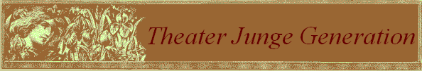
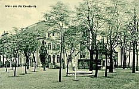
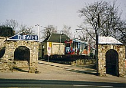

* * *

* * *

* * *

* * *

* * *

* * *

Das Gebäude des heutigen Theaters Junge Generation entstand 1895/96 nach Plänen von Hermann Sperk als Ballhaus “Constantia” an der [Meißner Landstraße](../../../../../west/cotta/strassen_cotta/meissner_landstrasse/) in Cotta. Wegen seines großen Gästegartens, von dem sich ein schöner Ausblick auf die Elbe bot, war das Lokal vor dem Zweiten Weltkrieg ein beliebtes Ausflugslokal und wurde von Gästen aus ganz Dresden gern besucht _(Foto)_. Im Saal, der fast 1000 Plätze bot,  fanden regelmäßig Konzerte und Tanzveranstaltungen statt. 1944/45 dienten die Räume zeitweise als Notunterkunft für Soldaten.

Da das Gebäude nach den Zerstörungen des Zweiten Weltkriegs einen der wenigen erhaltenen großen Säle besaß, wurde es bald wieder für kulturelle Veranstaltungen genutzt. Bereits am 7. Juli 1945 fand im Saal ein erstes Konzert mit dem Bergsteigerchor statt, am 5. November 1945 erfolgte die offizielle Eröffnung als Konzert- und Theaterhaus. Ab 1947 diente die frühere Gaststätte unter dem Namen “Volksbühne” als regelmäßige Theaterspielstätte. Beliebt waren vor allem Auftritte der 1945 von Richard Flechsig gegründeten privaten “Dresdner Märchenbühne”. Ein weiteres Theater, speziell für Kinder, hatte sich mit den “Dresdner Märchenspielen” im Strehlener [“Königshof”](../../../../../sudost/strehlen/strassen_strehlen/wasaplatz/) etabliert. Direktor dieser Spielgemeinschaft war Hans Fuchs. Aber auch die übrigen Theater hatten spezielle Kindervorstellungen in ihrem Repertoire, oft Märchen der Brüder Grimm oder Bühnenstücke nach bekannten Kinderbüchern wie z. B. “Pünktchen und Anton”.

Wegen der großen Resonanz solcher Veranstaltungen entstand die Idee, ein ständiges Theater für Kinder und Jugendliche einzurichten. Dieses wurde am 15. Oktober 1949 im “Volksvarieté” (ehem. “Damms Etablissement”) auf der Königsbrücker Straße gegründet. Als künftige Spielstätte entschied man sich für die frühere “Constantia” in Dresden-Cotta. Am 21. April 1950 erhielt das Theater den Namen “Theater Junge Generation” (TJG). Bis 1989 verzeichnete die Bühne über 10 Millionen Besucher, die ca. 70 Ur- und DDR-Erstaufführungen erleben konnten.

Die im April 1976 bei einem Brand schwer in Mitleidenschaft gezogenen Räume wurden bis 1979 modernisiert und wurden bis 2016 als Theater genutzt. Zu den größten Erfolgen gehören die Aufführungen des “Tagebuchs der Anne Frank” und des Musicals “Linie 1”, für das ein historischer Straßenbahnwagen vor dem Gebäude aufgestellt wurde _(Foto)_. 2008 erwarb die Woltersdorfer Straßenbahn GmbH das historische Fahrzeug. 1997 fusionierte das Theater mit dem Dresdner Puppentheater, welches seine Spielstätte derzeit im Rundkino auf der Prager Straße hat. 2016 bezog das Theater Junge Generation seine neue Spielstätte im Kulturkraftwerk Mitte, während die Theaterwerkstätten auch weiterhin in Cotta verbleiben.

* * *

 \[ [Home](../../../../../index.html)\] \[ [Nord](../../../../../nord/)\] \[ [Nordwest](../../../../../nordwest/)\] \[ [Neustadt](../../../../../neustadt/)\]
 \[ [Nordost](../../../../../nordost/)\] \[ [West](../../../../../west/)\] \[ [Zentrum](../../../../../zentrum/)\] \[ [Südwest](../../../../../sudwest/)\]
 \[ [Süd](../../../../../sud/)\] \[ [Südost](../../../../../sudost/)\] \[ [Ost](../../../../../ost/)\] \[ [Register](../../../../../Register/register.html)\] \[ [Kontakt](../../../../../Kontakt/kontakt.html)\] \[ [Impressum](../../../../../impressum/)\]
