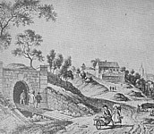
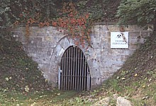

* * *

* * *

* * *

Der Tiefe Elbstollen wurde zur Ableitung der Grubenwässer aus dem Zauckeroder
Steinkohlenrevier geplant und sollte zugleich dem unterirdischen Kohletransport per Lastkahn dienen. Dabei war vorgesehen, die Kohle auf drei Ellen lange und zwei Ellen
breite Holzkähne zu verladen und dann zum Elbufer zu transportieren, wo die Umladung auf Elbschiffe erfolgen sollte. Nach Abschluss der Vermessungsarbeiten begann am 5.
September 1818 der Bau. Dabei trieb man von beiden Seiten, ausgehend vom Zauckeroder Oppelschacht und vom Mundloch in Cotta, den Stollen voran. Zusätzlich
mussten an neun Stellen Lichtlöcher für die Belüftung und zum Abtransport des Abraums abgeteuft werden. Diese befanden sich u.a. unter der Pesterwitzer Kirche, an der
Gorbitzer Kirschstraße, der Ockerwitzer und der Mobschatzer Straße sowie an der Warthaer Straße. Auf der Abraumhalde des 5. Lichtlochs steht heute die [Leutewitzer Windmühle](../../../../../west/leutewitz/). Für den Aushub kamen auch Dampfmaschinen
zum Einsatz, was die Arbeit der Bergleute deutlich erleichterte.

Am 5. November 1836 gelang endlich der Durchstoß des Hauptstollens. Wenige Wochen später, am 4. Februar 1837 erfolgte die offizielle Einweihung.
Der Tiefe Elbstollen hat eine Gesamtlänge von 6.170 Meter und überwindet dabei einen Höhenunterschied von nur zwei Metern, eine bergbautechnische
Meisterleistung für diese Zeit. Nach seiner Fertigstellung wurde der Tiefe Elbstollen wie geplant als Entwässerungsstollen genutzt. Der ursprünglich
vorgesehene Einsatz von Lastkähnen kam allerdings wegen des effektiveren Eisenbahntransports nicht zu stande. Bis heute wird der Stollen jedoch regelmäßig zu Kontrollzwecken befahren. Eine grundlegende Sanierung und
Reinigung erfolgte 1997/98. Markantestes sichtbares Sachzeugnis ist das noch erhaltene Mundloch am Cottaer Elbufer in der Nähe des Theaters Junge Generation _(Foto)_.
