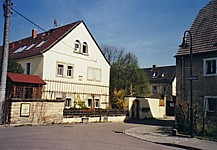
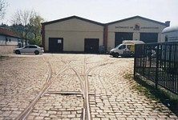

Gohlis entstand als Elbfischersiedlung auf einem flachen Uferstreifen unmittelbar
am Elbufer und wurde 1144 erstmals urkundlich erwähnt. Der Ortsname ist vom slawischen “gola” abgeleitet, was übersetzt “Heide” bedeutet und auf die kargen
Sandböden hinweist. Um 1260 war der Ort im Besitz der Herren von Goluz, die dem Meißner Domherren hier ein Vorwerk übertrugen. Nach Auflösung dieses Vorwerks wurde Gohlis 1329 in die beiden Gemeindeteile Ober- und
Niedergohlis geteilt. Niedergohlis befand sich viele Jahrzehnte im Besitz des Klosters Seußlitz und kam nach der Reformation an einen Dresdner Ratsherren.

Von wirtschaftlicher Bedeutung war neben der Elbfischerei die Landwirtschaft, an die noch einige Bauerngüter im Ort erinnern. Historische Gehöfte aus dem 16. - 19.
Jahrhundert sind in Obergohlis noch an der Elbstraße, in Niedergohlis an der Dorfstraße _(Foto)_ erhalten geblieben. Zu den interessantesten Gebäuden gehören der Hof  Dorfstraße 12 und
der ehemalige Gohliser Gasthof an der Elbstraße, welcher 1784 erbaut wurde. Außerdem erinnern das alte Schulhaus, das Gemeindehaus, einige alte Pumpen, Wassertröge und Schlußsteine an die Vergangenheit des Dorfes.

Im 19. Jahrhundert siedelten sich auf Gohliser Flur zahlreiche Gärtnereien an, die
bis heute das Ortsbild prägen. 1886 erhielt der Ort eine eigene Schule. Ab 1906 fuhr die 1991 eingestellte Straßenbahnlinie nach Cossebaude durch Gohlis, für die an der Dresdner Straße ein Straßenbahnhof entstand _(Foto)_. Hinzu kamen zahlreiche kleinere Gewerbebetriebe. Infolge der verbesserten Infrastruktur stieg auch die Einwohnerzahl des Ortes an, was bereits 1929 zum Versuch einer
Eingemeindung nach Dresden führte. Allerdings wurde sowohl dieses Ersuchen als auch die Bemühungen Cossebaudes 1939 und 1950 von den Gohlisern mehrheitlich abgelehnt. Erst 1974 wurde Gohlis zum Ortsteil von Cossebaude
und gehört seit dem 1. Juli 1997 zu Dresden.  Bis 2000 verband eine Elbfähre an der [Gohliser Windmühle](../../west/gohlis/gohliser_windmuhle/) Obergohlis
mit dem gegenüberliegenden Serkowitz. Eine zweite Fährverbindung nach Radebeul- Kötzschenbroda war bereits 1956 eingestellt worden.

Im August 2002 gehörte der Ort zu den am stärksten vom Elbehochwasser betroffenen Gebieten. Niedergohlis, welches zuvor vollständig evakuiert worden war, stand mehrere Tage komplett unter Wasser, wobei zahlreiche
Wohnungen, Gewerbebetriebe und Gärtnereien zerstört wurden. Besonders betroffen war das Gebiet einer erst nach 1990 entstandenen Wohnanlage, die entgegen früheren Bestimmungen im Überflutungsgebiet der Elbe errichtet
worden war.

Gohliser Elbfähren:

Bereits im Mittelalter war Gohlis ein wichtiger regionaler Elbübergang, wobei die älteste Flussquerung vermutlich in einer Furt bestand. 1547 ist im Erbbuch der Stadt Dresden erstmals eine Elbfähre erwähnt. Eine weitere Fähre ist im Jahr 1690 für Niedergohlis nachweisbar. Von Bedeutung waren beide Fähren vor allem für die Bauern der Umgebung, die ihr Getreide auf diesem Weg zu den per Mahlzwang festgelegten Mühlen transportierten. Ein Gerichtsurteil aus dem Jahr 1778 legte fest, dass die Fähre an der Windmühle ausschließlich von Mühlenkunden genutzt werden durfte, während die Niedergohliser Fähre dem allgemeinen Verkehr offenstand. Der Betrieb der Fähren oblag wechselnden Pächtern, die dafür eine entsprechende Konzession erhielten. Zeitweise wurde die Fährkonzession auch direkt an die Gemeinde übertragen.

Noch bis 1880 war die Fähre an der Gohliser Windmühle eine freifahrende Kahnfähre. Danach wurde diese durch eine von der Strömung des Flusses angetriebene Gierseilfähre ersetzt. Die Modalitäten, Rechte und Pflichten der Fährleute sowie die Fahrpreise regelte eine von der Amtshauptmannschaft Dresden-Neustadt erlassene “Überfahrtsordnung für die Kahnüberfahrt bei Serkowitz”. Zulässig war ausschließlich das Übersetzen von Personen, Handwagen, Schubkarren, Körben, kleineren Gepäckstücken und Kleinvieh. Genutzt wurde die Überfahrt vor allem von den Bewohnern der Anliegergemeinden, an Wochenenden jedoch auch von Ausflüglern. Die wachsende Fahrgastzahl ermöglichte 1924 den Erwerb einer Motorschaluppe.

Mit dem Bau der Autobahn 1936 und dem beiden Seiten befindlichen Fußweg an der [Autobahnbrücke](../../west/kemnitz/autobahn/) verloren die beiden Fähren an Bedeutung. Am 30. September 1956 endete deshalb der Fährbetrieb zwischen Niedergohlis und Kötzschenbroda. Für die verbliebene Fährstelle an der Gohliser Windmühle schaffte man 1963 ein neues Fährboot mit dem Namen “Windmüller” an, womit die alte Gierseilfähre endgültig außer Betrieb ging. Im Zusammenhang mit der Eingemeindung von Cossebaude nach Dresden wurde die Gohliser Fähre im August 1998 von der Stadt Dresden übernommen und fortan von den Dresdner Verkehrsbetrieben betrieben. Wirtschaftliche Gründe führten, gegen massiven Protest der Anwohner, am 1. Januar 2000 zur Einstellung des Fährbetriebs.
