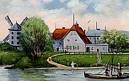

Die erste in Gohlis verbürgte Mühle war eine um 1570 erstmals erwähnte Schiffsmühle. Mehrfach wurde diese zerstört, letztmals bei einem Brand 1764. Die Mühle befand sich in der Nähe der bereits 1337
bestehenden Elbfähre und stellte ihren Betrieb 1867 ein.

Bereits seit 1784 besaß Gohlis jedoch auch eine Bockwindmühle an der früheren Ziegengasse. Der heutige Windmühlenweg erhielt diesen Namen, da er ursprünglich dem Ziegenauftrieb zu den Elbwiesen diente. 1828
entstand hier die bis heute erhaltene Gohliser Windmühle, ein Wahrzeichen des Ortes. Erster Besitzer war der aus
Stetzsch stammende Gutsbesitzer Hefter. 1867 kam sie in den Besitz der Familie Heide, die neben der Mühle auch
eine Gaststätte einrichtete. Neben dem “Restaurant zur Gohliser Windmühle” gab es ab 1901 eine Bäckerei, später auch eine Bankfleischerei. Windmühle, Gastwirtschaft und Elbfähre waren vor 1945, vor allem zur Zeit der
Baumblüte, beliebtes Ausflugsziel. 1925 ließ Max Heide, Sohn des ersten Gastwirts, die Gebäude gründlich sanieren und erweitern. Der Mahlbetrieb war bereits 1914 eingestellt worden.

Nach 1945 verfielen Mühlen- und Gaststättengebäude, so dass letzteres in den 70er Jahren
abgerissen werden musste. Zuvor war das Haus zeitweise als Bezirksschule der FDJ, als Ferienlager und Lehrlingswohnheim genutzt worden. In der Mühle selbst bestand noch bis
1961 ein kleines Museum. Die unter Denkmalschutz stehende Windmühle wurde 1983 rekonstruiert und einige Jahre als Jugendclub genutzt, verfiel später jedoch erneut. 2001
wurde das Gelände an einen Privatmann verkauft, der hier die Einrichtung einer Gaststätte und eines kleinen Mühlenmuseums vorbereitete. Zum Auftakt entstand im Sommer 2003 ein
Biergarten am Elberadweg. 2006 begannen die Sanierungsarbeiten an der historischen Mühle, welche wenig später auch ihre Flügel zurückerhielt _(Foto)_. Nach deren Abschluss
konnte die Gohliser Windmühle im September 2007 der Öffentlichkeit übergeben werden. Seitdem steht die Mühlenstube mit ihren 21 Plätzen als Gaststätte und für Familienfeiern zur
Verfügung. An den Wochenenden finden auch Führungen durch das Gebäude statt.
