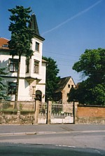
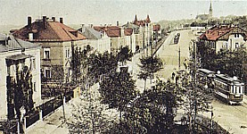

**Gemeindesiegel von Kemnitz**

Kemnitz entstand im 12. Jahrhundert als slawische Siedlung an der Mündung des
Zschonergrundbaches in die Elbe und wurde 1254 erstmals erwähnt. Der Name ist vom slawischen “kamenica” abgeleitet und bedeutet übersetzt Steinbach, womit auf die Lage
des Dorfes hingewiesen wird. Der Ort mit seinen drei Gütern und einigen Häusleranwesen gehörte ab 1324 den Meißner Domherren Heinrich und Albrecht von Guben und kam nach
der Reformation zum Prokuraturamt Meißen. Neben der Landwirtschaft war früher auch der Fischfang von Bedeutung, der mit Hilfe von Pfahlwerken und Weidengeflechten in der
Elbe betrieben wurde. Im 17. Jahrhundert musste diese Art der Fischerei wegen Behinderung der Elbeschiffahrt eingestellt werden. Zum Dorf gehörte auch eine bereits um
1324 erwähnte Mühle im Zschonergrund. 1566 entstand eine weitere Wassermühle, aus der später die beliebte Ausflugsgaststätte [Weltemühle](../../west/kemnitz/zschonergrund/weltemuhle/) hervorging.

Gegen Ende des 19. Jahrhunderts entwickelte sich Kemnitz zum Wohnvorort von Dresden, wozu auch der Bau der [Eisenbahnstrecke nach Berlin](../../zentrum/friedrichstadt/dresden_-_berlin/) (1875) und der Straßenbahn nach Cossebaude (1906) beitrug. Größere
Industriebetriebe entstanden jedoch nicht. 1900 erhielt die Gemeinde Anschluss an das Verbands-Elektrizitätswerk “Elbtal” in Cossebaude. Gemeinsam mit einigen Nachbardörfern wurde Kemnitz am 1. April 1921 nach Dresden
eingemeindet. In den Zwanziger Jahren entstanden außerhalb des Dorfkerns weitere Wohnsiedlungen an den landschaftlich reizvollen Hängen des [Zschonergrundes](../../west/kemnitz/zschonergrund/), der bereits zuvor beliebtes Naherholungsziel der Dresdner
Bevölkerung war. Massive Eingriffe in die Struktur des Ortes brachte 1935 der Autobahnbau, für den ein Großteil der
alten Bauernhöfe und der frühere Dorfgasthof abgerissen werden mussten, um Platz für die neue Anschlussstelle Dresden-Altstadt zu schaffen. Für die Autobahn wurde 1935/36 eine moderne [Stahlträgerbrücke](../../west/kemnitz/autobahn/) über die Elbe errichtet.

**_Foto:_** _Meißner Straße in Kemnitz um 1910_

Heute sind nur noch wenige Sachzeugen aus der dörflichen Vergangenheit des Ortes erhalten geblieben. Einige wenige
Bauernhöfe stehen noch an der Zschonergrundstraße. Das frühere Gut Nr. 4 wurde 1998 zum Gastronomie- Erlebnistheater “Merlins Wunderland” umgebaut. Auch die nach 1945 geschlossene Weltemühle konnte in den letzten
Jahren komplett saniert und als Hotel & Restaurant wiedereröffnet werden. Von hier aus sind Ausflüge in den reizvollen Zschonergrund möglich.
