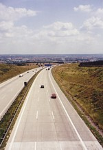
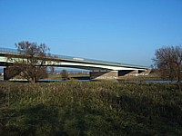
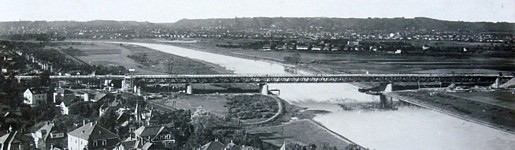
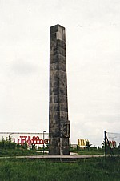
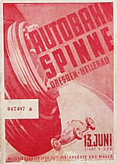

## Autobahn Dresden - Chemnitz / Bautzen (A4)

Erste Pläne zum Bau einer Autobahn im Dresdner Raum kamen 1933 auf. Mit
Machtübernahme der Nationalsozialisten sollte in ganz Deutschland ein leistungsfähiges Straßennetz geschaffen werden, um Hitlers Pläne der Massenmotorisierung in die Tat
umzusetzen. Auch strategische Erwägungen spielten bei der Planung eine Rolle. Dresden war als Schnittpunkt der Trassen nach Osten (Bautzen - Görlitz), Westen (Chemnitz - Hof) und
Norden (Berlin) vorgesehen. Bei der Trassierung entschied man sich für eine Streckenführung ganz im Westen des Stadtgebietes, da man hier nur wenig Rücksicht auf vorhandene Bebauung
nehmen musste und zudem bessere topografische Bedingungen vorfand. Lediglich in Kemnitz mussten für die dort vorgesehene Anschlusstelle Dresden-Altstadt mehrere Gebäude des alten Dorfkerns abgerissen werden.

Bereits 1933 begann der Erwerb der erforderlichen Flächen, wobei vor allem die Bauern von Kaditz und Kemnitz größere Landstreifen zugunsten des Autobahnbaus abgeben mussten. Am 21. März 1934 vollzog
der sächsische Reichsstatthalter Martin Mutschmann in Kemnitz den ersten Spatenstich. Die Arbeiten wurden meist von ehemals Erwerbslosen ausgeführt. Für den Bau der Autobahn
musste ein 40 Meter breiter Damm aufgeschüttet werden, um eine kreuzungsfreie Streckenführung zu ermöglichen. Um die umfangreichen Erdarbeiten bewältigen zu können, war in
Kaditz eine Feldbahn in Betrieb, die Sand und Kies vom ehemaligen Kaditzer Tännicht zur Baustelle transportierte. Auf
dem Gelände des früheren Flugplatzes bestand zeitweise ein Barackenlager für die Unterbringung der Arbeiter.

Am 23. September 1936 konnte der erste Bauabschnitt zwischen Dresden, Chemnitz und Meerane freigegeben werden. Die im Sommer 1934 begonnene Autobahnbrücke
war ebenfalls ab 1936 befahrbar. Das Bauwerk, eine Fachwerk-Stahlkonstruktion überspannte den Fluss mit 126 Metern bei einer Gesamtlänge von 484 Metern _(Foto)_.
Als Projektverantwortliche wurden die Ingenieure P. Bonatz, G. Schaper, K. Schreiner und E. H. Weiß genannt. Die Bauausführung erfolgte gleichzeitig von beiden Ufern aus
und endete mit dem Zusammenfügen der beiden Brückenhälften über dem Strom.  Kleinere Brücken waren zur Überquerung der Bahnstrecke Dresden - Leipzig und
verschiedener Straßen erforderlich. Anschlussstellen entstanden an der Meißner Landstraße (Dresden-Altstadt), Kötzschenbroder Straße (Dresden-Neustadt) und der Radeburger Straße
(Dresden-Nord), die mit Inbetriebnahme dieses Abschnittes am 17. Dezember 1937 eröffnet wurden.

**_Foto:_** _Die Autobahnbrücke bei Kemnitz kurz nach ihrer Eröffnung 1937_

Am 25. Juni 1937 fand an der Anschlusstelle Dresden-Altstadt in Kemnitz die offizielle
Einweihungsfeier der Reichsautobahn Dresden - Meerane statt. Im Beisein tausender Dresdner, die an diesem Tag extra frei bekommen hatten, hielt Hitler die Eröffnungsrede.
Kurze Zeit später durften die ersten Kraftfahrzeuge die neue Autobahn benutzen. In Erinnerung an das Ereignis entstand in Kaditz ein noch heute vorhandener Obelisk, der 1998 an seinen
jetzigen Standort versetzt wurde. Die 13,5 Meter große Sandsteinsäule _(Foto)_ wurde vom Bildhauer Max Grünert künstlerisch gestaltet. Neben dem Dresdner Stadtwappen und der
Inschrift “Reichsautobahn 1937” waren früher auch Symbole der Nationalsozialisten angebracht. Diese wurden nach 1945 entfernt.

Die Arbeiten am Autobahnnetz um Dresden wurden auch nach der Eröffnung des ersten
Abschnitts ohne Verzögerung fortgesetzt. Am 1. April 1939 folgte die Freigabe des Hellerauer Autobahnabzweigs mit den Verbindungen in Richtung Berlin und Bautzen. Lediglich die
geplante Verlängerung nach Görlitz kam kriegsbedingt nicht mehr zu Stande. 1941 wurde aus strategischen Gründen eine
weitere Autobahnauffahrt am Wilden Mann eingerichtet. Mit dem Autobahnbau machten sich auch Veränderungen an den
wichtigen Zufahrtsstraßen erforderlich, die bis zum Beginn des Zweiten Weltkrieges weitgehend abgeschlossen waren.

Während des Zweiten Weltkrieges dienten die Autobahnen vorrangig militärischen Transporten. Zeitweise wurden in
Dresden sogar U-Boote über Chemnitz bis nach Ingolstadt transportiert. Zuvor waren die Schiffe, die im Schwarzen
Meer zum Einsatz kommen sollten, auf dem Wasserweg nach Übigau gebracht und dort auf Spezialtransporter verladen
worden. Von Ingolstadt ging es dann weiter über die Donau bis zum geplanten Einsatzort. Trotz ihrer militärischen Bedeutung blieb die Autobahn von größeren
Kriegsschäden verschont. Lediglich die Autobahnbrücke wurde noch in den letzten Kriegstagen von abziehenden SS-Einheiten gesprengt, war jedoch bereits im Sommer 1945 provisorisch wieder
befahrbar. Eine Reparatur der zerstörten Bauteile erfolgte 1947.

 In der Nachkriegszeit waren die Fernstraßen nur wenig befahren. Aus diesem Grund nutzte man das Autobahn-Dreieck in Hellerau ab 1951 für Auto- und Motorradrennen. Die Anregung dafür kam vom aus Cossebaude stammenden Rennfahrer Helmut Zimmer. Um einen Rundkurs zu erhalten, wurden an geeigneten Stellen Übergänge zwischen den Fahrspuren geschaffen. Als Büro der Rennleitung diente das Café am [Hellerauer Markt](../../../nord/hellerau/strassen_und_plaetze/), das Fahrerlager war in den Gebäuden der Autobahnmeisterei untergebracht. Mit einer Streckenlänge von ca. 6,44 km und der noch gut erhaltenen Zementdecke der Autobahn entsprach die Strecke den damaligen Anforderungen für den Motorsport. Das erste offizielle Rennen fand am 17. Juni 1951 statt. Regelmäßig zog die “Hellerauer Spinne” tausende Motorsportfans an, bevor die Rennen 1971 wegen des wachsenden Verkehrs eingestellt werden mussten.

Nach 1990 wurden Autobahn und -brücke im Rahmen des “Verkehrsprojektes Deutsche
Einheit” komplett erneuert. In diesem Zusammenhang erfolgte eine Verbreiterung auf sechs Spuren sowie die Umgestaltung der Anschlussstellen. Die Autobahnbrücke erhielt dabei zwischen 1995 und 1998 einen komplett neuen
Überbau. Eine zusätzliche Auffahrt wurde zur Anbindung des Flughafens in Klotzsche angelegt.

Technische Daten zur Autobahnbrücke:

**Konstruktionsart des Überbaus:**

Stahl-Doppelhohlkasten

**Gesamtlänge:**

496 Meter

**Spannweite über der Elbe:**

130 Meter

**Gesamtbreite:**

43 Meter

**Fahrbahnen:**

je drei Fahrstreifen pro Richtung sowie zugehörige Standstreifen

**Fuß- und Radwege:**

auf beiden Außenseiten
