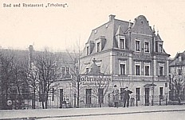
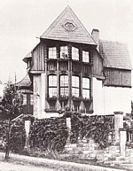
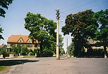
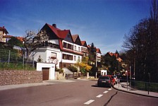
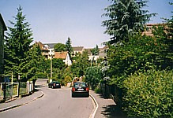
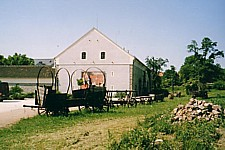

## Am Kirchberg

Die Straße entstand Ende des 19. Jahrhunderts und verband den alten Kemnitzer Dorfkern mit dem benachbarten Briesnitz.
Da sich hier zahlreiche Gärtnereien angesiedelt hatten, trug sie zunächst den Namen Gartenstraße. Im Zuge der Eingemeindung von Kemnitz und Briesnitz wurde sie
mit der Briesnitzer Kirchstraße vereinigt und am 19. Februar 1926 in Am Kirchberg umbenannt.

Nr. 23:
Das sogenannte “Bramschgut” gehört zu den letzten verbliebenen Bauerngehöften von Kemnitz. Seinen Namen verdankt es dem Unternehmer Johann Ludwig Bramsch, der einst hier wohnte und 1837 die [Spirituosenfabrik Bramsch](../../../zentrum/friedrichstadt/strassen_friedrichstadt/friedrichstrasse/bramsch-spirituosenfabrik/) in
der Friedrichstadt gründete. Die heute erhaltenen Gebäude stammen aus der Zeit um 1880 und wurden 2011/12 zu einer Wohnanlage ausgebaut.

## Brückenstraße

Die Brückenstraße hieß ursprünglich Bahnstraße, da sie an der 1875 erbauten Eisenbahnlinie entlangführte. In ihrer Nähe entstand eine Straßenbrücke im Verlauf der Meißner Landstraße, die diese Bahnstrecke überspannt. 1926 wurde die Bahnstraße deshalb in Brückenstraße umbenannt. Im heute nicht mehr vorhandenen Haus Nr. 7 befand sich einst die "Badeanstalt und Restaurant Erholung".

**_Foto:_** _Das frühere Restaurant Erholung um 1910_

## Holsteiner Straße

Die Holsteiner Straße hieß vor der Eingemeindung von Kemnitz Bergstraße. Um Verwechslungen zu vermeiden, wurde sie am 26. Februar 1926 in Skagerrakstraße umbenannt. Dieser Name sollte an die Seeschlacht des Ersten Weltkrieges erinnern, die 1916 in einem Meeresarm der Nordsee stattfand. Da man im Mai 1936 den damaligen Kurfürstenplatz in der Inneren Neustadt (heute Rosa-Luxemburg-Platz) in Skagerrakplatz umbenannt hatte und eine räumliche Trennung von Platz und Straße als nicht wünschenswert betrachtet wurde, erhielt die Straße am 29. Mai 1936 ihren heutigen Namen nach der Region Holstein in Norddeutschland.

Nr. 8: Die Villa _(Foto)_ wurde 1912 als privates Wohnhaus des Zimmerermeisters Ernst Noack errichtet. In Tradition seines Handwerks ließ der Erbauer sein Haus und den zugehörigen Gartenpavillon mit zahlreichen dekorativen Holzelementen versehen, welche sich an angelsächsischen Vorbildern orientieren. Noack (1861-1924) war ab 1905 Hofzimmermeister und ab 1912 Obermeister der Dresdner Baumeisterinnung und hatte sein Büro auf der Fröbelstraße 101. Zu seinen Arbeiten gehörten u.a. verschiedene Ausstellungspavillons für die Ausstellung "Die alte Stadt" (1896) und zur 3. Deutsche Kunstgewerbeausstellung 1906. Außerdem errichtete er 1907 den Interimsbau im Zusammenhang mit der Erneuerung der Augustusbrücke und verschiedene Wohnhäuser in Dresden.

## Lindenplatz

Der Platz wurde in den Zwanziger Jahren angelegt und erhielt seinen Namen 1934 nach den hier stehenden Lindenbäumen.
Bereits seit 1913 gab es die in unmittelbarer Nachbarschaft verlaufende Lindenstraße (heute Lindenheim). Die Siedlung um
den Lindenplatz gehört zu den nach der Jahrhundertwende in Kemnitz entstandenen neuen Wohnvierteln außerhalb des alten Dorfkerns.

**_Foto:_** _Lindenplatz in Kemnitz_

## Lößnitzblick

Im Zusammenhang mit der Bebauung der heutigen Holsteiner Straße entstand an deren westlichen Ende eine kleine Sackgasse, die am 27. August 1923 den Namen Lößnitzblick erhielt. Im Zuge der Eingemeindung des Ortes Mobschatz 1999 gab es diesen Straßennamen jedoch doppelt, so dass man beschloss, die Namensgebung in Kemnitz aufzuheben und die wenigen Häuser der Holsteiner Straße zuzuordnen.

## [Meißner Landstraße](../../../west/cotta/strassen_cotta/meissner_landstrasse/)

## Merbitzer Straße

Die heutige Merbitzer Straße ist Teil des früheren Bischofsweges, der von Meißen über Klipphausen - Merbitz und Kemnitz zum Briesnitzer Burgward führte und zu den
ältesten Verkehrsverbindungen der Region gehört. Da er den Bewohnern der umliegenden Orte als Weg zur Kirche diente, wurde er auch Mobschatzer Meßweg genannt. Erst 1886 erfolgte ein Ausbau zur Straße, welche 1897 den Namen
Merbitzer Straße erhielt. Die um 1900 erfolgte Bebauung führte zur weitgehenden Zerstörung einer zuvor noch in Resten erhaltenen slawischen Wallanlage auf
Briesnitzer Flur. Historisch interessant ist das 1996 sanierte Fachwerkhaus Merbitzer Straße 4 von 1602.

1888 errichtete die Gemeinde Briesnitz an der Merbitzer Straße ein neues [Schulhaus](../../../west/briesnitz/), welches die alte Dorfschule an der
Meißner Landstraße ablöste. In den 1930er Jahren entstand in Kemnitz eine Wohnsiedlung oberhalb des Zschonergrundes _(Foto)_
. 2012 begann in der Nähe der Umbau der ehemaligen Gummifabrik Leupold zu einer kleinen Wohnanlage. Noch bis 1993 wurden auf dem Areal Merbitzer Straße 55 Gummimischungen, Walzen, Rollen- und Räderbezüge sowie Dichtungen
und ähnliche Waren produziert, zuletzt unter der Firmierung Gummiwerk Dresden-West. Unter weitgehendem Erhalt der historischen Bausubstanz sollen nun künftig in den Gebäuden Eigentumswohnungen entstehen.

## Pfaffengrund

Die frühere Kemnitzer Talstraße wurde 1926 nach einem alten Flurnamen in Pfaffengrund umbenannt. Die hier liegenden
Wiesen wurden einst Pfaffenwiesen genannt, da deren Ertrag dem Briesnitzer Pfarrer zustand. Bis zum Umbau nach 1990 diente die Straße als Autobahnzufahrt zur Anschlussstelle Dresden-Altstadt.

**_Foto:_** _Blick vom Briesnitzer Kirchberg über den Pfaffengrund nach Kemnitz_

## Weltestraße

Die Weltestraße wurde bis zur Eingemeindung von Kemnitz Hohe Straße genannt. Der heutige Name erinnert an die
MüllerfamilieWelte, die bis 1899 die gleichnamige Mühle am Eingang zum Zschonergrund betrieb. 1899 wurde die [Weltemühle](../../../west/kemnitz/zschonergrund/weltemuhle/) zur Gaststätte umgebaut.

## Zschonergrundstraße

An der Zschonergrundstraße sind bis heute einige Gehöfte des alten Kemnitzer Dorfkerns erhalten geblieben, der 1935 zum
Großteil dem Autobahnbau weichen musste. Bemerkenswert sind die Höfe Nr. 4 und 6. Im erstgenannten befindet sich seit 1998 die Erlebnisgaststätte “Merlins Wunderland”.

**_Foto:_** _Altes Kemnitzer Gehöft - heute Restauranttheater “Merlins Wunderland”_

## Zwergstraße

Die Straße wurde ursprünglich Querstraße genannt und gehört zu den kürzesten Straßen in Dresden. Dies war auch der Grund, die Straße 1926 in Zwergstraße umzubenennen.
