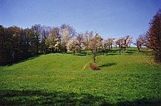
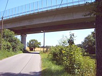
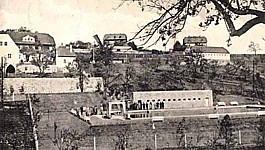
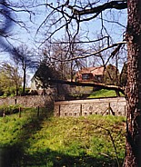

**_Die Sage vom Kroatenloch_**

_Im Zschonergrund befand sich einst am Rande der Briesnitzer Flur eine ca. eineinhalb Meter tiefe Senke, die “Kroatenloch” genannt wurde. Hier soll in einem sehr kalten und schneereichen_
_Winter eine aus Kroatien stammende Sippe Zuflucht gesucht haben, nach dem die Bauern der Umgebung ihnen ein Obdach verweigert hatten_

_Als nach einer besonders kalten Nacht, durch das_
_Heulen der Wölfe alarmiert, die Briesnitzer Bauern die Stelle aufsuchten, fanden sie nur noch erfrorene und von den Wölfen zerissene Körper vor. Lediglich ein Säugling überlebte das Drama und wuchs fortan bei einer_
_Bauernfamilie auf._

_Aus diesem Kind wurde im Laufe der Zeit ein kräftiger junger Mann, der gemeinsam mit den beiden Töchtern des Bauern dessen Anwesen bewirtschaftete und als ein_
_überaus fleißiger Bauer und hervorragender Jäger galt. Innerhalb weniger Jahre gelang es ihm, fast alle Wölfe und Bären der Umgebung auszurotten._

_Allerdings missfiel_

_den Nachbarn das_
_Zusammenleben des jungen Kroaten mit den beiden Schwestern, zumal aus dieser Dreierbeziehung mehrere Kinder hervorgegangen waren. Schließlich gingen_

_sie gemeinsam mit dem Briesnitzer Pfarrer gegen die_
_“Kroatenfamilie” vor, die daraufhin ihr Gut verkauften und wegzogen. Zuvor soll der Wolfsjäger das Anwesen verflucht haben, so dass hier kaum noch Ertrag zu_

_erzielen war._

* * *

Der Zschonergrund gehört zu den romantischsten linkselbischen Seitentälern und wird vom gleichnamigen Zschonerbach gebildet. Dieser Bach, früher auch als Schoner Bach bzw. Zschone bezeichnet, entspringt
oberhalb von Zöllmen und durchquert dann die Fluren von Ockerwitz, Kemnitz und Briesnitz, wo er in die Elbe mündet. Der Name ist wahrscheinlich vom slawischen “cujni” = munter abgeleitet. Die Namen der Orte Steinbach
und Kemnitz (slawisch: Steinbach) weisen ebenfalls auf diesen Flusslauf hin.

Bereits im Mittelalter wurde das Tal wirtschaftlich genutzt. So dienten die Wiesen den Bauern der angrenzenden Ortschaften zur
Heugewinnung. An den sonnigen Hängen wurde früher Wein angebaut, später auch Obstbäume. Außerdem war das Revier um den Zschonergrund Jagdrevier des Kurprinzen. Bereits 1324 wurde erstmals eine heute verschwundene Mühle
im Grund erwähnt. Ihre Nachfolge traten später die [Zschonermühle](../../../West/Kemnitz/Zschonergrund/Zschonermuhle/zschonermuhle.html), die [Weltemühle](../../../west/kemnitz/zschonergrund/weltemuhle/) und die [Schulzenmühle](../../../West/Kemnitz/Zschonergrund/Schulzenmuhle/schulzenmuhle.html) an.

**_Foto:_** _Wiesenlandschaft im Zschonergrund_

Zwischen 1763 und 1778 fanden unterhalb der Zschonermühle erfolglose Bergbauversuche nach Gold und Silber statt.
Unter Bezug auf den Freiberger Silberbergbau hatte der sächsische Kriegsrat Elias Unger die Konzession für ein Bergwerk
erworben, welches er unter dem Namen “Gabe Gottes Erbstolln und Fundgrube” betrieb. Da die erhofften Erzfunde jedoch
ausblieben, musste es bereits 1778 wieder schließen. Heute erinnert nur noch ein vermauertes Stollenmundloch, welches im
Volksmund als “Räuberhöhle” bezeichnet wird, an diese Episode. Später betrieben verschiedene Besitzer einige Plänersteinbrüche im Zschonergrund.

Spätestens im 19. Jahrhundert wurde das reizvolle Wiesental von den Dresdnern als
Ausflugsziel entdeckt. Vor allem zur Zeit der Baumblüte besuchten alljährlich Tausende den Zschonergrund mit seinen Streuobstwiesen. 1893 regte deshalb der Briesnitzer Arzt
Dr. med. Jahn die Neuanlegung eines Weges von der Zschonermühle in Richtung Ockerwitz an. Unter Mithilfe des Merbitzer Hausbesitzers Holling und mit Unterstützung
des Ockerwitzer Gemeinderates konnte der erste ca. 500 Meter lange Abschnitt wenig später fertig gestellt werden. 1904/05 setzte der Gebirgsverein Briesnitz den Ausbau des
Grundweges fort, der 1909 auch oberhalb der Schulzemühle verlängert wurde. Dabei mussten mehrere Holzbrücken über den Zschonerbach gebaut werden, wobei
ortsansässige Grundbesitzer die Kosten übernahmen. Die zeitgleich entstandenen Pläne, eine elektrische Straßenbahn durch
den Grund zu bauen, wurden aus Naturschutzgründen aufgegeben. 1927 entstand auf Kemnitzer Flur das  Zschonergrundbad. Der gesamte Zschonergrund steht heute unter Landschaftsschutz. Im oberen Teil wurde 1998 bei
Steinbach eine Brücke für die Autobahn Dresden - Prag errichtet, deren Bau zu heftigen Protesten vom Umweltschützern führte _(Foto)_.

Wüstung Zschon:

Der Ort wurde 1071 erstmals als Cinice urkundlich erwähnt und lag vermutlich in der Nähe von Steinbach. Das Dorf soll
der Legende nach Standort einer slawischen Kultstätte für den schwarzen Wendengott gewesen sein. Auch die Adelsfamilie
Sconowe, die ihren Sitz am Burgwall Ockerwitz gehabt haben soll, wird mit dem Ort in Verbindung gebracht. Bereits 1566
wird das Dorf Zschon als wüst bezeichnet. Dessen Fluren kamen nach dem Untergang zu Steinbach. Möglicherweise ist die außerhalb des Ortes gelegene Schulzemühle letzter Überrest des verschwundenen Dorfes am Zschonebusch.

## Zschonergrundbad

Das “Licht- und Luftbad Zschonergrund” entstand 1927 auf Kemnitzer Flur als zweites Freibad  im Westen der Stadt und gehörte wegen seiner reizvollen
Lage zu den beliebten Zielen der Bevölkerung der Umgebung. Das vom Dresdner Stadtbaurat Paul gestaltete Schwimmbecken und die zugehörigen Sanitärgebäude waren ein Geschenk der Stadt an die 1921 eingemeindeten
Vororte Briesnitz und Kemnitz. Dresden hatte sich bei den Verhandlungen zur Eingemeindung zum Bau eines Freibades in diesem Gebiet verpflichtet. Für
den Bau erwarb man einen 1836 erbauten Dreiseithof mit Stall und Scheune, welche in die Planungen einbezogen und zur Unterbringung der notwendigen
Umkleideräume und Sanitäranlagen genutzt wurden. Das Schwimmbecken besaß eine Größe von ca. 33 x 16 Metern und wurde von einem Brunnen gespeist. Hochmodern war die zum Bad gehörende Warmwasseranlage, mit deren Hilfe das
Wasser allein durch Sonneneinstrahlung vorgewärmt werden konnte. Nach Fertigstellung der Anlagen wurde das Bad am 14. Mai 1927 feierlich eingeweiht _(Foto rechts)_.

1946 machten sich umfangreiche Rekonstruktionsarbeiten erforderlich, nachdem ein Unwetter
größere Schäden an den Gebäuden angerichtet hatte. Weitergehende Reparaturen und Werterhaltungsmaßnahmen unterblieben jedoch. 1988 musste das Zschonergrundbad deshalb
wegen baulicher Mängel und des undichten Beckens geschlossen werden. Einwohnerproteste führten ein Jahr später zumindest zu einer Änderung des Flächennutzungsplanes, so dass der
Abbruch der Anlage verhindert werden konnte.

Seit 1996 bemüht sich ein Verein um den Erhalt des Bades, welches nach einer mehrjährigen
Rekonstruktion im Mai 2015 wieder eröffnet werden konnte. Bereits zuvor fanden Badfeste auf dem Gelände statt, um die notwendigen finanziellen Mittel für den Wiederaufbau zu beschaffen.
Ende 2010 konnte das komplett erneuerte Schwimmbecken erstmals wieder probeweise gefüllt werden. Außerdem wurde eine kleine Sommerwirtschaft eingerichtet. Die gesamte Anlage mit dem historischen Dreiseithof
von 1836, dem Schwimmbecken und den Nebengebäuden steht seit einigen Jahren unter Denkmalschutz. Als künstlerischer
“Blickfang” wurde ein Springbunnen mit einer Plastik Georg Wrbas aufgestellt. Die Bronzefigur eines Knaben mit Fisch gehörte ursprünglich zur Ausstattung des 1945 zerstörten [Güntzbades](../../../Zentrum/Pirnaische_Vorstadt/Strassen_Pirnaische_Vorstadt/Guntzbad/guntzbad.html).

## Birus-Gedenkstein

Der Gedenkstein mit einer Bronzeplakette erinnert an den seit 1891 an der Briesnitzer Schule unterrichtenden Lehrer Bruno
Birus. Birus setzte sich engagiert für den Ausbau des Wanderwegenetzes um den Zschonergrund ein und befasste sich mit
der Geschichte und Naturkunde des Tales. Auf seine Anregung geht auch der erst nach seinem Tod angelegte Lehrpfad
Zschonergrund zurück. Mit 70 Jahren verstarb Bruno Birus am 15. Mai 1935 in unmittelbarer Nähe des Denkmals, welches
ihm seine Schüler nach seinem Tode widmeten. Der Stein stammt aus einem nahegelegenen Steinbruch und besteht aus Syenit, die Gestaltung übernahm der Briesnitzer Bildhauer Johannes Meschke.

1958 wurde das Denkmal bei einem Hochwasser schwer beschädigt und stürzte in den Zschonerbach. Bei einem späteren
missglückten Bergungsversuch brach dieser entzwei. Die einst vorhandene rechteckige Gedenktafel gilt als verschollen. Erst 2005 konnte der Stein geborgen und restauriert werden. Eine
neue Gedenktafel wurde in der Kunstgießerei Lauchhamer angefertigt und trägt die Inschrift:

_Dem Betreuer des Zschonergrundes Oberlehrer Bruno Birus_

_Hier † 15. 5. 1935_

_Gebirgsverein für die Söchs. Schweiz, Ortsgruppe Dresden-Briesnitz u. Umg._

Am 8. Oktober 2005 wurde der Bruno-Birus-Gedenkstein neu eingeweiht.
