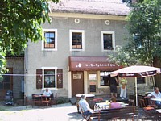
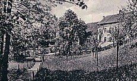

Die Schulzenmühle entstand vermutlich im 16. Jahrhundert im oberen Teil des [Zschonergrundes](../../../../west/kemnitz/zschonergrund/) in der Nähe des Dorfes Steinbach. Möglicherweise ist sie letztes Überbleibsel des bereits 1566 als “wüst” bezeichneten Dorfes Zschon.
1568 wurde sie als Steinbacher Mühle erstmals in einer Urkunde erwähnt, nachdem sich die Besitzer der Steinbacher und der Zschonermühle über die übermäßige Wasserentnahme aus dem Zschonerbach beklagten, die den
Mühlenbetrieb beeinträchtigte. Zwei Jahre später wurde der Mühle, so wie allen anderen Mühlen der Umgebung das Mahlrecht entzogen, um die Bauern zum
Aufsuchen der kurfürstlichen Amtsmühlen zu zwingen. Allerdings wurde dieses Verbot bereits wenig später aufgehoben, da schon 1573 ein “Matthes Petzsch, der Müller” als zinspflichtig nach Briesnitz genannt wurde.

Erneut erwähnt wurde die Steinbacher Mühle 1606. Am Hauptgebäude befindet sich eine historische Inschrift aus dem Jahr 1719:

_Halt fest frommes Herz, halt fest nur, bleib getreu_

_in Wiederwärtigkeit den Gott der sieht dir an_

_laß diesen deine sach handhaben, schützen führen_

_so wirst du wohl belehrt und endlich triumphieren_

_George Pietzsch 1719_

Nach Übernahme der Mühle durch die Familie Schulze wurde sie später Schulzenmühle genannt. Im Zusammenhang mit der “Entdeckung” des Zschonergrundes als Ausflugsziel wandelten die Schulzenmühle in eine Gaststätte um.
1999 wurde in unmittelbarer Nähe der Mühle mit dem Bau der Zschonergrundbrücke für die Autobahn nach Prag begonnen.

**_Foto:_** _Die Schulzemühle in den Dreißiger Jahren_
