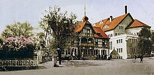
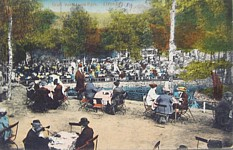

Bereits 1328 wurde erstmals eine Mühle am Zschonerbach
genannt, deren Standort heute jedoch nicht mehr lokalisierbar ist. Vermutlich befand sich diese im Dorfkern und ging wenig später wieder ein. 1566 ist erneut von einer Wassermühle im
Zschonergrund in der Nähe des Mobschatzer Meßweges die Rede. Als Bauherr trat der Kemnitzer Benno Fehrmann auf. Diese Mühle war sofort Gegenstand einer heftigen Auseinandersetzung
zwischen Müller und den kurfürstlichen Forstmeistern, die im Bau eine Bedrohung des Wildbestandes im Revier sahen und den
Abbruch der Mühle forderten. Auch der Kurfürst unterstützte diese Forderung, so dass die Mühle nur wenige Jahre bestand.

Erst 1606 bemühte sich ein Nachkomme Fehrmanns um die Genehmigung zum
Wiederaufbau, der zwei Jahre später auch vom Kurfürsten genehmigt wurde. Diese Mühle kam später in den Besitz der Bauernfamilie Welte, weshalb sie
als Weltemühle bekannt geworden ist. Ende des 19. Jahrhunderts wurde diese in eine Schankstätte umgewandelt und 1899 von der Familie Birnbaum
erworben. Die neuen Besitzer ließen das Anwesen erweitern, wobei u. a. ein großer Gästegartenund ein Ballsaal entstanden. Hauptattraktion war jedoch der am 9. Mai 1914 nach dem Vorbild von [“Donaths Neue Welt”](../../../../ost/tolkewitz/strassen_tolkewitz/alttolkewitz/donaths_neue_welt/) gestaltete “Luna-Park” mit Gebirgsbahn, einem mit verschiedenen maschinellen Anlagen
ausgestattetes Lachkabinett und einer Sommerrodelbahn _(Foto)_. Die Weltemühle gehörte nun zu den beliebtesten
Ausflugslokalen des Dresdner Westens. 1929 musste der Park in Folge der Weltwirtschaftskrise schließen und wurde wenig später abgebaut.

Trotz mehrerer Besitzerwechsel und zeitweiser Schließung blieb die Weltemühle noch bis 1954 als Ausflugslokal
erhalten. Während des Zweiten Weltkrieges befand sich hier eine Luftschutzschule. Die Gebäude wurden anschließend
gewerblich genutzt und verfielen. Erst nach 1990 wurde der gesamte Komplex verkauft und zum Großteil abgerissen.
Nach historischem Vorbild erfolgte anschließend bis 1997 ein Wiederaufbau der Weltemühle, welche bis 2011 von der
Familie Pattis als Gourmetrestaurant geführt wurde. In diesem Zusammmenhang entstand auch ein Hotel. Nach dessen
Verkauf an die Hotelgruppe “Grand City Hotels” und mit etwas verändertem Konzept trägt das Lokal seit 2012 den Namen ”Hotel Villa Weltemühle”.

Unweit der Weltemühle liegt ein ehemals morastiger Platz, welcher im Volksmund “Höllenpfuhl” genannt wird. Hier soll
im 16. Jahrhundert ein im Streit mit dem Briesnitzer Pfarrer befindlicher Bauer samt seinen Pferden vom Blitz erschlagen worden sein.
