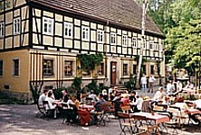
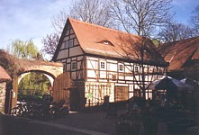

Die Entstehungsgeschichte der Zschonermühle liegt im Dunkeln, da Dokumente
über den ersten Mühlenbau fehlen. Vermutlich entstand sie zu Beginn des 16. Jahrhunderts. Erstmals erwähnt wurde die Ockerwitzer Mühle 1568 im Zusammenhang mit einem Streit um die Wasserrechte im Zschonergrund.
Bereits zwei Jahre später war die Zschonermühle erneut Gegenstand umfangreichen Aktenverkehrs, als der Kurfürst jeglichen Mahlbetrieb innerhalb einer Meile um seine Amtsmühlen verbot. Betroffen war auch der Müller
Gregor Götze, der in einem Bittgesuch auf die existenzielle Bedeutung der Mühle im Zschonergrund für seinen Lebensunterhalt hinwies. In diesem
Zusammenhang findet sich auch eine ausführliche Beschreibung der von Götze vorgenommen Erneuerungen seit Übernahme der Mühle im Jahr 1533. Die Mühle besaß damals zwei Mahlgänge und ein “Ölgezeug”. Außerdem
gehörten ein Garten und eine Wiese zum Grundstück, welches von allen Erbdiensten befreit war. Obwohl die Mühle
nur örtliche Bedeutung hatte und lediglich von den Bauern der umliegenden Orte Ockerwitz, Merbitz, Podemus und
Leuteritz genutzt wurde, hielt der Kurfürst an seinem Verbot fest, entschädigte den Mühlenbesitzer Götze jedoch mit einer jährlichen Zahlung von 20 Gulden.

Dieses Mahlverbot scheint wenige Jahre später jedoch wieder aufgehoben
worden sein, da die Zschonermühle auch weiterhin bestand. Zeitweise wurde sie auch als Sägemühle genutzt. 1812 kam die Mühle in den Besitz der Familie
Kunze, in dem sie viele Jahrzehnte blieb. Die Zschonermühle wurde umgebaut und erhielt dabei im Wesentlichen ihr heutiges Aussehen. Nachdem sich der
Zschonergrund Mitte des 19. Jahrhunderts zum Ausflugsziel entwickelt hatte, wurde die Mühle auch als Schankstätte genutzt und war beliebtes Ziel für Wanderungen durch den Grund. 1940 wurde der Gaststättenbetrieb jedoch
eingestellt.

Die nach 1945 stark verfallene Zschonermühle wurde Mitte der 1980er Jahre von ihrem heutigen Besitzer privat
erworben und in Eigeninitiative restauriert. 1991 konnte in der Mühle eine historische Gaststätte eröffnet werden.
Auch die komplett erhaltene historische Mühlentechnik und das betriebsfähige Wasserrad können besichtigt werden.
Regelmäßig finden auf dem Gelände verschiedene kulturelle Veranstaltungen statt. Dabei sind Puppenspieler, Musiker
und Kleinkünstler in der Mühle zu Gast. Seit 2011 gibt es zudem ein kleines Minikraftwerk, um Kindern und Jugendlichen die Funktionsweise der Stromgewinnung aus Wasserkraft nahezubringen.
