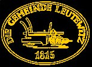
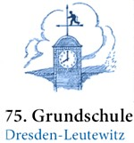
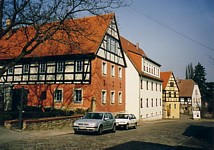
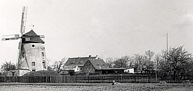
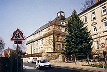
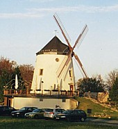

* * *

**Gemeindesiegel von Leutewitz**

* * *

* * *

 **Schulen in Leutewitz:**

Das Straßendorf  Leutewitz entstand vermutlich im 10. Jahrhundert und wurde 1071
erstmals urkundlich als Ludiwice erwähnt. Der Name ist wahrscheinlich von einem slawischen Ortsgründer Lut abgeleitet. Nach Inbesitznahme der Region durch
deutsche Siedler unterstand das Dorf dem Burgward Briesnitz und musste dem Meißner Domkapitel Geld und Getreidezins zahlen. Nach der Reformation gelangte
Leutewitz 1559 mit weiteren ehemaligen Stiftsdörfern an das kurfürstliche Amt Dresden. Bis ins 19. Jahrhundert blieb der Ort ein unbedeutendes Bauerndorf,
dessen Einwohner auch etwas Weinbau betrieben. 1827 zerstörte ein Großbrand einen Teil der Gehöfte, die danach in heutiger Form wiederaufgebaut wurden.

1839
wurde in Leutewitz auf einer durch den Bau des Tiefen Elbstollens entstandenen Abraumhalde eine bis heute erhaltene Windmühle errichtet. Die 1844 an dieser Mühle eröffnete Gastwirtschaft machte den Ort zum Ausflugsziel.
Außerdem wurden seit Mitte des 19. Jahrhunderts Teile der Gemeindeflur durch die Lehmgruben einiger Ziegeleien und
einige Plänersteinbrüche eingenommen. Weitere Flächen nutzten die hier gegründeten Handelsgärtnereien, die um 1900
wichtigster Erwerbszweig der Bewohner waren. 1876 hatte die zur Briesnitzer Kirche gehörende Gemeinde gemeinsam
mit den Nachbarorten Ockerwitz und Omsewitz ein eigenes Schulhaus errichtet. Kirchlich gehörte Leutewitz seit 1897 zur Cottaer Parochie.

**_Foto:_** _Blick zur Leutewitzer Windmühle um 1910_

Um 1900 setzte auch in Leutewitz eine zunehmende Bautätigkeit ein, die zur Entstehung neuer Wohngebäude an der
Wilhelm-Müller- und Droste-Hülshoff-Straße führte. Im gleichen Jahr wurde eine Straßenbahnlinie eingeweiht. 1906 erwarb die Stadt Dresden einen Teil der Leutewitzer Flur, um hier den [Leutewitzer Volkspark](../../west/leutewitz/leutewitzer_park/) anzulegen. Zwischen 1925
und 1939 wurden die verbliebenen Freiflächen zwischen Park und altem Dorfkern mit Kleinhaussiedlungen bebaut.
Bereits am 1. April 1921 war der Ort nach Dresden eingemeindet worden. Im Dorfkern sind noch zahlreiche historische Bauernhöfe erhalten geblieben, die zum Teil unter Denkmalschutz stehen.

Schulen in Leutewitz:

Da Leutewitz von alters her zur Briesnitzer Kirche gehörte, besuchten auch die
Kinder des Ortes die dortige Schule. Erst 1876 entschloss sich die Gemeinde zur Gründung eines Schulverbandes, zu dem auch die Nachbarorte Ockerwitz,
Omsewitz und Burgstädtel gehörten. Zuvor fand der Unterricht zeitweise in einem Wohnhaus im Omsewitzer Grund statt. Im gleichen Jahr entstand ein eigenes
Schulhaus an der Warthaer Straße 60, welches 1911 aufgestockt und erweitert wurde. Zwischen 1920 und 1945 als 75. Volksschule genutzt, ist das Gebäude
heute Domizil der 75. Grundschule. 2009/10 wurde diese komplett modernisiert. Auf dem Schulhof erinnert eine Lutherlinde an die Jubelfeiern zu Martin Luthers 400. Geburtstag im Jahr 1883.

Leutewitzer Windmühle:

Die Mühle
wurde 1839 für Johann Gottlieb Pietzsch auf einem künstlichen Schuttkegel gebaut, der durch den Aufschluss des 5. Lichtlochs des [Tiefen Elbstollens](../../west/cotta/strassen_cotta/meissner_landstrasse/tiefer_elbstollen/) entstanden war.
Dieser Stollen gehört zu den größten technischen Meisterleistungen des sächsischen Bergbaus und diente der Grubenentwässerung des Wurgwitz - Zauckeroder Kohlenreviers.
Wenig später richtete Pietzsch in seiner Mühle einen Most- und Weinschank ein, den er im Nebenerwerb betrieb. Dieser entwickelte sich schon bald zu einem beliebten Ausflugsziel,
nicht zuletzt durch den angeschlossenen Weinberg, dessen Erträge an Ort und Stelle gekeltert und verkauft wurden. 1844 erwarb Wilhelm Felgentreff die
Turmholländer-Windmühle mit dem umgebenden Grundstück und errichtete hier eine Gaststätte. Dafür entstanden einige Nebengebäude und ein schattiger Biergarten. Zeitweise
fanden in der Gastwirtschaft sogar Tanzveranstaltungen statt. Der Erfolg des Unternehmens und die zunehmende Konkurrenz moderner Großmühlen führten 1914 zur Einstellung des Mahlbetriebs.

Die Leutewitzer Windmühle, von wechselnden Eigentümern mehrfach rekonstruiert, ist bis heute als technisches Denkmal
erhalten. Eine grundlegende Umgestaltung des Areals erfolgte 1983/84 im Rahmen eines Jugendobjektes, welches die
Mühle zu einem Freizeitzentrum der Jugendlichen de Umgebung machen wollte. Dabei entstanden u.a. die Terrasse und
eine neue Zufahrtsrampe. Die im Inneren der Mühle eingerichtete historische Gaststätte hat nach längerer Schließzeit seit
Herbst 2003 wieder geöffnet. Eine umfassende Instandsetzung einschließlich der Erneuerung der Mühlenflügel erfolgte 2008. Bekannt wurde die Windmühle auch durch eine Sammlung von Mühlengeschichten, die ein Nachkomme des
früheren Mühlenbesitzers Felgentreff 1914 unter dem Titel “Der Windmüller von Leutewitz” veröffentlichte.

[_Weiterführende Literatur und Quellen_](../../impressum/quellenverzeichnis/)
