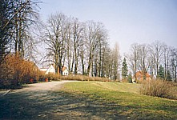
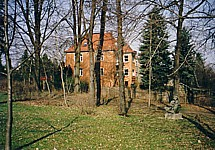
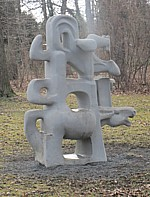

* * *

Das Gelände des heutigen Leutewitzer Parks wurde noch um 1900 als
Lehmgrube einer örtlichen Ziegelei genutzt, die ihren Betrieb jedoch mangels Rentabilität einstellen musste. Zu dieser Zeit entstanden die ersten Planungen für
einen großen “Westpark”, um den zahlreichen Arbeiterfamilien der dichtbesiedelten Dresdner Westvororte Ruhe-  und Erholungsmöglichkeiten zu
schaffen. Dabei konzentrierte man sich zunächst auf den Erwerb eines ca. 50 Hektar großen Areal des Kammergutes Gorbitz. 1906 bildete sich eine “Vereinigung zur Schaffung eines Volksparks Dresden-West”, welche mittels
Petition an die sächsische Staatsregierung Einfluss auf die Entscheidung der Stadt Dresden zu nehmen versuchte. Finanzielle Erwägungen führten jedoch 1908 zur Ablehnung des Ankaufs der
Kammergutsfelder und zur Konzentration auf eine deutlich kleinere Fläche am Ortsrand von Leutewitz.

Mit Hilfe der Dr.-Güntz-Stiftung gelang es, ca. 70.000 Quadratmeter Land von den Erben der Zigarettenfabrik
Malzmann zu erwerben. Außerdem verpflichtete sich die Stadt zur Anlage notwendiger Straßen und Zufahrtswege und
zu deren künftigem Unterhalt. Ein entsprechender Vertrag wurde am 13. November 1908 zwischen der Stadt Dresden und der Gemeinde Leutewitz geschlossen und in diesem Zusammenhang das künftige Parkgrundstück nach Dresden
einverleibt. Vertraglich festgelegt war auch die kostenlose Nutzung des Parks durch die Leutewitzer Einwohner.

Zwischen 1908 und 1911 entstand so der Leutewitzer Volkspark mit verschiedenen Sport- und Spielplätzen. Die Planung und Ausführung oblag der Stadtgartenverwaltung unter Leitung deren Direktors Wilhelm von Uslar. Uslars
Konzept sah regelmäßig angelegte Wegführungen mit einem Rundweg und dazu diagonal verlaufenden Seitenwegen
sowie einen großen Rasenplatz für Ballspiele vor. Die Hauptwege wurden dabei als Alleen gestaltet. Hinzu kamen 22
schattige Ruhebänke für Spaziergänger, drei von Hecken umgebene Sandspielplätze für Kinder und eine zentrale Spreng- und Bewässerungsanlage. Die offizielle Einweihung des Volksparks erfolgte am 30. September 1911.

Der täglich bis zum Einbruch der Dunkelheit zugängliche Park erfreute sich
schon bald großer Beliebtheit der Anwohner. Regelmäßig fanden hier Ballspiel- und Leichtathletikwettbewerbe statt. Über die Einhaltung der Parkordnung
wachte ein festangestellter Parkwächter, der an der Südostecke ein kleines Wächterhaus besaß. Hier befanden sich auch Toiletten und Unterkunftsräume
für die Gartenarbeiter. Die Finanzierung der jährlichen Unterhaltskosten übernahm der Volksparkverein “Naturschutz”, dem u.a. Kommerzienrat Bienert und Hofrat Gurlitt angehörten. Leider kamen mehrfach erwogene neue
Zugangsmöglichkeiten, besonders von Cottaer und Löbtauer Seite nie zustande. Während des Ersten Weltkrieges dienten Teile der Parkflächen dem Kartoffel- und Gemüseanbau. Erst 1920 konnten
die Rasenflächen wieder ihrer ursprünglichen Nutzung zugeführt werden und wurden ab 1921 dem “Verein für Turnen und Bewegungsspiele Jahn” als Trainingsgelände verpachtet.

1924 entstand eine öffentliche Toilettenanlage. Zwei Jahre später wurde im Park eine in Hellerau erworbene Baracke
aufgebaut, welche sowohl als Umkleideraum für Sportler als auch als Aufenthaltsraum für Kindergartenkinder bei
schlechtem Wetter diente. Hinzu kamen zwei Trinkwasserspender, die Schaffung weiterer Sitzgelegenheiten sowie 1928 die Anlage einer Rodelbahn am östlichen Parkweg. 1932 wurde am Ausgang zur Ockerwitzer Straße ein
Sandsteinquader zur Ehrung des Heimatdichters Erich Langer (1882-1932) aufgestellt. Langer wirkte zwischen 1903 und 1927 als Lehrer an der Leutewitzer Schule und verfasste zahlreiche Heimatgedichte.

Nach 1933 begann der schrittweise Verfall der Parkanlage, die einst ein bedeutendes
Zeugnis der Volksparkbewegung der Jahrhundertwende war. Mangels Pflege verwilderten Teile des Geländes. Auch nach 1945 setzte sich diese Entwicklung fort. Die obere Fläche
wurde in den 1950er Jahren als Stellfläche für Schausteller zweckentfremdet und dafür befestigt. 1976 verschwand das Denkmal des Dichters Erich Langer. Die historischen
gußeisernen Bänke wurden drei Jahre später als Requisiten für den DEFA-Film “Adel im Untergang” entfernt und kehrten nie zurück. Erst 1981 begannen erste Schritte zur
Wiederherstellung des Volksparks. U. a. wurden zwei neue Plastiken “Liegende mit Kind” und “Bremer Stadtmusikanten” _(Foto)_ aufgestellt und ein Kinderspielplatz angelegt. 1994
folgte eine Studie zur Wiederherstellung der historischen Blickbeziehungen und des Wegenetzes im Park. Künftig soll dieser in Anlehnung an seinen historischen Zustand
rekonstruiert werden. 2013 konnte bereits die einst vorhandene Rodelbahn wieder eingeweiht werden.

* * *

 \[ [Nord](../../../nord/)\] \[ [Nordwest](../../../nordwest/)\] \[ [Neustadt](../../../neustadt/)\] \[ [Nordost](../../../nordost/)\] \[ [West](../../../west/)\] \[ [Zentrum](../../../zentrum/)\] \[ [Südwest](../../../sudwest/)\] \[ [Süd](../../../sud/)\] \[ [Südost](../../../sudost/)\] \[ [Ost](../../../ost/)\] \[ [Register](../../../Register/register.html)\] \[ [Kontakt](../../../Kontakt/kontakt.html)\] \[ [Impressum](../../../impressum/)\]
