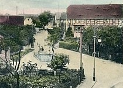
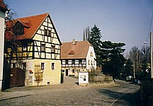
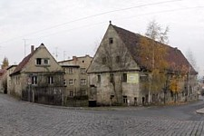

## Altleutewitz

Die Straße Altleutewitz wurde bis 1926 als Dorfstraße bezeichnet und bildet den Kern des slawischen Straßendorfes. Deutlich
ist noch die alte Struktur des Ortes zu erkennen, der in seiner heutigen Form nach einem Großbrand 1827 entstand. Noch bis
Ende des 19. Jahrhunderts dominierte die Landwirtschaft. Heute werden die Gebäude meist zu Wohn- und Gewerbezwecken
genutzt. Die gesamte Anlage steht unter Denkmalschutz. Bemerkenswert sind vor allem die Fachwerkhäuser Nr. 6 und Nr. 7.

**_Fotos:_** _Dorfplatz Altleutewitz um 1910 - renoviertes Bauerngehöft im alten Leutewitzer Dorfkern_

Gasthof Leutewitz:
Zu den erhaltenen Gebäuden des Dorfkerns gehört auch die frühere Dorfschänke, die noch bis in die 1970er Jahre geöffnet hatte. Diese war 1854 aus dem früheren Reiheschank hervorgegangen. Neben der Leutewitzer
Windmühle war auch diese Einkehrstätte bei den zahlreichen Ausflüglern beliebt. Seit einigen Jahren besteht auf dem
Nachbargrundstück wieder eine kleine Gartenwirtschaft. Neben dieser bescheidenen Schänke besaß Leutewitz ab 1870 noch
einen weiteren Gasthof an der Warthaer Straße. Dieser war mit seinem großen Saal und einem Gästegarten ein beliebtes Tanz-
und Vergnügungslokal. Ab 1953 diente der Tanzsaal als Turnhalle der Leutewitzer Schule, musste jedoch 1972 baupolizeilich gesperrt werden. Nach Abriss der Ruine entstanden auf dem Grundstück 2006 Einfamilienhäuser.

Alte Brauerei (Nr. 13):
Die Gebäude der alten Leutewitzer Brauerei gehen auf einen historischen Dreiseithof zurück, welcher um 1805 als Teil des Leutewitzer Rittergutes
errichtet wurde. Besitzer des Gutes war bis zur Mitte des 19. Jahrhunderts die Familie Pietzsch. Nach mehrfachem Besitzerwechsel erwarb 1881 der Oberwarthaer
Braumeister August Bernhard Schubert das Anwesen und richtete hier eine Brauerei ein. Dafür ließ er das vorhandene Scheunengebäude zum Brauhaus umbauen und in einer für
die damalige Zeit typischen Industriearchitektur gestalten. Wenig später entstand noch eine neue Zufahrtsstraße in Richtung Dresden.

Die Brauerei Leutewitz existierte bis 1925 und wurde dann von ihrem Besitzer vermutlich aus Altersgründen aufgegeben. Um 1930 wurden Brau- und Kesselhaus zu Wohnzwecken umgebaut. Ab 2003 entstand unter weitgehender Bewahrung der
historischen Bausubstanz ein Wohnhof mit mehreren Wohneinheiten. Das Foto zeigt die ehemalige Brauerei kurz vor ihrer Sanierung.

## Am Leutewitzer Park

Die Straße Am Leutewitzer Park entstand im Zusammenhang mit der Anlage des [Leutewitzer Volksparks](../../../west/leutewitz/leutewitzer_park/) und wurde zunächst
Parkstraße genannt. Nach der Eingemeindung von Leutewitz erfolgte am 19. Februar 1926 die Umbenennung in Am Leutewitzer Park.

## Droste-Hülshoff-Straße

An der früheren Kemnitzer Straße entstanden um 1900 die ersten Häuser außerhalb des Leutewitzer Dorfkerns, die die
Entwicklung zum Dresdner Wohnvorort einleiteten. Ihren Namen erhielt sie 1908 nach dem benachbarten Dorf Kemnitz. Am
19\. Februar 1926 wurde sie nach der bekannten deutschen Dichterin Annette Freiin von Droste-Hülshoff (1797-1848) in Droste-Hülshoff-Straße umbenannt.

## Gorbitzer Straße

Die heutige Gorbitzer Straße wurde früher als Oberer Leichenweg bezeichnet, da die Bewohner des Ortes hier ihren Weg zum
Briesnitzer Friedhof nahmen. 1904 ist sie jedoch bereits als Gorbitzer Straße im Leutewitzer Adressbuch verzeichnet. Auf
Gorbitzer Flur trug sie offiziell den Namen Leutewitzer Straße, wurde jedoch zur Vermeidung von Verwechslungen 1926
ebenfalls in Gorbitzer Straße umbenannt. Bereits 1893 ist in diesem Gebiet eine Ziegelei erwähnt. 1898 entstand an der Straße
der Cottaer Friedhof. Ursprünglich führte die Gorbitzer Straße bis zur Kesselsdorfer Straße, wurde jedoch beim Bau des Neubauviertels Gorbitz auf die heutige Straßenführung gekürzt.

## Schaumbergerstraße

Die Schaumbergerstraße erinnert an den Volksschriftsteller Heinrich Schaumberger (1843-1874), der durch seine
Dorfgeschichten im 19. Jahrhundert beliebt war. 1875 erschien eine zweibändige “Volksausgabe” seiner gesammelten Werke. Die frühere Südstraße in Leutewitz erhielt diesen Namen am 19. Februar 1926.

## Weststraße

Die Weststraße trug bis zur Eingemeindung des Ortes den Namen Weinbergstraße, der an den noch um 1870 bedeutenden
Weinbau im Ort erinnerte. Initiator war der Mühlen- und Gastwirtschaftsbesitzer Felgentreff, der für sein Lokal einige Weinberge anlegen ließ. Am 1. Oktober 1931 wurde die Straße nach ihrer geografischen Lage umbenannt.

## Wilhelm-Müller-Straße

Die frühere Hohe Straße erhielt 1926 den neuen Namen Wilhelm-Müller-Straße. Wilhelm Müller (1794-1827) gehört zu den
bedeutendsten Dichtern der deutschen Romantik und ist Verfasser so bekannter Volkslieder wie “Das Wandern ist des Müllers
Lust” und “Im Krug zum Grünen Kranze”. Mehrfach weilte er in Dresden und traf sich hier mit bekannten Persönlichkeiten seiner Zeit. Während einem seiner Besuche entstand sein Werk “Frühlingskranz aus dem Plauenschen Grunde”.

[Leutewitz auf OpenStreetMap](https://www.openstreetmap.org/search?query=Dresden+Leutewitz)

* * *

 \[ [Home](../../../index.html)\] \[ [Nord](../../../nord/)\] \[ [Nordwest](../../../nordwest/)\] \[ [Neustadt](../../../neustadt/)\] \[ [Nordost](../../../nordost/)\] \[ [West](../../../west/)\] \[ [Zentrum](../../../zentrum/)\] \[ [Südwest](../../../sudwest/)\] \[ [Süd](../../../sud/)\] \[ [Südost](../../../sudost/)\] \[ [Ost](../../../ost/)\] \[ [Register](../../../Register/register.html)\] \[ [Kontakt](../../../Kontakt/kontakt.html)\] \[ [Impressum](../../../impressum/)\]
