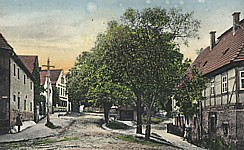
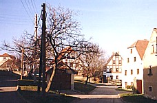
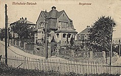
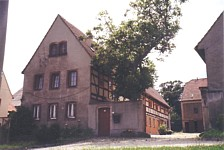

* * *

**Gemeindesiegel von Mobschatz**

Ortschaft mobschatz am tummelsgrund 7b 01156 dresden-mobschatz  tel. 0351/4538631  ortschaft-mobschatz @dresden.de

**Mobschatzer Ortsteile**

* * *

Das Gebiet um Mobschatz war bereits um 1.000 v. Chr. besiedelt, wie bronzezeitliche Funde an der Ortsgrenze zu Stetzsch beweisen. Nach dem Abzug der germanischen Stämme nahmen Slawen das Gebiet in Besitz, die auch den Rundweiler Mobschatz anlegten.1091 wurde der Ort in einer Schenkungsurkunde Kaiser Heinrich IV. erstmals urkundlich als Mococice erwähnt. Der Name ist vom slawischen Wort "mociti" = nässen abgeleitet. Mokos war zugleich auch der Name des slawischen Regengottes, der an diesem Ort vermutlich besonders verehrt wurde.

Das Dorf befand sich ursprünglich im Besitz des Domstiftes Meißen und unterstand dem Briesnitzer Burgward, der auch für Gerichtsbarkeit und kirchliche Verwaltung zuständig war. In den Hussitenkriegen wurde Mobschatz wahrscheinlich zerstört, jedoch bald wieder aufgebaut. Zu den ältesten Zeugnissen der Dorfgeschichte gehört das 1517 entstandene “Rügenbuch”, in dem die Regeln des dörflichen Zusammenlebens detailliert geregelt waren. Im Ort lebten damals acht Bauernfamilien und drei “Inwohner”, deren Nachkommen bis zur Gegenwart in der Region ansässig sind. Abgaben mussten an die Briesnitzer Kirche und den Bischof von Meißen geleistet werden. Nach der Reformation übernahm 1559 das Prokuraturamt Meißen dessen Nachfolge.

Zu den schwierigsten Problemen der Einwohner gehörte früher die Wasserversorgung, da natürliche Gewässer nur in einiger Entfernung vom Dorfkern vorhanden waren und die Anlage von Hausbrunnen infolge der geologischen Verhältnisse nicht möglich war. 1603 wurde deshalb eine Röhrwasserleitung zwischen Dorfplatz und Leuteritzer Grund angelegt.Für deren Bau genehmigte der Kurfürst die Entnahme von 32 Kiefern aus der Dresdner Heide. Von wirtschaftlicher Bedeutung für Mobschatz war bis in die jüngste Vergangenheit neben der Landwirtschaft der Obstanbau, der auf Streuobstwiesen und in den Hausgärten erfolgte. Früher wurde auch etwas Weinbau betrieben. Seit dem 18. Jahrhundert begann die Rodung der Hänge zum Zschonergrund, was zu Konflikten mit den kurfürstlichen Jagdbeamten führte, die den Wildbestand in diesem Revier bedroht sahen.

Zu den einschneidendsten Ereignissen der Ortsgeschichte gehörte der
Dorfbrand am 24./25. Juli 1816, dem fast alle Gehöfte des Ortes zum Opfer fielen. Ein in Mobschatz angestellter Knecht hatte das Feuer mutwillig gelegt
und die Katastrophe, bei der zwei Menschen ums Leben kamen, herbeigeführt. Für seine Tat erhielt er eine langjährige Haftstrafe, wobei die Gemeinde für die
Kosten aufkommen musste. Steuererleichterungen und Spendenaktionen in den umliegenden Dörfern und auf der Dresdner Vogelwiese ermöglichten den Wiederaufbau der Wohnhäuser, Ställe und Scheunen, wobei das Dorf sein
heutiges Aussehen erhielt. Ein Großteil der Gehöfte steht unter Denkmalschutz.

Um 1900 brachte die allgemeine wirtschaftliche Entwicklung im Dresdner Westen auch für Mobschatz zahlreiche Veränderungen. Bereits 1888 war ein
neuer Wasserbehälter am Buschweg errichtet worden, bevor der Ort 1912 Anschluss an die Trinkwasserversorgung der Talsperre Klingenberg erhielt. 1901 wurde Mobschatz an das Gemeindeverbands-Elektrizitätswerk “Elbtal”
in Cossebaude angeschlossen, womit die elektrische Beleuchtung im Ort Einzug hielt. Die ins Elbtal führenden Wege wurden befestigt und als Fahrstraßen ausgebaut. Hier entstand, abseits vom Dorfkern, ein neues
Wohnviertel mit villenartigen Wohnhäusern _( **Foto:** Bergstraße um 1915)_. Nach Stillegung der alten Mobschatzer Ziegelei wurde deren Areal für die Wohnsiedlung an der Lutherstraße genutzt.
Weitere Siedlungshäuser folgten ab 1926/27 an der Straße Lößnitzblick.

Der von Kriegsschäden verschont gebliebene Ort bot nach 1945 Zuflucht für zahlreiche ausgebombte Dresdner Familien, was zu einem deutlichen Anwachsen
der Einwohnerzahlen führte. Erst in den 1950er Jahren sank die Bewohnerzahl wieder ab. 1960 schlossen sich die Mobschatzer Bauern zur LPG “Lößnitzblick” zusammen. Außerdem bestanden einige kleinere Gewerbebetriebe.
1994 wurden die Nachbarorte Leuteritz, Brabschütz, Merbitz, Podemus und Rennersdorf nach Mobschatz eingemeindet. Außerdem entstand eine neue Wohnsiedlung am Tummelsgrund zwischen Dorfkern und
Villenkolonie. Da Gemeinderat und Einwohnerschaft eine freiwillige Eingliederung nach Dresden bis zuletzt ablehnten, wurde Mobschatz als einziger Ort des Dresdner Umlandes ohne
besonderen Vertrag am 1. Januar 1999 eingemeindet.

Postwesen in Mobschatz:

Ursprünglich wurde Mobschatz von Cossebaude aus postalisch versorgt. Nach dem Bau der Villensiedlung wurde diese an das Postamt Stetzsch/Kemnitz angeschlossen, während das Oberdorf bei Cossebaude verblieb. Diese
Zweiteilung erwies sich als nachteilig, zumal das Dorf so nicht von den günstigen Nachbarschaftstarifen Dresdens profitieren konnte. Erst am 1. O
ktober 1912 wurde der gesamte Ort dem Landbestellbezirk des Postamtes Stetzsch angeschlossen und somit einheitliches Postgebiet.

Gemeindeamt:

Ursprünglich befanden sich die Diensträume der Gemeindeverwaltung in der Wohnung des Gemeindevorstands. Erst 1939 richtete Mobschatz ein eigenes Gemeindeamt ein, welches sich zunächst in einer Erdgeschosswohnung auf der
Cossebauder Str. 5, seit 1949 im Haus Cossebauder Str. 3 befand. Nach der Eingemeindung wurde eine neue Verwaltungsstelle in einem Neubau am Tummelsgrund eingerichtet, welche heute Sitz der Ortschaftsverwaltung ist.

Schulwesen:

Die Kinder des Ortes besuchten ursprünglich die Briesnitzer Kirchschule, da sich der Bau einer eigenen Schule wegen
der geringen Kinderzahl nicht lohnte. Daran änderte auch die Einführung der Schulpflicht 1805 nichts. Erst 1877 bildete
sich der Schulgemeindeverband Stetzsch-Mobschatz, der bis 1884 ein eigenes Schulhaus an der Ortsgrenze errichtete.
Die Schule wurde 1894 und 1899 baulich erweitert. 1902 entstand ein zweiter Schulneubau an gleicher Stelle. Diese Schule besteht bis heute als 77. Grundschule “An den Seegärten”.

## [Mobschatzer Straßen](../../west/mobschatz/leuteritz/strassen_mobschatz/)

[_Weiterführende Literatur und Quellen_](../../impressum/quellenverzeichnis/)

 \[ [Home](../../index.html)\] \[ [Nord](../../nord/)\] \[ [Nordwest](../../nordwest/)\] \[ [Neustadt](../../neustadt/)\] \[ [Nordost](../../nordost/)\] \[ [West](../../west/)\] \[ [Zentrum](../../zentrum/)\] \[ [Südwest](../../sudwest/)\] \[ [Süd](../../sud/)\]
 \[ [Südost](../../sudost/)\] \[ [Ost](../../ost/)\] \[ [Register](../../Register/register.html)\] \[ [Kontakt](../../Kontakt/kontakt.html)\] \[ [Impressum](../../impressum/)\]
