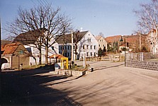
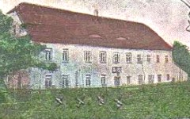
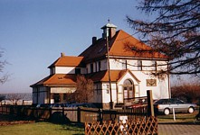

* * *

**Gemeindesiegel von Brabschütz**

* * *

Brabschütz entstand im 11./12. Jahrhundert als slawischer Rundling und wurde
1349 erstmals im Lehnsbuch Friedrich des Strengen erwähnt. Der Ortsname, der vermutlich vom Namen des Dorfgründers abgeleitet ist, wechselte mehrfach von
Praczschicz über Bratschitz und Preczsch zu Prabschütz, bevor am 8. August 1905 die heute gültige Schreibweise für verbindlich erklärt wurde. Brabschütz
gehörte ursprünglich als Lehen der Familie Podemitz bzw. zum Gauernitzer Rittergut, bevor der Ort 1547 unmittelbares Dresdner Amtsdorf wurde. Neben der Landwirtschaft betrieben die Bewohner schon immer etwas Wein- und
Obstbau. Kirchlich war Brabschütz ab 1555 der Briesnitzer Kirche zugeordnet.

Nach 1945 schlossen sich die Bauern des Dorfes zur LPG “Zschoner Höhe” zusammen, die später der LPG
Tierproduktion “Karl Marx” angeschlossen wurde. Bereits 1950 waren die Nachbarorte Merbitz, Podemus und Rennersdorf als Ortsteile angegliedert worden. 1994 vereinigte sich Brabschütz mit Mobschatz und kam im Zuge der
Gemeindereform am 1. Januar 1999 als Stadtteil zu Dresden. Sehenswert ist der [Dorfplatz](../../../west/mobschatz/leuteritz/strassen_mobschatz/) mit zahlreichen historischen
Dreiseithöfen, welcher noch deutlich des Form des slawischen Rundlings erkennen lässt.

Gasthof Brabschütz:

Der Gasthof in der Nähe des Dorfplatzes geht in seiner Geschichte auf den Reiheschank zurück, der in Brabschütz wie in vielen Orten des Umlandes noch bis ins 19. Jahrhundert üblich war. Demnach hatte jeder Bauer abwechselnd das Recht, Bier zu brauen und an seine Nachbarn zu verkaufen. Erst 1827 entstand eine feste Schankstätte, die zunächst nur im Nebenerwerb durch den Dorfschmied bewirtschaftet wurde. Der Brabschützer Gasthof wurde deshalb später auch als Gaststätte “Zur alten Schmiede” bezeichnet. Zuletzt als Konsum-Gaststätte betrieben, schloss das Lokal nach 1990 seine Pforten und stand danach viele Jahre leer. 2016 erfolgte der Abbruch und der Bau von Einfamilienhäusern auf dem Grundstück.

Schulhaus Brabschütz:

Im Jahr 1857 schloss sich Brabschütz mit seinen Nachbarorten Leuteritz, Merbitz, Podemus und Rennersdorf zu einer Schulgemeinde zusammen, um den langen und
beschwerlichen Schulweg nach Briesnitz zu vermeiden. Für die Kinder der genannten Dörfer entstand dafür ein eigenes Schulhaus im Ort.

Nachdem dieses zu klein geworden war, entschloss man sich um 1910 für einen Neubau am Dorfausgang in Richtung Mobschatz. Nach Plänen des Architekten Franz aus Dresden und des Cossebauder Baumeisters Säurig entstand ein
moderner Bau mit zwei Klassenzimmern, Lehrerwohnung, Bibliothek und Wannenbad. Das neue Schulhaus wurde am 14. Oktober 1914 feierlich eingeweiht und wurde noch bis 1960 als
Grundschule genutzt. 1936 erhielt es sein bis heute erhaltenes Uhrtürmchen. In den 1960er Jahren richtete die Gemeinde die Räume als Verwaltungssitz und Kindergarten des Ortes ein _(Foto)_.

[_Weiterführende Literatur und Quellen_](../../../impressum/quellenverzeichnis/)

 \[ [Home](../../../index.html)\] \[ [Nord](../../../nord/)\] \[ [Nordwest](../../../nordwest/)\] \[ [Neustadt](../../../neustadt/)\] \[ [Nordost](../../../nordost/)\] \[ [West](../../../west/)\] \[ [Zentrum](../../../zentrum/)\] \[ [Südwest](../../../sudwest/)\] \[ [Süd](../../../sud/)\] \[ [Südost](../../../sudost/)\] \[ [Ost](../../../ost/)\] \[ [Register](../../../Register/register.html)\] \[ [Kontakt](../../../Kontakt/kontakt.html)\] \[ [Impressum](../../../impressum/)\]
