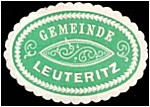
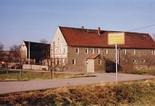
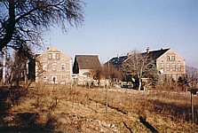

* * *

**Gemeindesiegel von Leuteritz**

Leuteritz entstand vermutlich im 10./11. Jahrhundrt als kleiner slawischer Rundling an der Schlucht des Lieschkenwassers. Die Ortsfluren wurden später mehrfach durch Rodungen erweitert. Die Siedlung gehörte
ursprünglich zum Burgward Woz (Niederwartha) und wurde 1071 erstmals in einer Urkunde des Bischofs Benno erwähnt. Der Name “Luderowice”  (= Leuteritz) geht wahrscheinlich auf den Ortsgründer zurück. Noch 1575 lebte
ein Hans Leuderwicz im Dorf.

Die Besitzverhältnisse des
Ortes wechselten mehrfach. 1468 besaß Georg von Taubenheim die Erbgerichtsbarkeit über Leuteritz, welches als Beilehen des Wilsdruffer Rittergutes bezeichnet wurde. Kirchlich unterstand Leuteritz der
Briesnitzer Kirche. Nach Auflösung des bischöflichen Amtes Briesnitz kam das Dorf an das Dresdner Ostravorwerk, später an das Amt Dresden. Lehnsherren
waren jedoch auch weiterhin die Besitzer des Wilsdruffer Rittergutes, seit dem 16. Jahrhundert die Herren von Schönberg. Infolge einer komplizierten
Erbteilung innerhalb dieser Familie gehörte Leuteritz ab 1691 gemeinsam mit Teilen des Nachbarortes Steinbach zum Rittergut Maxen bei Pirna. Erst die
Reformen des 19. Jahrhundert beendeten diese Zersplitterung und brachten Leuteritz 1839 den Status einer Landgemeinde. Die Bewohner des Ortes lebten vorrangig von der Landwirtschaft und vom Obstanbau; in geringerem
Umfang wurde auch Weinbau betrieben.

Ab 1857 bildete Leuteritz gemeinsam mit Brabschütz eine Schulgemeinde, für die ein zentrales Schulhaus in
Brabschütz entstand. Wenig später entstand nördlich des Ortes eine Ziegelei, die noch nach dem Ersten Weltkrieg in Betrieb war.
Etwas abseits vom Dorfkern liegt der Ortsteil Neuleuteritz, der sich seit Ende des 19. Jahrhunderts um die frühere Ausflugsgaststätte [“Albrechtshöhe”](../../../west/cossebaude/strassen_cossebaude/) entwickelte.

Auch nach 1945 blieb Leuteritz, welches nur ca. 200 Einwohner besaß,
zunächst selbstständig. Im Zusammenhang mit einer Gemeindereform in der DDR wurde die Gemeinde 1970 geteilt. Der Ortsteil Neuleuteritz wurde nach Cossebaude eingegliedert, während das Dorf Alt-Leuteritz als Ortsteil zu
Brabschütz kam. Im Zuge der Eingemeindungen im Dresdner Umland wurden beide Gemeindeteile 1997 bzw. 1999 Ortsteile der Landeshauptstadt. Im Dorfkern, der noch deutlich die Züge eines slawischen Rundlings erkennen
lässt, sind einige Bauernhöfe erhalten.

## [Leuteritzer Straßen](../../../west/mobschatz/leuteritz/strassen_mobschatz/)

[_Weiterführende Literatur und Quellen_](../../../impressum/quellenverzeichnis/)

 \[ [Home](../../../index.html)\] \[ [Nord](../../../nord/)\] \[ [Nordwest](../../../nordwest/)\] \[ [Neustadt](../../../neustadt/)\] \[ [Nordost](../../../nordost/)\] \[ [West](../../../west/)\] \[ [Zentrum](../../../zentrum/)\] \[ [Südwest](../../../sudwest/)\] \[ [Süd](../../../sud/)\] \[ [Südost](../../../sudost/)\] \[ [Ost](../../../ost/)\] \[ [Register](../../../Register/register.html)\] \[ [Kontakt](../../../Kontakt/kontakt.html)\] \[ [Impressum](../../../impressum/)\]
