* * *

Der Dorfplatz bildet mit seinen Gehöften den Kern des Ortes und lässt noch deutlich die Form des slawischen Rundlings erkennen. Im Zuge der deutschen Landnahme wurde er später in östlicher Richtung erweitert. Die Drei- bzw. Vierseithöfe entstanden nach dem großen Dorfbrand von 1816 und stehen heute unter Denkmalschutz. Bemerkenswert ist vor allem der Vierseithof Altmobschatz Nr. 1, der sich seit 1550 ununterbrochen im Besitz der Bauernfamilie Kürbis befand. Auch dieses Gut brannte 1816 ab und wurde bis 1818 in heutiger Form wiederaufgebaut. Neben der historischen Toreinfahrt sind auch noch einige Inschriftentafeln an der Fassade erhalten geblieben. Im Zusammenhang mit der Eingemeindung des Ortes 1999 erfolgte 2001 die Umbenennung des seit 1911 offiziell so benannten Dorfplatzes in Altmobschatz.

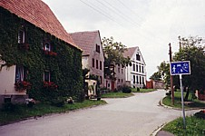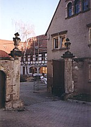

**_Fotos:_** _Altmobschatz, rechts die Hofeinfahrt zum Bauerngut Kürbis (Nr. 1)_

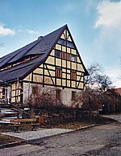
Seit der Eingemeindung des Ortes trägt der frühere Dorfplatz von Podemus, eine von der Podemuser Hauptstraße abzweigende kurze Sackgasse, offiziell den Namen Altpodemus. Auch
hier sind noch mehrere historische Gebäude erhalten geblieben, unter Denkmalschutz stehen die Bauernhäuser Altpodemus Nr. 1 und 3 _(Foto)_.

Die steile und kurvenreiche Straße Am Berg verbindet Mobschatz mit dem Elbtal und wurde Ende des 19. Jahrhunderts ausgebaut. Ab 1911 hieß sie bis zur Eingemeindung des Ortes Bergstraße und wurde erst 2001 umbenannt. Um 1900 entstanden hier zahlreiche Villen für wohlhabende Zuzügler.

Die Straße Am Hang wurde nach 1900 angelegt und nach ihrer Lage am Elbtalhang benannt. Zugleich bildet sie die Grenze der Mobschatzer Gemarkung zu den Nachbarstadtteilen Stetzsch und Gohlis. Ab 1926 entstanden hier einige Siedlungshäuser.In einem dieser Häuser befand sich vor 1945 das beliebte Café “Himmelreich”.

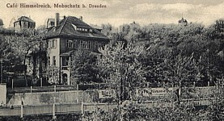

**_Foto:_** _Das frühere Café Himmelreich auf einer historischen Ansicht von 1920_

Der erst nach der Eingemeindung offiziell benannte Wirtschaftsweg Am Rausch zweigt westlich des Brabschützer Ortskerns
von der Oberlandstraße ab und führt zu den nördlich des Dorfes gelegenen Feldern, bevor er an der Ortsgrenze zu Cossebaude in den Friedhofsweg übergeht. Seinen Namen erhielt er nach einem alten Flurnamen.

Die heutige Straße Am Tummelsgrund wurde erst nach 1990 angelegt und nach einem alten Flurnamen benannt. Bereits
zwischen 1927 und 1933 war jedoch der nördliche Teil der heutigen Elbhangstraße von der Flurgrenze zu Cossebaude bis zur Straße Am Berg als Tummelsgrund bezeichnet worden. Im Mittelalter gab es westlich von Mobschatz eine kleine
Siedlung Domlitz, welche jedoch zur Wüstung wurde. Im Laufe der Zeit wandelte sich dieser Name zu Tummelse und ging später auf die wenigen Häuser am heutigen Daheimweg über. Die Freifläche zwischen dem alten Dorfkern und der
Villensiedlung wurde ab 1993 mit einer neuen Wohnsiedlung bebaut.

Die Straße war ursprünglich Teil des alten Merbitz - Mobschatzer Kommunikationsweges. Durch den Autobahnbau wurde
die Verbindung 1935 unterbrochen, woraufhin der verbliebene kurze Straßenteil den Namen An der Autobahn erhielt. Unweit davon führt eine Brücke über die Autobahntrasse, von der sich ein interessanter Blick über die Stadt bietet.

Der Buschweg führt vom alten Dorfkern von Mobschatz oberhalb des Leuteritzer Grundes bis zum Nachbarort
Alt-Leuteritz. 1888 wurde hier ein Wasserhochbehälter zur besseren Versorgung des Ortes angelegt. Ein Teil des Weges
wurde früher auch als Weinbergsweg bezeichnt. Reste der einstigen Weinbergsanlagen, die zu den ältesten im Cossebauder
Gebiet gehören, sind noch erhalten geblieben. Der Weinbau war bis ins 19. Jahrhundert neben dem Obstanbau wichtige Erwerbsquelle der Einwohner.

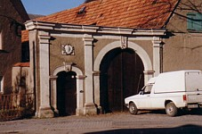Sehenswert ist der gut erhaltene Dorfplatz von Brabschütz mit einem kleinen Teich,
der noch deutlich die Form des Rundlings slawischer Herkunft erkennen lässt. Die heutige Namensgebung wurde offiziell erst nach der Eingemeindung des Ortes
eingeführt. Bemerkenswert sind die Gehöfte Nr. 2, 4, 6, 7 und 9, an denen sich teilweise verschiedene Inschriften erhalten haben. Das Gut Nr. 8 war bereits seit
1630 im Besitz der Familie Kürbis, die zu den ältesten Bauernfamilien der Umgebung gehört. Interessant ist auch das unter Denkmalschutz stehende Gut Nr. 10 mit großem Hoftor und Wappenstein von 1790 _(Foto)_.

Die Elbhangstraße entstand 2001 durch die Zusammenlegung der früheren Cossebauder Straße und der Ernst-Thälmann-Straße. Die Verbindungsstraße nach Cossebaude wurde 1906/07 angelegt und mit Ein- und Mehrfamilienhäusern bebaut. Nach dem Ersten Weltkrieg beschloss man die amtliche Namensgebung als Cossebauder Straße, welche erstmals 1925 im Adressbuch nachweisbar ist. Zwischen 1927 und 1933 wurden die Häuser der Straße Am Tummelsgrund zugeordnet. 1934 erfolgte eine Umbenennung in Adolf-Hitler-Straße, 1945 die Rückbenennung in Cossebauder Straße.

Die nach 1945 Ernst-Thälmann-Straße genannte Hauptstraße des Ortes trug im 19. Jahrhundert den Namen Mobschatz - Merbitzer Kommunikationsweg. Später wurde sie im Ortszentrum als Hauptstraße, im südlichen Abschnitt ab 1933 als Merbitzer Straße bezeichnet. 1945 erfolgte die Vereinigung beider Abschnitte und ihre Umbenennung nach dem deutschen KPD-Chef Ernst-Thälmann. Im Zuge der Eingemeindung hob man diese Namensgebung auf Beschluss des Dresdner Stadtrates auf und entschied sich für den neuen Namen Elbhangstraße. An der Flurgrenze geht sie über in die Oberlandstraße, die über Merbitz weiter bis nach Brabschütz führt.

Gasthof Mobschatz: Ein Gasthof ist in Mobschatz bereits 1726 auf einer alten Poststraßenkarte verzeichnet, in der Mobschatz als “ein Dorff, da nur Bauernhäuser” mit einer “schlechten Schencke” verzeichnet ist. Ursprünglich wurde der Schankbetrieb im Nebenerwerb betrieben und befand sich im Gut Nr. 13, welches zugleich als Dorfschmiede diente. Der heutige Gasthof entstand 1897/98 und war bereits vor dem Ersten Weltkrieg als Veranstaltungslokal für Vereinsfeiern, Bälle und Theateraufführungen beliebt. Nach der Besitzerfamilie wurde er zu dieser Zeit “Döhnerts Gasthof” genannt. Im hinteren Teil befand sich damals mit dem "Feensaal" ein Saalgebäude, welches nach 1945 wegen Baufälligkeit abgerissen wurde. Die Gaststätte selbst ist bis heute geöffnet.

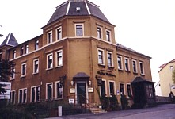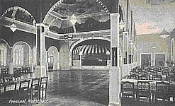

_Fotos: Gasthof Mobschatz - rechts der frühere Saal auf einer historischen Ansicht_

Der Weg bildete früher die Verbindung zwischen Mobschatz und der Briesnitzer Kirche. Da er von den Bewohnern regelmäßig zum Besuch der Messe genutzt wurde, erhielt er
den Namen Mobschatzer Meßweg. 1886 erfolgte im unteren Teil der Ausbau zur Straße, welche seit 1897 Merbitzer Straße genannt wird. Der auf Mobschatzer Flur gelegene Teil ist in heutigen Stadtplänen als Kirchenweg eingetragen.

Die Straße Lößnitzblick, direkt am Elbhang gelegen, erhielt ihren Namen nach dem Blick auf die gegenüberliegenden Lößnitzhänge in Radebeul. Sie wurde 1926/27 angelegt und mit Siedlungshäusern bebaut.

Die Straße wurde als Lutherstraße 1911 auf dem Gelände der stillgelegten Mobschatzer Ziegelei angelegt. Bis zum Beginn
des Ersten Weltkrieges entstand hier eine Villenkolonie. 1919 erfolgte eine Verlängerung der Straße bis zur Bergstraße und die Bebauung
der verbliebenen Freiflächen bis 1925. Um Verwechslungen mit der gleichnamigen Straße in Dresden vorzubeugen, wurde die Straße 2001 in Martin-Luther-Ring umbenannt.

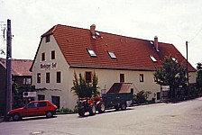
Die Straße verbindet die Gehöfte des alten Dorfkerns von Merbitz und erhielt ihren Namen Merbitzer Ring erst nach 1990. Fast alle der noch erhaltenen Dreiseithöfe
stehen unter Denkmalschutz.  Zu den interessantesten Gehöften gehören das Bauerngut Große (Nr. 2), in dem 1830 der Pfarrer und Verleger Karl Ernst Richter
Unterschlupf fand, und der Hof  Nr. 9 mit einer Erinnerungstafel an den früheren Weinbau. Auch an anderen Gebäuden im Ort haben sich historische Inschriften und
Türschlusssteine erhalten. Das 1843 erbaute Gut Nr. 11 beherbergt heute das Landhotel “Merbitzer Hof” _(Foto)_.

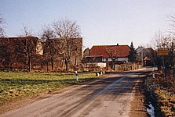Die Oberlandstraße bildet die Verbindungsstraße zwischen Brabschütz, Leuteritz und
Mobschatz und ist Teil des alten Bischofsweges, welcher über die Merbitzer Straße weiter nach Briesnitz führte und dort durch die “Eiserne Furt” die Elbe querte. Seinen
heutigen Namen erhielt dieser Straßenabschnitt erst nach der Eingemeindung 1999.

Zu den historischen Gebäuden an der Oberlandstraße gehören der alte Brabschützer [Gasthof “Zur Alten Schmiede”](../../../../west/mobschatz/brabschutz/) (Nr. 1) und das Schulhaus des Ortes (Nr. 6).

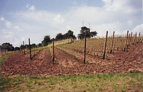
Der Ockerwitzer Weg verbindet den Merbitzer Dorfkern mit dem benachbarten Ockerwitz und führt dabei durch den Zschonergrund, wo er in der Nähe der [Zschonermühle](../../../../west/kemnitz/zschonergrund/zschonermuhle/) auf den Talweg trifft und von dort steil hinauf zum Dorfplatz von
Ockerwitz führt. An den zum Zschonergrund weisenden Hängen hat sich noch ein alter Bauernweinberg erhalten, der zu den ältesten Anlagen seiner Art im Dresdner
Raum gehört. Das erhaltene Weinbergshäuschen mit Eingangsportal stammt von 1794 und steht ebenso wie die Sandsteinmauern und die Anlage selbst unter Denkmalschutz.

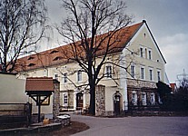Den Namen Podemuser Ring trägt die östlich und südlich um den alten Dorfkern
herumführende Straße, während der westliche Abschnitt Podemuser Hauptstraße genannt. wird. Bis heute haben sich hier einige historische Bauernhöfe erhalten. Größtes Gehöft des Ortes ist der Vierseithof Podemuser Ring 1 _(Foto)_
, dessen Geschichte bis ins 11. Jahrhundert zurückreicht. Die Gutswirtschaft befindet sich seit 1991 wieder in Privatbesitz und wird unter dem Namen [Vorwerk Podemus](../../../../west/mobschatz/podemus/) für den ökologischen
Landbau genutzt. Unter Denkmalschutz stehen auch der Dreiseithof Nr. 3 und das Wohnstallhaus Podemuser Ring 3.

Als Rennersdorfer Hauptstraße wird seit der Eingemeindung des Ortes nach Dresden die alte Hauptstraße des Ortes
bezeichnet. Zuvor trug sie den Namen Brabschützer Straße. Bis heute blieben hier mehrere Bauernhöfe erhalten. Im Haus
Rennersdorfer Hauptstraße 8 befand sich einst der Dorfgasthof, welcher auch “Gasthof zur Silbertalsperre” genannt wurde. Das Gebäude entstand 1851 und wurde um 1900 umgebaut. Heute dient es Wohnzwecken.

Die Schützenstraße zweigt westlich des Brabschützer Ortskerns von der Oberlandstraße ab und verbindet diese mit der [Lotzebachstraße](../../../../west/oberwartha/strassen_oberwartha/lotzebachstrasse/) nach Cossebaude. Ihren Namen verdankt sie dem hier gelegenen Schießplatz des Mobschatzer
Schützenvereins.

Sowohl die Straßenbezeichnung Stauseeweg als auch der benachbarte Silbergrundweg erinnern an das frühere [Silbergrundtal](../../../../west/mobschatz/rennersdorf/), welches 1928 zugunsten des Oberen Stausees Oberwartha für das [Pumpspeicherwerk Niederwartha](../../../../west/niederwartha/pumpspeicherwerk/) geflutet wurde. Die Drei- und Vierseithöfe Stauseeweg 1, 2, 4 und 5 gehören zum alten Rennersdorfer Dorfkern und
stammen in heutiger Form aus dem 19. Jahrhundert.

Der Ziegeleiweg führt vom Alt-Leuteritzer Dorfkern in nördlicher Richtung nach Cossebaude, wo er in den Grünen Weg
übergeht. Seinen Namen verdankt er der einst hier gelegenen Leuteritzer Ziegelei. Ursprünglich gab es an diesem Standort
das bereits im Mittelalter untergegangene Dorf Domlitz, dessen Name in den Bezeichnungen “Tümmelse” für die Siedlung am Daheimweg und in der Flurbezeichnung Tummelsgrund weiterlebt.

* * *

 \[ [Home](../../../../index.html)\] \[ [Nord](../../../../nord/)\] \[ [Nordwest](../../../../nordwest/)\] \[ [Neustadt](../../../../neustadt/)\] \[ [Nordost](../../../../nordost/)\] \[ [West](../../../../west/)\] \[ [Zentrum](../../../../zentrum/)\] \[ [Südwest](../../../../sudwest/)\] \[ [Süd](../../../../sud/)\] \[ [Südost](../../../../sudost/)\] \[ [Ost](../../../../ost/)\] \[ [Register](../../../../Register/register.html)\] \[ [Kontakt](../../../../Kontakt/kontakt.html)\] \[ [Impressum](../../../../impressum/)\]
