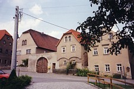
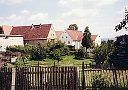
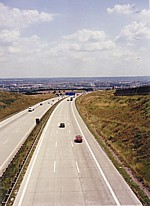
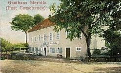
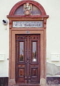
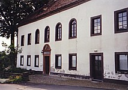

* * *

**Gemeindesiegel von Merbitz**

Merbitz entstand im 10. Jahrhundert als slawischer Rundling und bestand
ursprünglich aus nur drei Gehöften, die sich um einen Dorfteich gruppierten. Später kamen durch Erbteilungen weitere Bauernhöfe hinzu, wodurch sich die
heutige Ortsstruktur herausbildete. In einer Schenkungsurkunde an das St.-Afra-Kloster in Meißen vom 24. Juli 1332 wurde Merbitz als “Merenwicz” erstmals erwähnt. Der Name leitet sich vermutlich vom altsorbischen
Personennamen Miran ab. 1378 gehörte Merbitz zum größeren Teil dem St.-Afra-Kloster, zum kleineren Teil der Dresdner Bürgerfamilie Busmann. Diese
Zweiteilung des Ortes blieb bis ins 19. Jahrhundert bestehen und führte für die betroffenen Einwohner zu deutlichen Unterschieden bei der Besteuerung und den Dienstpflichten.

Die Zinsrechte der Familie Busmann in Merbitz kamen 1429 an das Dresdner Maternihospital, nachdem die Familie ein
Vermächtnis zugunsten der wohltätigen Einrichtung veranlasst hatten. Die Besitzer der drei Güter waren von allen
Frondiensten und der Geschosszahlung befreit, was wiederholt zu Auseinandersetzungen mit dem Eigentümer des
größeren Dorfteils führte.  Diese 9 1/2 Hufen waren 1445 in den Besitz des auf Scharfenberg ansässigen Dietrich von
Miltitz gelangt, der den Bewohnern neue Frondienste und Verpflichtungen auferlegte. Infolge finanzieller Probleme
musste einer seiner Nachfolger 1580 Merbitz und sechs weitere Dörfer an den Kurfürsten verkaufen. Die Merbitzer Einwohner unterstanden nun direkt dem Amt Dresden,
was sich für die Entwicklung des Ortes als sehr vorteilhaft erwies. Schrittweise wurden die verschiedenen Dienstpflichten nun durch Geldzahlungen abgelöst.

Haupterwerbszweig der Bewohner von Merbitz war neben der Landwirtschaft der
Obst- und Weinanbau. Noch heute hat sich oberhalb des Zschonergrundes ein alter Bauernweinberg erhalten, der zu den ältesten Anlagen seiner Art im Dresdner
Umland gehört. Das erhaltene Weinbergshäuschen mit Eingangsportal stammt von 1794. Zur Erweiterung der Anbauflächen ließen die Merbitzer Bauern seit dem
17\. Jahrhundert die Hänge des Zschonergrundes abholzen und mit Obstbäumen bepflanzen. Ein Erlass August des Starken aus dem Jahr 1700 förderte den Obstbau durch zahlreiche Neuanpflanzungen.

1815 wurden sieben Güter des Ortes bei einem Brand zerstört, jedoch schon bald wieder aufgebaut. Zu den Bewohnern des Dorfes gehörte 1830 der aus Zwickau stammenden Pfarrer Karl Ernst Richter, der als Herausgeber der
einzigen unabhängigen regierungskritischen Zeitung “Biene” zu den Wegbereitern der bürgerlichen Reformen in Sachsen
gehörte. Richter nahm nach dem Verbot seiner Zeitung für einige Monate im Merbitzer Gut Nr. 2 Unterschlupf und
wanderte 1837 nach Amerika aus. An seinen Aufenthalt erinnert eine Gedenktafel. Die von Richter mit angeregten
Reformen führten bis 1852 zur Ablösung aller noch bestehenden Dienst- und Dienstersatzpflichten der Bewohner.
Merbitz bildete nun eine selbstständige Landgemeinde, die von einem Gemeindevorstand verwaltet wurde. 1857 schloss sich der Ort der Schulgemeinde Brabschütz an, womit der Schulweg nach Briesnitz bzw. Podemus entfiel.

Auch unter den neuen Rahmenbedingungen blieb der Ort
wichtige Obstbaugemeinde. Noch in den Jahren vor dem Ersten Weltkrieg weilten alljährlich unzählige Erntehelfer aus ganz Deutschland in Merbitz und den umliegenden Dörfern, um hier bei der Kirschenernte zu
helfen. Der Transport der Ware erfolgte meist per Leiterwagen ins Elbtal, wo das Obst dann mit Dampfschiff oder Eisenbahn in die Markthallen nach Dresden gebracht wurde. In der
Baumblütezeit waren die Fluren rund um den Ort beliebtes Ausflugsziel der Dresdner, welche von hier auch einen herrlichen Fernblick über das Elbtal genießen konnten. Erst durch den
Bau der Autobahn im Jahr 1935/36 wurden die landschaftlichen Reize beeinträchtigt.

**_Foto:_** _Blick von der Merbitzer Brücke in Richtung Stadt_

Merbitz wurde 1950 als Ortsteil nach Brabschütz eingemeindet, mit dem bereits zuvor enge Verbindungen bestanden. 1993 kam der Ort zur Gemeinde Mobschatz und wurde am 1. Januar 1999 Teil der
Landeshauptstadt. Nach 1990 wurde am Ortsrand ein neues Gewerbegebiet erschlossen, in dem sich einige kleinere
Unternehmen ansiedelten. Im alten Ortskern sind noch zahlreiche Bauernhöfe aus dem 18. und 19. Jahrhundert erhalten.

Gasthof Merbitz:

Der Merbitzer Gasthof
befindet sich abseits des Dorfkerns an der Straße nach Briesnitz und ist aus dem Reiheschank hervorgegangen. Das Gebäude entstand in heutiger Form 1848 für den Gastwirt und Gutsbesitzer Sohrmann und besitzt
ein interessantes, farblich gestaltetes Eingangsportal. Um 1900 wurde der Gasthof umgebaut und erweitert, wobei sich
unter den Dielenbalken ein vermutlich aus der Zeit des Siebenjährigen Krieges stammendes Gewehr fand. Der Merbitzer Gasthof war vor dem Zweiten Weltkrieg wichtiger Versammlungsort regionaler Vereine, darunter des 1867
gegründeten Landwirtschaftlichen Vereines für Merbitz und Umgegend. Nach 1990 wurde das Lokal geschlossen.

[_Weiterführende Literatur und Quellen_](../../../impressum/quellenverzeichnis/)

 \[ [Home](../../../index.html)\] \[ [Nord](../../../nord/)\] \[ [Nordwest](../../../nordwest/)\] \[ [Neustadt](../../../neustadt/)\] \[ [Nordost](../../../nordost/)\] \[ [West](../../../west/)\] \[ [Zentrum](../../../zentrum/)\] \[ [Südwest](../../../sudwest/)\] \[ [Süd](../../../sud/)\] \[ [Südost](../../../sudost/)\] \[ [Ost](../../../ost/)\] \[ [Register](../../../Register/register.html)\] \[ [Kontakt](../../../Kontakt/kontakt.html)\] \[ [Impressum](../../../impressum/)\]
