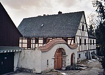
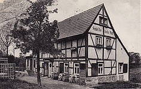
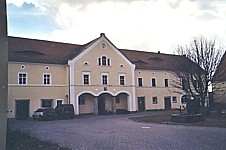

* * *

**Gemeindesiegel von Podemus**

* * *

[**Die Homepage**\
\
**von Podemus**](http://www.podemus.de)

1349 wurde erstmals ein Diezmann von Podemiz erwähnt, der in diesem Jahr den
Ort Brabschütz vom Markgrafen zum Lehen erhielt. Dieses Dokument ist zugleich “Geburtsurkunde” des kleinen Dorfes Podemus, welches im Laufe der Jahrhunderte vielfach seinen Namen wechselte. Über Podemuz (1405) und
Bodenitz (1551) entwickelte sich bis zum Beginn des 19. Jahrhunderts die Schreibweise zu Boderitz (1827), bevor im Jahr 1905 Podemus als einzige offizielle Bezeichnung festgelegt wurde. Der Name ist wahrscheinlich eine
Zusammensetzung der slawischen Worte “pod” und “moch”, was “unterhalb der Niederung” bedeutet und auf die Lage des Dorfes hinweist. Möglich ist jedoch auch die Ableitung vom Namen des Sippenältesten bzw. Dorfgründers.

1405 belehnte Markgraf Wilhelm den Meißner Weihbischof Nikolaus mit Dorf und Vorwerk Podemus, welches nun mehrfach seinen Besitzer wechselte.
Es waren in der Regel hohe Kirchenbeamte, die in Podemus zinsberechtigt waren. Im Zusammenhang mit diesen Besitzerwechseln ist 1406 erstmals von einem “bomgarthe” die Rede, was auf die
Bedeutung des Obstbaus als wichtigsten Wirtschaftszweig hinweist. Nach der Reformation wurde Podemus dem Prokuraturamt Meißen unterstellt, dem die Verwaltung des gesamten früheren Stiftsbesitzes unterstand. Die
Obergerichte gehörten ab 1559 dem kurfürstlichen Amt Dresden.

Podemus blieb bis in jüngste Vergangenheit ein Bauerndorf mit bedeutendem Obst- und Gartenbau. Außerdem bestanden früher einige Weinberge. Unterhalb des Dorfes liegt die [Zschonermühle](../../../west/kemnitz/zschonergrund/zschonermuhle/), die sich im 19. Jahrhundert zu
einem beliebten Ausflugsziel entwickelte. Ein weiteres bekanntes Lokal ist die aus dem früheren Dorfgasthof hervorgegangene historische Schänke [“Hotel de bücke dich”](../../../west/mobschatz/podemus/hotel_de_bucke_dich/) _(Foto)_. 1839 entstand in Podemus eine eigene Schule, die auch
von den Kindern der Nachbardörfer besucht wurde. Erst 1857 wurde diese nach Brabschütz verlegt. Das Dorf  mit seinen ca. 200 Einwohnern wurde 1950 nach Brabschütz eingemeindet und kam mit diesem 1994 zu Mobschatz.
Seit 1999 ist auch Podemus Ortsteil von Dresden.

Im Dorfkern haben sich noch einige historische Gebäude erhalten. Neben dem Gasthof “Hotel de bücke dich” gehören
dazu die ehemalige Schmiede, das alte Schulhaus und das frühere Vorwerk. Die Schmiede (Altpodemus 1) gehörte einst als Zubehör zur Zschonermühle, woran noch das Müllerwappen über dem Eingang erinnert. Außerdem ist eine
eingemauerte Kanonenkugel und eine Inschrift von 1875 zu sehen. Die frühere Schule (Nr. 3) wurde 1858 zum Wohnhaus umgebaut. Bemerkenswert ist auch der aus dem früheren Vorwerk hervorgegangene Vierseithof Podemuser
Ring 1 von 1793. Die historische [Scheunenwindmühle](../../../west/mobschatz/podemus/scheunenwindmuhle/) wurde 1974 abgebaut und ist heute im Freilichtmuseum Saalow
in Brandenburg zu sehen.

Vorwerk Podemus:

Das Vorwerk Podemus geht auf eine bereits im 11. Jahrhundert erwähnte
Gutswirtschaft zurück, welche sich bis zur Reformation im Besitz des Meißner Domkapitels befand. Das nach der Reformation in bäuerliche Hände gelangte
Gut wurde 1793 in seiner heutigen Form als Vierseithof neu aufgebaut. Bis zur zwangsweisen Eingliederung in die LPG “Karl Marx” im Jahr 1960 gehörte es
der Familie Probst. Diese erhielt ihr Eigentum 1991 zurück und ließ die stark verfallenenen Gebäude schrittweise sanieren. Heute dient das Gut auf dem
Podemuser Ring 1 unter dem Namen  “Vorwerk Podemus” als Mustergut für ökologischen Landbau mit eigenem Getreide- und Feldfruchtanbau,
Viehwirtschaft und Fleischerei. Im Hofladen können neben eigenen auch die Bio-Produkte weiterer sächsischer Anbieter erworben werden. Außerdem finden für Interessenten regelmäßige Führungen statt.

[_Weiterführende Literatur und Quellen_](../../../impressum/quellenverzeichnis/)
