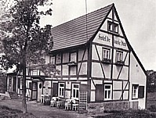

* * *

Der Gasthof mit dem kuriosen Namen “Hotel de bücke dich” ging aus dem früheren Dorfgasthof des Ortes Podemus hervor. Ursprünglich gehörte das Haus einem Hufschmied, der den Bierausschank im Nebenerwerb
betrieb. Am 6. August 1813 soll Napoleon mit seinem General Vandamme den kleinen Gasthof besucht haben, bevor er weiter zum Schlachtfeld auf der Räcknitzhöhe zog. Wegen der niedrigen Eingangstür der Schänke soll er in
diesem Zusammenhang von einem “Hotel de bücke dich” gesprochen haben. Spätere Besitzer des Gasthofes verwendeten diese Legende zu Werbezwecken, obwohl weder der Ausspruch noch der Besuch Napoleons historisch nachweisbar
sind.

Die Gaststätte diente um 1900 zugleich als Poststelle des Ortes. In den 1920er Jahren wurde sie auch “Herrmanns Gasthaus” genannt. Später folgten mehrfach Erweiterungen der historischen G
ebäude, bei denen der Besitzer auch einige Fremdenzimmer eingerichtete. Nach jahrelanger Schließung wurde das “Hotel de bücke dich” 1990 wieder eröffnet. In
der Gaststube sind zahlreiche historische Zeugnisse aus der Napoleonzeit sowie Dokumente zur Geschichte des Ortes Podemus und seiner Umgebung zu sehen.

* * *

 \[ [Home](../../../../index.html)\] \[ [Nord](../../../../nord/)\] \[ [Nordwest](../../../../nordwest/)\] \[ [Neustadt](../../../../neustadt/)\] \[ [Nordost](../../../../nordost/)\] \[ [West](../../../../west/)\] \[ [Zentrum](../../../../zentrum/)\] \[ [Südwest](../../../../sudwest/)\] \[ [Süd](../../../../sud/)\] \[ [Südost](../../../../sudost/)\] \[ [Ost](../../../../ost/)\] \[ [Register](../../../../Register/register.html)\] \[ [Kontakt](../../../../Kontakt/kontakt.html)\] \[ [Impressum](../../../../impressum/)\]
