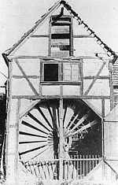

* * *

* * *

* * *

* * *

* * *

* * *

Zu den ungewöhnlichsten Gebäuden des Dorfes Podemus gehörte bis zu ihrer Umsetzung
1974 die Scheunenwindmühle, eine Spezialkonstruktion einer Windmühle, bei der der Wind über zwei zu öffnende Scheunentore direkt durch das Gebäude hindurchströmte und dadurch
das Mahlwerk antrieb. Diese hölzerne Windturbine war in ihrer Art weltweit einmalig und entstand im 19. Jahrhundert.

Die Scheunenwindmühle wurde 1864 vom Podemuser Bauern Johann Traugott Leberecht
Schubert (1820-1889) errichtet, der sich neben der Bewirtschaftung seines Hofes auch mit handwerklich-technischen Dingen befasste. Da Schubert selbst keine Konzession für den
Betrieb einer Windmühle besaß, baute er eine ungenutzte Scheune auf seinem Grundstück um. An beiden Seiten befanden sich große Tore, welche für den Betrieb geöffnet wurden. Diese
dienten zugleich zum Einleiten der einströmenden Luft, welche im Inneren zwei Windräder mit einem Durchmesser von 4,70 Meter bzw. 3,85 Meter antrieb. Das eigentliche Mahlwerk
befand sich im Obergeschoss des Fachwerkgebäudes. 1914 erfolgte eine Umstellung der Scheunenwindmühle auf elektrischen Betrieb. Erst 1957 wurde die Mühle endgültig stillgelegt.

Das in der Folgezeit vernachlässigte und verfallende Gebäude musste 1974 abgerissen
werden. Dabei konnten wichtige Bauteile geborgen und die Mühle dokumentiert werden. Diese erhielten offiziell den Status eines Denkmals der Produktionsgeschichte, blieben jedoch
zunächst im Depot des Museums für Volkskunst in Dresden. 1992-93 erfolgte in Saalow bei Luckenwalde (Brandenburg) der Wiederaufbau der Scheunenwindmühle, welche dort seit 1995
besichtigt werden kann. Gepflegt und betrieben wird die Mühle durch den Verein „Scheunenwindmühle Saalow e. V.“, welcher im Inneren auch ein kleines Museum einrichtete.
Am ursprünglichen Standort in Podemus befindet sich seit einigen Jahren eine kleine Gedenktafel.

**_Foto:_** _Die Podemuser Scheunenwindmühle an ihrem heutigen Platz in Saalow_
