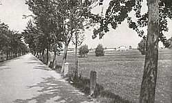
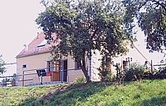
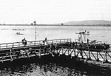

* * *

Das Gebiet um Niederwartha war bereits im 7. Jahrhundert von Slawen besiedelt, die in der Nähe des Ortes einen in Kriegszeiten als Zufluchtsort genutzten Burgwall anlegten. Die Anlage, in alten Urkunden “Gvozdez” bzw. “Woz” genannt (slawisch für “Bergwald”), war einst  Mittelpunkt eines Burgwardbezirkes, zu dem u. a. die Dörfer Leuteritz, Mobschatz und Cossebaude gehörten. Dieser frühgeschichtlichen Wehranlage verdankt das 1205 erstmals urkundlich erwähnte Niederwartha auch seinen Namen. Der Ortsname geht zurück auf das althochdeutsche „warta“ und bedeutet „Siedlung,von der aus gelauert und ausgeschaut wird“.

Mit der Eroberung des Meißner Landes durch Deutsche und der Errichtung des Burgwards Briesnitz verlor Niederwartha an Bedeutung und blieb bis in die jüngere Vergangenheit ein kleines Bauerndorf, dessen Bewohner bevorzugt von der Viehhaltung und vom Obstbau lebten. 1390 sind ein Vorwerk, eine Mühle am Tännichtbach sowie fünf kleine bäuerliche Wirtschaften erwähnt. 1466 kam der Ort in den Besitz der Herren von Saalhausen, die die benachbarte Siedlung Gruna in die Niederwarthaer Flur einbezogen. Einen Teil der Flächen erwarben Bauern aus Naundorf am gegenüberliegenden Elbufer. Gemeinsam mit den 1519 von der Gemeinde Kötzschenbroda gekauften [Weiherwiesen](../../west/niederwartha/weiherwiesen/) bildeten diese bis 1954 eine Radebeuler Enklave. Bereits um 1485 soll sich in Niederwartha auch ein Fährübergang befunden haben. Hinzu kamen drei Mühlen sowie der Gasthof an der Landstraße nach Meißen. Zum Schutz vor Hochwasser legten die Bewohner zwischen 1765 und 1790 am Elbufer Dämme an.

1875 erhielt Niederwartha Eisenbahnanschluss an die Bahnstrecke [Dresden-Berlin](../../zentrum/friedrichstadt/dresden_-_berlin/), wofür eine [Elbbrücke](../../west/niederwartha/niederwarthaer_elbbrucke/) entstand. Die verbesserten Verkehrsbedingungen und eine wenig später eingerichtete Dampferanlegestelle trugen dazu bei, dass der Ort am Ausgang des romantischen [Tännichtgrundes](../../west/oberwartha/tannichtgrund/) zu einem beliebten Ausflugsziel der Dresdner Bevölkerung wurde. Zeiweise gab es hier eine kleine Künstlerkolonie, außerdem siedelten sich Beamte und Pensionäre in den neuerbauten Wohnhäusern an. 1927 errichtete die Energieversorgung Groß-Dresden AG das bis heute in Betrieb befindliche [Pumpspeicherwerk](../../west/niederwartha/pumpspeicherwerk/) Niederwartha mit oberem und unterem Stausee. In diesem Zusammenhang entstand eine weitere kleine Siedlung, die vorrangig von Angestellten des Kraftwerkes bewohnt wurde.

1945 blieb Niederwartha von größeren Kriegsschäden verschont. Lediglich die Eisenbahnbrücke fiel in den letzten
Kriegstagen der Sprengung zum Opfer, konnte jedoch bald wieder repariert werden. Durch den Zuzug von Flüchtlingen
wuchs die Einwohnerzahl des kleinen Ortes zeitweise auf über 1000 an, ging jedoch in den 1960er und 70er Jahren
wieder deutlich zurück. Seit 1974 gehört Niederwartha zu Cossebaude und kam mit diesem gemeinsam am 1. Juli 1997
zu Dresden. In den letzten Jahren entstanden einige Neubauten am Burgberg, 2006-12 eine neue Straßenbrücke über die Elbe.
Am Elbufer befindet sich mit 101 m ü. NN der tiefstgelegene Punkt Dresdens.

1998 verstarb in Niederwartha der letzte deutsche Freiherr Harry Götz von Schaumberg (1907-1998). Die Familie
gehörte zum alten Thüringer Landadel und war später im Raum Gera ansässig. Eine interessante private Homepage über die Geschichte der Familie von Schaumberg findet sich hier: [www.von-schaumberg.net](http://www.von-schaumberg.net).

Elbfähre:

Die Niederwarthaer Fähre gehört zu den ältesten verbürgten Elbübergängen der Region und wurde bereits 1397 erstmals genannt. In diesem Jahr erwarb
die Dresdner Familie Kundige den Ort mit seiner Schankwirtschaft, zu deren Rechten auch der Fährbetrieb gehörte. Bis ins 19. Jahrhundert verblieb die
Fährgerechtigkeit bei diesem Brauschänkengut, wodurch die Gasthofsbesitzer zugleich auch Inhaber der Elbfähre waren. 1828 führte die Gerichtsbarkeit
Weistropp als Eigentümer der Fähre feste Tarife und geregelte Fährzeiten ein. Veränderte Verkehrsbedürfnisse führten 1865 zu einer geplanten Verlegung
der Fährstelle nach Niedergohlis, welche jedoch nicht zustande kam. Erst die Fertigstellung der Elbbrücke brachte 1877 schließlich die Einstellung des Betriebs. Die Fährkähne wurden daraufhin
nach Kötzschenbroda verkauft.

Zu einem Wiederaufleben des Fährverkehrs kam es 1945, da die Brücke infolge ihrer Sprengung durch abrückende
Wehrmachtssoldaten nicht mehr zur Verfügung stand. Am 21. Dezember wurde dieser durch den Scharfenberger Fährmeister König aufgenommen. Bis 1973 gab es
nun in Niederwartha wieder eine Personenfähre. Heute erinnert nur noch das historische Fährhaus von 1765 an deren Geschichte _(Foto)_. Das Gebäude diente einst als Unterkunft der
Fährmeisterfamilie, danach noch bis 1995 als Wohnhaus. Heute gibt es hier eine kleine Gaststätte mit Biergarten.

Stauseebad Cossebaude:

Das am 23. Juni 1936 eröffnete Stauseebad befindet sich am Ufer des unteren
Stausees des Pumpspeicherwerkes und ist zweitgrößtes Dresdner Freibad. Es entstand im Auftrag der Gemeinde Cossebaude unmittelbar am Staudamm auf
einem eigens für diesen Zweck erworbenen Grundstück. Bereits 1935 wurde ein ca. 500.000 m² großer Bereich für Schwimmer freigegeben. Hinzu kamen ein
Kinderplanschbecken, Kantine, Wasserrutschbahn und die notwendigen sanitären Einrichtungen. Außerdem konnte ein Teil des Stausees als Gondelteich genutzt
werden. Für Nichtschwimmer gab es ein ca. 10 x 20 m großes Floß als “schwimmendes Badebassin” _(Foto)_. Diese seinerzeit in Deutschland einmalige
Konstruktion entstand in der Dresdner Firma Eisenbau Karl Ladwig und ruhte auf neun Schwimmkörpern, welche einen
versenkbaren Lattenkasten trugen. Somit war eine variable Wassertiefe von 60 bis 120 cm möglich. Erreicht werden konnte das Becken über einen hölzernen Steg. Nachteilig war jedoch der große Aufwand für den alljährlich
erforderlichen Auf- und Abbau, weshalb das Becken seit den 60er Jahren nicht mehr genutzt wurde.

In den 1960er und 70er Jahren erfolgten verschiedene Modernisierungen des Stauseebades.
1972 entstand ein neues Nichtschwimmerbecken außerhalb des eigentlichen Staubeckens. Außerdem wurden weitere Einstiegstreppen am
Damm geschaffen und die vorhandene Liegewiese erweitert. Zum Bad gehören heute auch eine 86 Meter lange Wasserrutsche und verschiedene Sport- und Spielplätze. Außerdem existiert ein kleiner FKK-Bereich. 2001/02 wurde
mit der Sanierung des Freibades begonnen. Wenig später entstanden beim Elbehochwasser im August 2002 große Schäden, was eine erneute Komplettsanierung erforderlich machte. Diese endete 2004 mit dem Bau eines neuen
Kassenbereichs und moderner Umkleidekabinen. Seit 2013 gehört das Stauseebad zur Städtischen Bäder GmbH.

Stauseebad cossebaude/niederwartha meißner straße 26 - 01156 dresden tel. 0351/4537555

Kleditschgrundbach:

Der in der Nähe von Weistropp entspringende Kleditschgrundbach ist westlichster linkselbischer Zufluss im Stadtgebiet.
Über weite Strecken seines Verlaufs bildet er zugleich die Dresdner Stadtgrenze und mündet in der Nähe von Niederwartha in die Elbe. Seine Gesamtlänge beträgt ca. 1,74 Kilometer. Der Kleditzschgrund gehört zum
Landschaftschutzgebiet "Elbtal zwischen Dresden und Meißen“ und ist noch weitgehend naturbelassen. Unweit des Gewässers befindet sich die „Politische Buche“, ein unter Naturschutz stehender 25 Meter hoher Baum mit
Schnitzereien am Stamm, welche an politische Auseinandersetzungen zwischen den Parteien vor 1933 und nach 1945 erinnern.

## [Niederwarthaer Straßen](../../west/niederwartha/strassen_niederwartha/)

[_Weiterführende Literatur und Quellen_](../../impressum/quellenverzeichnis/)

 \[ [Home](../../index.html)\] \[ [Nord](../../nord/)\] \[ [Nordwest](../../nordwest/)\] \[ [Neustadt](../../neustadt/)\] \[ [Nordost](../../nordost/)\] \[ [West](../../west/)\] \[ [Zentrum](../../zentrum/)\] \[ [Südwest](../../sudwest/)\] \[ [Süd](../../sud/)\]
 \[ [Südost](../../sudost/)\] \[ [Ost](../../ost/)\] \[ [Register](../../Register/register.html)\] \[ [Kontakt](../../Kontakt/kontakt.html)\] \[ [Impressum](../../impressum/)\]
