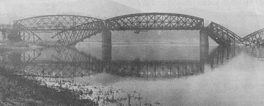
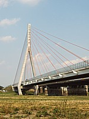

* * *

* * *

Eisenbahnbrücke:

Die erste Niederwarthaer Elbbrücke entstand 1873/74 im Zusammenhang mit dem Bau der [Eisenbahnstrecke Dresden - Berlin](../../../zentrum/friedrichstadt/dresden_-_berlin/) und diente vorrangig dem Eisenbahnverkehr. Außerdem gab es einen schmalen Fuß- und Fahrweg. Zwanzig Jahre später erfolgte eine Erweiterung des Bauwerks, um die Bahnstrecke zweigleisig ausbauen zu können. Kurz vor Kriegsende sprengten abziehende deutsche Truppen am 8. Mai 1945 das Bauwerk, welches wenig später am 31. Juli 1945 beim Versuch, es mit einem sowjetischen Militärtransport zu befahren, einstürzte. Zuvor hatten russische Soldaten die deutschen Eisenbahner gezwungen, das Bauwerk trotz bestehender Streckensperrung zu überqueren.

**_Foto:_** _Die Niederwarthaer Brücke kurz nach Ihrer Sprengung 1945_

Wenige Monate später konnte die Elbbrücke notdürftig wieder hergestellt werden und war ab August 1945 wieder für
Fußgänger nutzbar. Am 13. April 1946 konnte schließlich auch der Eisenbahnverkehr wieder aufgenommen werden. Da dieses Provisorium in den 1970er Jahren jedoch nicht mehr dem stark angewachsenen Verkehrsaufkommen
genügte, entschloss man sich 1977 zu einem kompletten Neubau. Bis 1983 entstand auf den elf alten Pfeilern die noch
heute erhaltene 346 Meter lange Brücke, die neben den Gleisanlagen auch einen kombinierten Fuß- und Radweg besitzt.

Straßenbrücke:

Im Frühjahr 2006 wurde in unmittelbarer Nachbarschaft der Eisenbahnbrücke mit dem
Neubau einer modernen Straßenbrücke begonnen. Die offizielle Grundsteinlegung erfolgte am 13. Juni 2006. Das Bauwerk ist Teil der neuen Staatsstraße S 84 zwischen Coswig und
Cossebaude und wird von einem 77 Meter hohen Pylon mit 36 Seilen getragen. Die Gesamtlänge der ersten Schrägseilbrücke Sachsens beträgt 366 Meter (davon 192 Meter
Spannweite). Hinzu kommen zwei Zufahrtsbrücken auf  Niederwarthaer und Radebeuler Seite von 138 bzw. 112 Metern Länge. Die  Brücke dient ausschließlich dem Autoverkehr,
besitzt zwei  Fahrbahnen und soll künftig zu einer Verbesserung der Verkehrsbedingungen vor allem im Raum Coswig/Radebeul beitragen. Obwohl die neue Brücke bereits 2009
fertig gestellt war, verzögerte sich die Übergabe wegen fehlender Zufahrten um über zwei Jahre. Die feierliche Einweihung des Bauwerks erfolgte am 12. Dezember 2011.

* * *

 \[ [Nord](../../../nord/)\] \[ [Nordwest](../../../nordwest/)\] \[ [Neustadt](../../../neustadt/)\] \[ [Nordost](../../../nordost/)\]
 \[ [West](../../../west/)\] \[ [Zentrum](../../../zentrum/)\] \[ [Südwest](../../../sudwest/)\] \[ [Süd](../../../sud/)\] \[ [Südost](../../../sudost/)\] \[ [Ost](../../../ost/)\] \[ [Register](../../../Register/register.html)\] \[ [Kontakt](../../../Kontakt/kontakt.html)\] \[ [Impressum](../../../impressum/)\]
