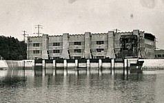
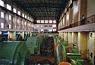
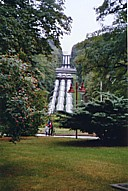
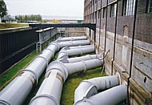
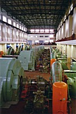

* * *

* * *

Das Niederwarthaer Pumpspeicherwerk wurde 1927 gegen den Protest der umliegenden Gemeinden durch die Energieversorgung Groß-Dresden AG gebaut. Ziel des neuen Kraftwerkes war die Gewinnung zusätzlicher Elektroenergie in Spitzenzeiten, während die lastschwachen Zeiten zur Umwälzung des Wassers genutzt werden. Für das Pumpspeicherwerk entstanden der obere und untere Stausee, die mittels gewaltiger Rohrleitungen verbunden sind. Am unteren Stausee wurden das Turbinenhaus und ein Verwaltungsgebäude im Bauhausstil errichtet. Architekten waren Emil Högg und Kurt Beyer. Das Niederwarthaer Pumpspeicherwerk ging am 27. November 1929 noch vor seiner vollständigen Fertigstellung in Betrieb und war erstes leistungsfähiges Wasserkraftwerk seiner Art in der Welt.

 1946 erfolgte im Zusammenhang mit Reparationsforderungen der Sowjetunion eine Demontage der Kraftwerksanlagen, so dass das Werk vorerst stillgelegt werden musste. Erst 1954 konnten die technischen Anlagen soweit wiederhergestellt werden, das das Pumpspeicherwerk wieder in Betrieb ging. Zwischen 1958 und 1960 erfolgte eine Erweiterung bis zu einer maximalen Kapazität von 120 MW. Das Werk stellt ein einzigartiges technisches Denkmal der Elektroerzeugung dar und gehört heute zum schwedischen Energiekonzern Vattenfall Europe. Wirtschaftliche Überlegungen führten Ende 2015 zur Stillegung, so dass das Pumpspeicherwerk seit 1. Januar 2016 nur noch im Übergangsbetrieb als Bedarfsreserve erhalten wird. Der untere Stausee wird zugleich als [Freibad](../../../west/niederwartha/) genutzt.

Technische Daten:

**Stauraum des Oberbeckens**

**2,9 Mio m³**

**Anzahl Maschinensätze**

**6**

**Stauraum des Unterbeckens**

**2,5 Mio m³**

**Turbinen-Bauart**

**Francis-Turbine**

**Höhenlage des Oberbeckens**

**254 m NN**

**Turbinen-Nenndurchfluss**

**18 m³/s**

**Höhenlage des Unterbeckens**

**110 m NN**

**Pumpen-Bauart**

**einstufige Kreiselpumpe**

**Arbeitsvermögen**

**591 MWh**

**Pumpen-Nennförderstrom**

**11 m³/s**

**Generatorleistung**

**31,5 MVA**

**Rohrsystem**

**3 Rohrleitungen**

**Generatorspannung**

**10,5 kV**

**Länge**

**1.920 m**

**Leistung (Turbinenbetrieb)**

**20 MW**

**Durchmesser**

**2,5 bis 3,5 m**

**Leistung (Pumpbetrieb)**

**20 MW**

**Mittlere Fallhöhe**

**143 m**

**Gesamtnennleistung**

**120 MW**

**_Fotos:_** _Rohrleitungssystem zwischen Ober- und Niederwartha,_

_rechts ein Blick in die Turbinenhalle_

* * *

 \[ [Home](../../../index.html)\] \[ [Nord](../../../nord/)\] \[ [Nordwest](../../../nordwest/)\] \[ [Neustadt](../../../neustadt/)\] \[ [Nordost](../../../nordost/)\] \[ [West](../../../west/)\] \[ [Zentrum](../../../zentrum/)\] \[ [Südwest](../../../sudwest/)\] \[ [Süd](../../../sud/)\] \[ [Südost](../../../sudost/)\] \[ [Ost](../../../ost/)\] \[ [Register](../../../Register/register.html)\] \[ [Kontakt](../../../Kontakt/kontakt.html)\] \[ [Impressum](../../../impressum/)\]
