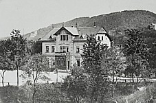
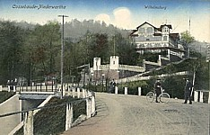
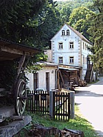
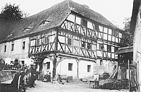
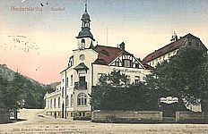

Der Straßenname Am Burgberg erinnert an den einst hier gelegenen Burgward “Gwosdez” bzw. “Woz”, welchem
Niederwartha seine Existenz und auch seinen Namen verdankt. Die Anlage entstand vermutlich im 7./8. Jahrhundert und
diente der slawischen Bevölkerung als Zufluchtsort in Kriegszeiten. Heute sind von der Anlage nur geringe Reste sichtbar.

Markantestes Bauwerk der kleinen Straße Am Fährhaus sind die Gebäude des [Pumpspeicherwerkes](../../../west/niederwartha/pumpspeicherwerk/), das hier 1927/28 errichtet wurde. Ihren Namen verdankt sie dem alten Niederwarthaer [Fährhaus](../../../west/niederwartha/) von 1765, welches heute als Gaststätte am Elberadweg dient. Der Fährbetrieb selbst wurde bereits 1877 nach Einweihung der Elbbrücke bzw. nach seiner Wiederaufnahme in der Nachkriegszeit 1973 eingestellt. Kurz nach Eröffnung der Brücke entstand auf dem Grundstück Am Fährhaus 2 das Gasthaus "Bahnschlösschen". Heute dient das nach 1945 geschlossene Lokal als Wohnhaus _(Foto)_. Noch bis 1954 gehörte das Areal am Fährhaus zur Stadt Radebeul am gegenüberliegenden Elbufer, da sich hier einst die Kötzschenbrodaer [Weiherwiesen](../../../west/niederwartha/weiherwiesen/) befanden.

Die Friedrich-August-Straße wurde Ende des 19. Jahrhunderts zur Erschließung eines neuen Wohngebietes oberhalb der
Meißner Straße angelegt. Das Straßenbild prägen bis heute Villen und Landhäuser aus der Zeit vor dem Ersten Weltkrieg. Zahlreiche Gebäude stehen unter Denkmalschutz. Ihren Namen erhielt die Straße nach dem letzten sächsischen König
Friedrich August III (1865-1932), der bis zur Revolution von 1918 das Land regierte.

Wilhelmsburg: Das traditionsreiche Ausflugslokal wurde 1895 vom Cossebauder Tischlermeister Karl Hohnstein eingerichtet, der sich für die Namensgebung sogar eine Genehmigung des Kaisers aus Berlin beschaffte. Das Haus besaß neben Gasträumen und einem Kaffeegarten einen Tanzsaal im Obergeschoss, der nach 1945 jedoch zu Wohnzwecken umgebaut wurde. An der unteren Grenze des Grundstücks ließ Hohnstein den Nachbau einer mittelalterlichen Burgmauer mit Zinnen und Türmen errichten. Dieser fiel später dem Bau des Pumpspeicherwerks zum Opfer. Außerdem gab es einen Waldspielplatz im nahen Amselgrund. Vor allem zur Zeit der Baumblüte erfreute sich die “Wilhelmsburg” großer Beliebtheit.

Auch nach 1945 wurde der Gastronomiebetrieb noch bis 1999 weitergeführt, zeitweise unter dem “unpolitischen” Namen HO-Gaststätte “Am Stausee”. 2007 übernahmen neue Besitzer das Haus und eröffneten das Lokal wieder unter seinem ursprünglichen Namen “Wilhelmsburg”. 2012 wurde das Hotel jedoch geschlossen und soll künftig als Kinderheim genutzt werden.

Der Straßenname Grunaweg erinnert an das einst selbständige Dorf Gruna, welches im 14. Jahrhundert in den Besitz der
Herren von Saalhausen kam und dadurch mit Niederwartha vereinigt wurde. Am Grunaweg haben sich noch zwei Gehöfte aus der dörflichen Vergangenheit des Ortes erhalten. Beide Höfe (Grunaweg 1 und 3) stehen unter Denkmalschutz.

Die Hermann-Große-Straße im alten Dorfkern Niederwarthas verdankt ihren Namen dem früheren Gemeindevorstand des
Ortes Hermann Große (1848-1928), der sich sehr für die Belange seines Heimatortes engagierte.

Als Meißner Straße wird der auf Cossebauder und Niederwarthaer Flur verlaufende Straßenabschnitt der Bundesstraße 6
nach Meißen zwischen Hauptstraße und Stadtgrenze bezeichnet. Im Zusammenhang mit dem Bau der neuen Straßenbrücke nach Radebeul erfolgten zwischen 2006 und 2012 umfangreiche Ausbauarbeiten an dieser Straße. Um die Ortsdurchfahrt
zu entlasten, ist jedoch künftig eine Verlegung der Straße parallel zur Eisenbahnstrecke geplant.

Zu den bemerkenswerten Gebäuden an der Meißner Straße gehören
die unter Denkmalschutz stehenden Wohnhäuser Nr. 2, 18, 20 sowie das Doppelhaus Nr. 43/45. Im Haus Meißner Straße 35 hatte einst die Ortsbehörde Niederwarthas ihren Sitz.

Die Oberwarthaer Straße verbindet das im Elbtal gelegene Niederwartha mit dem Nachbarort Oberwartha und führt in
steilen Serpentinen den Elbhang hinauf. Bemerkenswertestes Gebäude ist das sogenannte “russische Landhaus” (Oberwarthaer Str. 4).

Die Tännichtgrundstraße führt vom Ortszentrum zum Eingang in das Tal des [Tännichtgrundbaches](../../../west/oberwartha/tannichtgrund/), dem sie auch Ihren
Namen verdankt. An der Einmündung zur Weistropper Straße weist eine historische Wegsäule auf bestehende alte Verkehrsverbindungen nach Weistropp und Oberwartha hin.

Tännichtgrundmühle: Die früher auch Obermühle bzw. nach ihrem Besitzer Appeltmühle genannte Sägemühle am Ende der Tännichtgrundstraße wurde 1842 durch den Gutsbesitzer
Johann Gottlieb Fehrmann als Mahl- und Schneidemühle erbaut. Die Wasserversorgung des neun Meter großen Wasserrades erfolgte über einen eigens angelegten Mühlteich, der einen
kontinuierlicheren Betrieb ermöglichte. Angeschlossen war auch eine Bäckerei.

Während der Mahl- und Backbetrieb bereits im 19. Jahrhundert wieder eingestellt wurde, blieb
die Sägemühle bis zur Gegenwart in Betrieb, wird heute jedoch nur noch gelegentlich und elektrisch betrieben zur Brennholherstellung genutzt. Das Hauptgebäude dient
Wohnzwecken. Am Damm des Mühlteiches im Tännichtgrund erinnert ein Mühlenmodell an das einstige Aussehen der Tännichtgrundmühle.

Die Weistropper Straße wurde um 1900 als Staatsstraße zwischen Wilsdruff und der Fährstelle Niederwartha angelegt und
erhielt ihren Namen nach dem benachbarten Ort Weistropp, heute ein Ortsteil der Gemeinde Klipphausen. Historische Baudenkmale sind der Gasthof Niederwartha an der Einmündung in die Meißner Straße, die frühere Reibigmühle (Nr. 1/3)
sowie mehrere Bauernhöfe (Weistropper Straße 4, 6 und 10).

Reibigmühle: Die Wassermühle im alten Ortskern von Niederwartha wurde 1397
erstmals urkundlich erwähnt, als Markgraf Wilhelm von Meißen den Brüdern Hans und Friedrich Kundige die Dörfer Wildberg und Niederwartha zum Lehen gab. Ab
1535 befand sie sich für zwei Jahrhunderte im Besitz der Familie Ryssel und wurde deshalb auch Rysselmühle genannt _(Foto)_. 1894 erfolgte im Auftrag des neuen
Eigentümers Max Tittel ein umfassender Umbau zur Mühle mit angeschlossener Bäckerei. 1927 übernahm die Müllerfamilie Reibig das Anwesen und betrieb die Mühle noch bis 1960. Das Nebengebäude (Nr. 3) wurde noch bis 1971 als
Bäckereiverkaufsstelle genutzt. Heute dient die ehemalige Mühle als Wohnhaus, das Nebengebäude wurde 2014 wegen Baufälligkeit abgetragen..

Gasthof Niederwartha: Zu den ältesten Grundstücken Niederwarthas gehört der bereits 1397 erstmals genannte Gasthof an der Landstraße nach Meißen. Neben der Schankgerechtigkeit besaß dieser auch das Recht zum Betreiben einer Fähre, damals einzige Flußquerung zwischen Dresden und Meißen. Im 19. Jahrhundert gewann der nun meist als "Brauschänkengut" bezeichnete Gasthof Bedeutung als Ausflugslokal und wurde kurz vor der Jahrhundertwende deutlich vergrößert.

1945 quartierten sich hier russische Soldaten ein, womit der Gastwirtschaftsbetrieb vorerst endete. Erst nach 1990 konnte das Lokal wieder gastronomisch genutzt werden. Seit 1994 befindet sich in den Kellerräumen und im großen Saal die mittelalterliche Erlebnisgaststätte "Zarenkeller" (seit 2015 Prinzenkeller), im Erdgeschoss ein italienisches Restaurant.

[Niederwartha auf OpenStreetMap](https://www.openstreetmap.org/search?query=Dresden+Niederwartha)

* * *

 \[ [Home](../../../index.html)\] \[ [Nord](../../../nord/)\] \[ [Nordwest](../../../nordwest/)\] \[ [Neustadt](../../../neustadt/)\] \[ [Nordost](../../../nordost/)\] \[ [West](../../../west/)\] \[ [Zentrum](../../../zentrum/)\] \[ [Südwest](../../../sudwest/)\] \[ [Süd](../../../sud/)\] \[ [Südost](../../../sudost/)\] \[ [Ost](../../../ost/)\] \[ [Register](../../../Register/register.html)\] \[ [Kontakt](../../../Kontakt/kontakt.html)\] \[ [Impressum](../../../impressum/)\]
