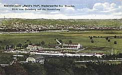

* * *

* * *

* * *

Die sogenannten Weiherwiesen bilden einen Ortsteil von Niederwartha und befinden sich unmittelbar am Elbufer. Noch bis 1954 gehörten sie als
einziger linkselbischer Teil zu Radebeul. Im Jahr 1519 hatte die Gemeinde Kötzschenbroda ca. 43 Hektar Elbwiesen erworben. Diese sollten vorrangig für die Gewinnung von Heu und als Weideland dienen, da in Kötzschenbroda
selbst zu wenig für die Weidewirtschaft geeignete Flächen zur Verfügung standen. Das jenseits der Elbe gewonnene Heu wurde mit Hilfe einer Kahnfähre in den Ort transportiert und dort in für eine Verfütterung in den
Wintermonaten eingelagert.

Mit der Auflösung des kleinen Dorfes Gruna und dessen Eingliederung nach Niederwartha wurde ein Teil der Grunaer Ortsflur
an Bauern aus Naundorf, heute ebenfalls ein Ortsteil von Radebeul, verkauft. Insgesamt kamen so ca. 10 Hektar Wiese, unmittelbar westlich an die Weiherwiesen
angrenzend, zu Naundorf. Da sowohl die Weiherwiesen als auch die Naundorfer Wiesenflur unmittelbar am Elbufer lagen und deshalb stark hochwassergefährdet waren, gab es hier keine Bebauung. Lediglich das noch heute
erhaltene und als Gaststätte genutzte [Fährhaus](../../../west/niederwartha/)
wurde später als Unterkunft der Fährleute errichtet.

Mit dem Bau der
[Eisenbahnstrecke Dresden - Berlin](../../../zentrum/friedrichstadt/dresden_-_berlin/) und Errichtung der [Niederwarthaer Elbbrücke](../../../west/niederwartha/niederwarthaer_elbbrucke/) 1873/75 erwarb der Staat Teile des Areals. Wenig später entstand in der Naundorfer Enklave das Gasthaus
“Bahnschlösschen”. Im Zuge der Entwicklung der Lößnitzgemeinden zu Industrie- und Villenvororten verlor die Landwirtschaft an Bedeutung, so dass auch die Weiherwiesen nicht mehr benötigt wurden. Kötzschenbroda
verpachtete daraufhin im Ersten Weltkrieg einen Teil des Grundstücks für eine Kleintierzucht. Die auch unter dem Namen “ReidlŽs Hof” bekannte Gutswirtschaft _(Foto)_ bestand aus mehreren Gebäuden. Auch eine kleine
Gastwirtschaft gehörte dazu. Beim Bau des Niederwarthaer [Pumpspeicherwerkes](../../../west/niederwartha/pumpspeicherwerk/) musste das Grundstück geräumt werden. Heute befindet sich hier das untere Staubecken des Kraftwerkes mit dem Cossebauder Freibad.

Die Inanspruchnahme eines Großteils der früheren Weiherwiesen führte Anfang der Dreißiger Jahre bereits zu
Diskussionen im Kötzschenbrodaer Stadtrat über eine Veräußerung der linkselbischen Flächen. Im Zuge der Vereinigung des Ortes mit Radebeul 1935 lebten diese noch einmal auf, blieben jedoch letztlich erfolglos. Erst 1952
beschloss der Radebeuler Stadtrat eine Umbezirkung des Stadtteils “Am Fährhaus” an die Gemeinde Niederwartha.
Am 1. April 1954 wurde diese schließlich rechtskräftig. Nach der Eingemeindung von Niederwartha 1974 gehörte das Areal zu Cossebaude, seit 1997 zu Dresden.

* * *

 \[ [Nord](../../../nord/)\] \[ [Nordwest](../../../nordwest/)\] \[ [Neustadt](../../../neustadt/)\] \[ [Nordost](../../../nordost/)\]
 \[ [West](../../../west/)\] \[ [Zentrum](../../../zentrum/)\] \[ [Südwest](../../../sudwest/)\] \[ [Süd](../../../sud/)\] \[ [Südost](../../../sudost/)\] \[ [Ost](../../../ost/)\] \[ [Register](../../../Register/register.html)\] \[ [Kontakt](../../../Kontakt/kontakt.html)\] \[ [Impressum](../../../impressum/)\]
