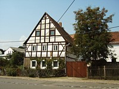
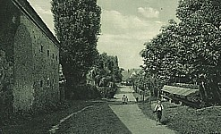
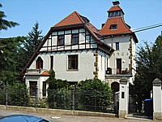
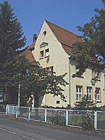

* * *

**Gemeindesiegel von Oberwartha**

Die Fluren des heutigen Stadtteils Oberwartha waren bereits in der Steinzeit besiedelt. Funde aus dieser Ära (5.000 - 8.000 v. Chr.) wurden u.a. in der Nähe der [Lochmühle](../../west/oberwartha/strassen_oberwartha/lotzebachstrasse/) und im Silbergrund bei Rennersdorf gemacht. Weitere archäologische Objekte fanden sich bei Bauarbeiten an der heutigen Karl-Liebknecht-Straße und auf dem Osterberg und weisen auf die Anwesenheit von Siedlern der Bronzezeit hin. Ihnen folgten im 6. Jahrhundert die Hermanduren, später die Slawen, auf welche vermutlich die heutige Ortsgründung zurückgeht.

Oberwartha wurde in einer Urkunde vom 24. Juli 1266 erstmals urkundlich erwähnt.
In diesem Dokument wird der Kauf eines Vorwerks mit zwei Hufen Land durch den Bischof Albert II. dokumentiert, welches er dem Domkapitel zu Meißen übereignete.
Die Meißner Bischöfe waren auch Begründer des Weinbaus um Cossebaude, der neben der Landwirtschaft wichtigster Wirtschaftszweig der Region war. Zu den
ältesten Lagen gehört die bis 1492 auf Oberwarthaer, heute auf  Cossebauder Flur gelegene “Liebenecke”. Wein wurde jedoch auch an den Steilhängen des Lotzebachtals, am [Tännichtgrund](../../west/oberwartha/tannichtgrund/) und am Osterberg angebaut. Die Namensgebung des Ortes weist auf eine früher hier vorhandene Befestigungsanlage (Warte) hin,
welche sich oberhalb des “Katzensprungs” und der Talstraße befunden haben könnte. Denkbar ist jedoch auch ein Bezug zum Burgward “Woz” oberhalb des Nachbarortes Niederwartha.

Im Mittelpunkt der Ansiedlung stand das [Brauschänkengut](../../west/oberwartha/klostergut/) (Klostergut), ein bischöfliches Vorwerk mit größerem
Landbesitz. Dieses hatte Bischof Albert II. vom Meißner Hospital bzw. dem Adligen Conrad von Boritz erworben und
1266 “zu seinem Seelenheil und dem Gedächtnis zweier Verstorbener” dem Domkapitel zu Meißen übereignet. In Folge
dessen blieb Oberwartha fast 250 Jahre lang im Besitz kirchlicher Würdenträger. Erst 1501 wurden die Fluren des Gutes an die Dorfbewohner aufgeteilt, wobei diese im Gegenzug zur Leistung von Abgaben und Frondiensten
verpflichtet wurden. Das Brauschänkengut selbst befand sich nun im Besitz verschiedener Pächter und Eigentümer, blieb jedoch immer wirtschaftlicher Mittelpunkt des kleinen Ortes.

Auch von kriegerischen Ereignissen blieb Oberwartha nicht verschont. 1618
drangen kroatische Söldner ins Dorf ein, was zu Plünderungen und Brandschatzungen führte. Erst mit dem im benachbarten Cossebaude verhandelten und in Kötzschenbroda unterzeichneten Friedensvertrag von
1645 endete für Sachsen der Dreißigjährige Krieg. In diesem Zusammenhang fand am Poetenweg in einem früheren Steinbruch ein Bitt- und Dankgottesdienst statt, dessen Tradition bis zur Gegenwart mit einem
alljährlichen Berggottesdienst fortgesetzt wird. 1731 vernichtete ein durch Blitzschlag entstandener Brand mehrere Oberwarthaer Gehöfte.  Im
Siebenjährigen Krieg 1756 bis 1763 mussten die Einwohner Geld- und Lebensmittel für die hier einquartierten Truppen des preußischen Oberst Graf von Donhoff zur Verfügung stellen.

1818 erhielt das Oberwarthaer Brauschenkengut mit Johann Georg Voigt einen
neuen Besitzer. Fortan lenkten  nun bürgerliche Familien die Geschicke der Gutswirtschaft. Von diesen war der Dresdner Kaufmann Fritz Arndt für die
Entwicklung des Ortes von Bedeutung. Der aus einer gutbürgerlichen und kunstsinnigen Dresdner Familie stammende Unternehmer hatte das Anwesen 1885
mit nur 29 Jahren erworben und begann mit der grundlegenden Umgestaltung der Gutswirtschaft. So ließ er die vorhandenen Gebäude im Neorenaissancestil umbauen
und bezeichnete diese fortan als “Klosterhof”. In der Landwirtschaft  führte er neuartige Dünge- und Meliorationsverfahren ein, legte Kleinfelder zu größeren
Flächen zusammen und setzte sich für eine Verbesserung der dörflichen Infrastruktur ein. Zugleich förderte er die
Bebauung der Oberwarthaer Ortsflur mit Villen, um damit den Zuzug wohlhabender Kreise zu ermöglichen. In diesem Zusammenhang entwickelte sich nach 1900 eine Villenkolonie an den Elbhängen rund um die [Dorotheenstraße](../../west/oberwartha/strassen_oberwartha/) _(Foto)_.
1914 entstand mit dem “Presseheim” ein kleines Kurhaus, welches u. a. von König Friedrich August III. besucht wurde.
Das frühere Bauerndorf wurde so immer stärker zum Dresdner Wohnvorort. Zur besseren Erschließung des Gebietes war 1912 sogar der Bau einer Zahnradbahn zwischen Oberwartha und dem Elbtal geplant, welche jedoch bedingt
durch den Ersten Weltkrieg nicht realisiert wurde.

1928 begann unweit des Ortes der Bau des oberen Stausees für das neue [Pumpspeicherwerk](../../west/niederwartha/pumpspeicherwerk/) Niederwartha, wobei der
Silbergrund geflutet wurde. Weitere Wohnhäuser entstanden in den 1920er und 1930er Jahren. Das Klostergut bestand
noch bis 1945 und wurde dann im Zuge der Bodenreform enteignet. Zuletzt diente es einer LPG als Stützpunkt. Mit seiner Sanierung wurde 2010 begonnen. 1994 kam Oberwartha als Ortsteil zu Cossebaude und wurde mit diesem
gemeinsam am 1. Juli 1997 nach Dresden eingemeindet.

Schule Oberwartha

Mit Einführung des neuen Sächsischen Schulgesetzes 1805 wurde auch für die Oberwarthaer Kinder der Schulbesuch obligatorisch. Zunächst besuchten diese die Schule im benachbarten
Cossebaude, bevor 1908 mit finanzieller Unterstützung des Klostergut-Besitzers Fritz Arndt ein eigenes Schulhaus errichtet werden konnte. Dieses befindet sich an der nach dem ersten
Leiter der Schule, dem Oberlehrer Max Schwan, benannten Max-Schwan-Straße Nr. 4. Die  Oberwarthaer Schule bestand bis 1968. Im Anschluss wurde das Gebäude bis 1993 als
Kindergarten genutzt und dient heute als Bürger- und Vereinshaus. Hier hat auch die Heimatkundliche Zentralsammlung für Oberwartha ihr Domizil. Seit 1997 erinnert an der
Fassade eine Gedenktafel an die 25 im Zweiten Weltkrieg gefallenen ehemaligen Schüler Oberwarthas.

[_Weiterführende Literatur und Quellen_](../../impressum/quellenverzeichnis/)

 \[ [Home](../../index.html)\] \[ [Nord](../../nord/)\] \[ [Nordwest](../../nordwest/)\] \[ [Neustadt](../../neustadt/)\] \[ [Nordost](../../nordost/)\] \[ [West](../../west/)\] \[ [Zentrum](../../zentrum/)\] \[ [Südwest](../../sudwest/)\] \[ [Süd](../../sud/)\]
 \[ [Südost](../../sudost/)\] \[ [Ost](../../ost/)\] \[ [Register](../../Register/register.html)\] \[ [Kontakt](../../Kontakt/kontakt.html)\] \[ [Impressum](../../impressum/)\]
