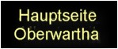
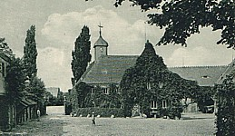
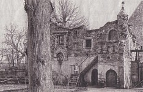
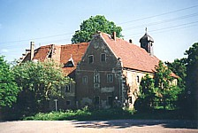
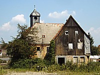

* * *

* * *

* * *

* * *

* * *

* * *

Das Klostergut Oberwartha, früher Brauschänkengut genannt, entstand vermutlich zeitgleich mit dem Ort und gehörte bis Ende des 16. Jahrhunderts zum Besitz der Meißner Bischöfe. Zwischen 1258 und 1266 hatte Bischof Albert II. das Vorwerk und mehrere Hufen Land erworben und diese dem Domkapitel übereignet. In der Folgezeit besaßen wechselnde geistliche Würdenträger Gut und Ort. Neben dem als Wohn- und Verwaltungssitz dienenden Brauschänkengut gehörten u.a. eine Schmiede, Baum- und Weingärten, Scheunen sowie die [Lochmühle](../../../west/oberwartha/strassen_oberwartha/lotzebachstrasse/) im Lotzebachtal zum Vorwerk. Von wirtschaftlicher Bedeutung war vor allem der Weinbau, an dessen einstige Bedeutung noch heute die romanischen Kelleranlagen des Klostergutes erinnern. 1495 erwarb Domdechant Ulrich von Wolffersdorf Dorf und Brauschänkengut und ließ die Oberwarthaer Fluren 1501 an die Einwohner aufteilen.Im Gegenzug mussten diese regelmäßig verschiedene Abgaben an das Domkapitel leisten und waren außerdem zu Spann- und Handdiensten verpflichtet.

1507 kam das Brauschänkengut mit der Oberwarthaer Schänke an den Lehnsherren Matthes Gansauge, der damit zugleich das Recht zum Brauen, Schlachten und Backen erwarb. Trotz wechselnder Eigentümer und Pächter blieb es jahrhundertelang Mittelpunkt eines landwirtschaftlichen Großbetriebes und war zugleich Zentrum des Ortes. Im 19. Jahrhundert folgten bürgerliche Familien als neue Eigentümer. Zunächst ab 1818 im Besitz von Johann Georg Vogt erwarb 1885 der Dresdner Kaufmann Fritz Arndt das Gut. Arndt war neben seiner beruflichen Tätigkeit zugleich Vorsitzender des Dresdner Kunstvereins und ließ die Gutsgebäude 1898 grundlegend umbauen. In diesem Zusammenhang erhielt das von ihm “Klostergut” genannte Anwesen sein heutiges Aussehen. Ganz im Geiste der Romantik entstand um das Gut ein kleiner Landschaftspark mit künstlicher Ruine _(Foto rechts)_

Um 1900 war das Klostergut Oberwartha ein Treffpunkt der Dresdner Kunstfreunde. In den Räumen hatte der Besitzer eine umfangreiche Sammlung von Gemälden, historischen Waffen und Zinngegenständen zusammen getragen. Arndt setzte sich auch für die Entwicklung des Dorfes zu einem Villenvorort ein. Neben dem Verkauf von Parzellen für den Neubau von Landhäusern ließ der Gutsbesitzer mehrere Aussichtspunkte und Wanderwege anlegen, u.a. die Ludwig-Richter-Bank oberhalb der Talstraße und die nach der Gemahlin Napoleons benannte Marie-Louis-Bank am Himmelreichweg. Die französische Kaiserin hatte Oberwartha im Jahr 1812 besucht und war vom Hegereiter Hink durch die Umgebung geführt worden.

Nach dem Freitod Fritz Arndts im Jahr 1919 fiel das Klostergut an seine Tochter Charlotte und deren Mann, den österreichischen Rittmeister Erwin Schiviz von Schivizhofen. Die Bewirtschaftung übernahmen jedoch Pächter. Das Klostergut blieb noch bis 1945 in Privatbesitz, wurde dann jedoch durch die Bodenreform enteignet. Ab 1956 nutzte eine LPG die Gebäude, welche immer mehr verfielen. Zuletzt diente das frühere Klostergut als Wohnhaus, bevor die Gebäude baupolizeilich gesperrt werden mussten. Auch nach 1990 scheiterten vorerst alle Pläne, das denkmalgeschützte Anwesen einer neuen Nutzung zuzuführen. 2010 begann der Umbau zu einer Wohnanlage.

Video: Rundgang durch das Klostergut Oberwartha

* * *

 \[ [Home](../../../index.html)\] \[ [Nord](../../../nord/)\] \[ [Nordwest](../../../nordwest/)\] \[ [Neustadt](../../../neustadt/)\] \[ [Nordost](../../../nordost/)\] \[ [West](../../../west/)\] \[ [Zentrum](../../../zentrum/)\] \[ [Südwest](../../../sudwest/)\] \[ [Süd](../../../sud/)\] \[ [Südost](../../../sudost/)\] \[ [Ost](../../../ost/)\] \[ [Register](../../../Register/register.html)\] \[ [Kontakt](../../../Kontakt/kontakt.html)\] \[ [Impressum](../../../impressum/)\]
