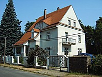
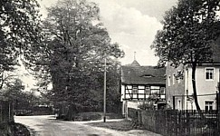
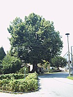
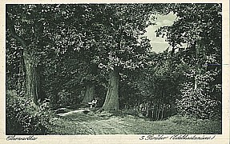
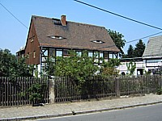
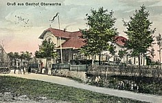
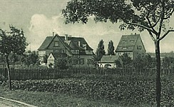
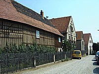
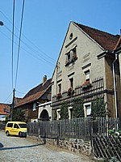
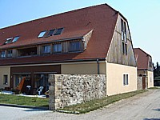

* * *

Der offiziell in den Stadtplänen nicht verzeichnete Weg von Oberwartha in Richtung Tännichtgrund wird im Volksmund als
Bierallee bezeichnet. Die historische Verkehrsverbindung war ein früher für den Biertransport vom Klostergut nach Meißen
von Bedeutung und dient heute als Wanderweg. 2011/12 erfolgte durch das Sächsische Umschulungs- und Fortbildungswerk eine umfassende Sanierung.

Die Dorotheenstraße wurde im Zusammenhang mit der Anlage eines Villenviertels am
nördlichen Ortsrand angelegt und in den Jahren vor dem Ersten Weltkrieg mit Villen und Landhäusern bebaut. Bemerkenswert sind die unter Denkmalschutz stehenden Gebäude
Nr. 7 (Landhaus Küster, heute Pension “Villa am Wald” ), Nr. 9 (Villa Hübner), Nr. 11, Nr. 17 (Haus Abendröte) und Nr. 19 (Haus Morgensonne). In der heute als Pension genutzten Villa Dorotheenstraße 15 _(Foto)_
befand sich einst das “Hygienische Erholungsheim Waldfrieden”.

Benannt ist die Dorotheenstraße nach der Tochter des Klostergutsbesitzers Fritz Arndt,
welcher sich sehr für die Entwicklung seines Wohnortes engagierte. Dorothee Arndt (1892–1980)
widmete sich künstlerischen Tätigkeiten und heiratete später ihren Zeichenlehrer, den Dresdner Maler Richard Birnstengel.

Die Friedensallee führt vom Oberwarthaer Ortskern zum benachbarten Niederwartha und ins Elbtal. Hier befindet sich auch eine Zwischenstation des [Pumpspeicherwerkes](../../../west/niederwartha/pumpspeicherwerk/)
. Vier Rohrleitungen verlaufen parallel zur Friedensallee ins Tal und verbinden den oberen und den unteren Stausee des Werks. Erstmals ist die Straße im Jahr 1921 unter dem Namen Kaiser-Wilhelm-
Allee im Adressbuch verzeichnet. Nach 1945 erfolgte die Umbenennung in Friedensallee.

Als Fritz-Arndt-Platz wird heute der frühere Dorfplatz (bis 1945 Hindenburgplatz) von Oberwartha bezeichnet. Benannt wurde er nach dem einstigen Besitzer des Klostergutes, dem Kaufmann und Kunstsammler Fritz Arndt (1856-1919). Arndt hatte die Gebäude des Brauschänkengutes 1885 erworben und umbauen lassen. Außerdem engagierte er sich für die Belange seines Wohnortes, finanzierte den Schulbau mit und setzte sich für den Ausbau des Oberwarthaer Villenviertels ein.

Markantestes Gebäude ist das Herrenhaus des [Klostergutes](../../../west/oberwartha/klostergut/), welche seine heutige Gestalt Ende des 19. Jahrhunderts erhielt. Fritz Arndt hatte dafür die einstige Brauschänke abreißen lassen und den Gutshof zu einer schlossartigen Anlage im Neorenaissancestil umgestaltet. Zum Klostergut gehörten auch ein Pferde und Schafstall, zwei Scheunen sowie ein kleiner Park mit Teich und Garten. 2010 begann der Umbau zu einer Wohnanlage.Gegenüber befindet sich ein kleinerer Zweiseitenhof (Nr. 2), der ebenfalls unter Denkmalschutz steht. Den Mittelpunkt des Platzes prägt eine ca. 400 Jahre alte Dorflinde _(Foto)_, welche einst als Gerichtslinde diente. 1922 wurde hier eine bronzene Gedenktafel für zwölf gefallene Soldaten des Ersten Weltkrieges angebracht.

Als Fuchslochweg wird ein kleiner, unbebauter Weg bezeichnet, der  in Oberwartha von der Gustav-Voigt-Straße abzweigt
und dann die unterirdisch verlaufende Röhrleitungen des Pumpspeicherwerks Niederwartha überquert. Seinen Namen erhielt er nach einer Flurbezeichnung.

Der Fünf-Brüder-Weg, welcher von der Friedensallee in Richtung [Tännichtgrund](../../../west/oberwartha/tannichtgrund/) führt, verdankt seinen Namen den “Fünf
Brüdern”, einer Gruppe von fünf oberitalienischen Esskastanien. Die als Naturdenkmal geschützten Bäume sind ca. 400 Jahre
alt. Der Sage nach sollen diese von einem Mädchen in Erinnerung an ihre fünf verstorbenen Brüder gepflanzt worden sein. Die
Männer waren beim Versuch, ihre entführte Schwester aus den Händen eines Drachen zu befreien, ums Leben gekommen.

**_Foto:_** _Die “Fünf Brüder” auf einer historischen Ansichtskarte_

Die Gustav-Voigt-Straße erinnert an den früheren Oberwarthaer Gemeindevorstand Gustav Voigt (1852–1938), der für seine Verdienste um die Entwicklung des Ortes auch die Ehrenbürgerwürde von Oberwartha erhielt.

An der Straße haben sich noch einige Wohngebäude aus der Vergangenheit des Bauerndorfes erhalten, welche in traditioneller Fachwerkbauweise errichtet sind. Unter Denkmalschutz stehen die Dreiseithöfe Gustav-Voigt-Straße 18 _(Foto)_ und 20 sowie das Wohnstallhaus des Gutshofes Nr. 24.

Gasthof Oberwartha: Der Gasthof des Ortes entstand Ende des 19. Jahrhundert im Stil eines kleinen Landhauses an der Gustav-Voigt-Straße 16. Mit seiner überdachten Terrasse und Gästegarten wurde er auch als Ausflugslokal gern besucht. Der kleine straßenseitige Anbau beherbergte eine Fleischerei. Zudem betrieb der Gastwirt Hagedorn zu Beginn des 20. Jahrhunderts in seinem Lokal die Posthilfsstelle des Ortes, bis diese am 1. Mai 1928 durch eine reguläre Poststelle abgelöst wurde. Der Gasthof wurde auch nach 1945, zuletzt unter dem Namen "Sonnenhäusel" noch bis ca. 1990 betrieben. Heute dient das Gebäude nur noch als Wohnhaus.

Die Hässige Straße führt von Oberwartha ins Tal des Lotzebaches und geht vermutlich auf einen alten Weinbergweg zurück. Bereits in der Mitte des 13. Jahrhunderts sind hier Weinberge erwähnt, welche sich von der Herrenkuppe und vom Osterberg bis zur Hässige Straße und zum Bischof-Benno-Weg hinzogen. Die Herkunft des Namens ist unklar und wurde vermutlich von einer früheren Flurbezeichnung abgeleitet. Um 1900 ist sie im Adressbuch von Cossebaude als Hassigeweg, später als Hässige (1915) bzw. Hässigestraße (1916), verzeichnet. Nach dem Zweiten Weltkrieg bürgerte sich die heutige Schreibweise ein.

Um 1900 ließ der Besitzer des Klostergutes hier einige Landhäuser errichten, so die Villen “Weinrebe” (Nr. 3) und “Waldruhe” (Nr. 4). Auch die benachbarte Villa Vera (Nr. 6) mit Stützmauern und Turmanbau steht unter Denkmalschutz.

Als Katzensprung wird ein steiler und schmaler Fußweg bezeichnet, welcher vom Ausgang der Dorfstraße (Rudolf-
Förster-Straße) hinab ins Lotzebachtal führt. In diesem Bereich vermuten Historiker den Standort einer frühgeschichtlichen Wehranlage, von der heute jedoch keine Spuren mehr erkennbar sind.

Die Liebknechtstraße verbindet Oberwartha mit dem benachbarten Cossebaude und wurde vor dem Zweiten Weltkrieg
Prinz-Friedrich-August-Straße genannt. Die heutige Bezeichnung erinnert an den sozialdemokratischen Politiker Karl
Liebknecht (1871-1919), der zu den wichtigsten Initiatoren der Novemberrevolution 1918 gehörte. Liebknecht war Führer der revolutionären Linken in der SPD und gehörte zu den Mitbegründern der KPD.

Die Max-Schwan-Straße wurde nach dem ersten Leiter der Oberwarthaer Schule,
dem Oberlehrer Max Schwan (1878–1942) benannt. Schwan gründete 1909 neben seiner beruflichen Tätigkeit einen Volksbildungsverein und setzte sich  gemeinsam mit seiner Frau Dora als Ortschronist für die Heimatpflege ein.

Am Ende der Straße befindet sich das 1908 eingeweihte frühere [Schulhaus](../../../west/oberwartha/) des Ortes (Nr. 4). Dieses diente bis 1968
seinem Zweck, wurde später u.a. als Kindergarten genutzt und ist heute Vereinshaus. Auf dem Nachbargrundstück entstand 1914 das Deutsche Presseheim, später auch als Kurhaus Oberwartha
bezeichnet. Zwischen 1927 und 1930 befand sich hier die Bauleitung für den Bau des Pumpspeicherwerkes in Niederwartha. Das Foto zeigt beide Gebäude in den Dreißiger Jahren.

Die vom Fritz-Arndt-Platz abgehende frühere Dorfstraße des Ortes trägt heute den Namen Rudolf-Förster-Straße, benannt
nach dem Oberwarthaer Bürgermeister Rudolf Förster (1885–1938). Hier haben sich noch einige Gehöfte aus der Vergangenheit des Ortes erhalten. Im sogenannten Jentzschgut (Nr. 5) befand sich nach dem Abriss der Brauschänke des
Klostergutes einige Jahre die Schänke des Dorfes.

**_Fotos:_** _Rudolf-Förster-Straße in Oberwartha_

__

Die Unkersdorfer Landstraße verbindet Oberwartha mit dem benachbarten Ort Unkersdorf und führt dabei am Oberen Stausee des Pumpspeicherwerkes vorbei, welcher auch als Badesee genutzt wird. Ungefähr dort, wo sich heute der
Wasserhochbehälter befindet, hatte einst die Oberwarthaer Windmühle ihren Standort. Die Mühle entstand 1708 und befand
sich im Besitz des Gutsbesitzers Rudolph. Als erster Betreiber ist Martin Voigt in den Urkunden verzeichnet, welcher zugleich
Müller der Lochmühle war. Ende des 19. Jahrhunderts wurde der Mahlbetrieb aufgegeben und die Mühle wenig später abgerissen. Heute erinnert noch der Flurname Windmühlenstriemen an ihre Existenz.

Der Weg Zur Schäferei erinnert an die einstige Schäferei des Klostergutes. Die teilweise unter Denkmalschutz stehenden Gebäude wurden 2010 zur Wohnanlage ausgebaut.

**_Foto:_** _Wohnanlage “Alte Schäferei”_

* * *

 \[ [Home](../../../index.html)\] \[ [Nord](../../../nord/)\] \[ [Nordwest](../../../nordwest/)\] \[ [Neustadt](../../../neustadt/)\] \[ [Nordost](../../../nordost/)\] \[ [West](../../../west/)\] \[ [Zentrum](../../../zentrum/)\] \[ [Südwest](../../../sudwest/)\] \[ [Süd](../../../sud/)\] \[ [Südost](../../../sudost/)\] \[ [Ost](../../../ost/)\] \[ [Register](../../../Register/register.html)\] \[ [Kontakt](../../../Kontakt/kontakt.html)\] \[ [Impressum](../../../impressum/)\]
