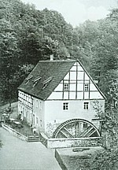
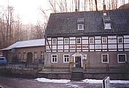

* * *

* * *

Als Lotzebachstraße wird der auf Oberwarthaer Flur liegende Abschnitt der von Brabschütz nach Cossebaude führenden Verbindungsstraße bezeichnet. Im unteren Cossebauder Teil trägt diese den Namen
Talstraße. Der namensgebende Lotzebach entspringt in einer Geländemulde in der Nähe von [Brabschütz](../../../../west/mobschatz/brabschutz/) und fließt von dort nach Cossebaude. Hier verläuft er seit dem Eisenbahnbau, teilweise verrohrt, parallel zur Bahntrasse und mündet westlich der Niederwarthaer Eisenbahnbrücke in die Elbe. Insgesamt legt der als Gewässer zweiter Ordnung eingestufte Bach dabei eine Strecke von 6,5 Kilometern zurück und nimmt dabei mehrere kleinere Gewässer, so den Rennersdorfer und den Brabschützer Dorfbach und den [Tännichtgrundbach](../../../../west/oberwartha/tannichtgrund/) auf.

Bereits im Mittelalter war das Lotzebachtal Standort mehrerer Wassermühlen, welche heute nicht mehr in
Betrieb, jedoch baulich noch erhalten sind. Im oberen Abschnitt liegt der 1929 von einem Rennersdorfer Fleischermeister zur Gewinnung von Kühleis angelegte Eisteich. Heute dient er als Zuchtanlage für Forellen.

Im Zusammenhang mit den Plänen Fritz Arndts, Oberwartha zu einem Kur- und Erholungsort zu entwickeln, entstanden Ende des 19. Jahrhunderts auch im Lotzebachtal neue Wanderwege und Ruheplätze. So gab es auf
der Höhe “Hebchen” oberhalb der Gaststätte Waldmühle die Ludwig-Richter-Bank. Die sogenannte Marie-Louis-Bank am Ausgang des Silbergrundes erinnerte an einen Besuch der Gemahlin Napoleons, Kaiserin Marie-Louis im Jahr
1812.

Lochmühle:

Die Lochmühle, früher auch Buschmühle genannt, wurde bereits um 1400 erstmals erwähnt
und gehörte als Kloster- und Lehnsmühle zum Zubehör des [Brauschänkengutes](../../../../west/oberwartha/klostergut/) Oberwartha. Als erster namentlich bekannter Besitzer ist 1509 ein Lorenz Schirmer genannt. Später
wechselten mehrfach die Betreiber. Um auch bei Niedrigwasser Getreide mahlen zu können, erteilte Kurfürst August der Starke 1709 dem Pächter der Lochmühle die Erlaubnis zum Bau
einer Windmühle „zur besseren Versorgung seiner Haushaltung“. Diese hatte ihren Standort an der von Oberwartha nach Unkersdorf führenden Landstraße. Außerdem erhielt die Lochmühle zu dieser Zeit erstmals das Schankrecht.

1715 erwarb der Besitzer der Brauschänke Johann Rudolph die Mühle, welche fortan bis Ende des 19. Jahrhunderts im Familienbesitz blieb. 1809 erfolgte der Bau des heutigen
Mühlengebäudes. Am Schlussstein über die Tür erinnern noch heute die Initialen "J G R 1809" an den Bauherren und Mühlenbesitzer Johann Gottlieb Rudolph. Im Jahr 1822 verpachtete Rudolph die
Lochmühle an den Weistropper Müllermeister Patzig. Die Mühle besaß zu diesem Zeitpunkt zwei Mahlgänge und diente zugleich auch als Bäckerei. Unter dem neuen Eigentümer Erdmann Veith wurde 1875 noch ein Schneidegang
hinzugefügt und die Lochmühle in eine Gaststätte umgewandelt.

Mit zunehmender Konkurrenz moderner Großmühlen erwies sich der Betrieb
jedoch als unwirtschaftlich, so dass er nach dem Ersten Weltkrieg eingestellt wurde. Stattdessen entwickelte sich die Lochmühle unter dem Namen
"Lochmühle Waldfrieden" zu einem beliebten Ausflugs- und Tanzlokal. Das noch erhaltene imposante Mühlrad fiel 1945 der Brennholzgewinnung zum
Opfer. Ab 1965 war die Lochmühle bis 1990 Ferienheim der Gewerkschaft des Braunkohlewerks Greifenhain, des Metallwerkes Leipzig und der Deutschen Reichsbahn _(Foto)_. Nach mehrjährigem Leerstand erfolgte 2010
der Verkauf an einen Privatmann und der Umbau zum Wohnhaus. Reste der noch vorhandenen wasserbaulichen Anlagen verschwanden nach dem Hochwasser im August 2002.

Waldmühle:

Wenige 100 Meter unterhalb der Lochmühle steht die Waldmühle, nach einem früheren Besitzer auch Ernst-August-
Mühle genannt. Die einstige Schneide- und Getreidemühle wurde um 1600 erstmals genannt. 1870 entstand ein neues
Mühlengebäude, welches nicht nur als Getreidemühle für die Dörfer des Cossebauder Oberlandes, sondern auch als Gaststätte diente.

1907 erwarb der Thekenbauer Kurt Körner das Mühlengrundstück und nutzte den vorhandenen Schneidegang für seine Produktion. 1943 erfolgte schließlich die Stilllegung der Mühle. Heute dienen die Gebäude gewerblichen
Zwecken und sind Sitz einer Firma für den Bau von Biertheken.

* * *

 \[ [Home](../../../../index.html)\] \[ [Nord](../../../../nord/)\] \[ [Nordwest](../../../../nordwest/)\] \[ [Neustadt](../../../../neustadt/)\] \[ [Nordost](../../../../nordost/)\] \[ [West](../../../../west/)\] \[ [Zentrum](../../../../zentrum/)\] \[ [Südwest](../../../../sudwest/)\] \[ [Süd](../../../../sud/)\] \[ [Südost](../../../../sudost/)\] \[ [Ost](../../../../ost/)\] \[ [Register](../../../../Register/register.html)\] \[ [Kontakt](../../../../Kontakt/kontakt.html)\] \[ [Impressum](../../../../impressum/)\]
