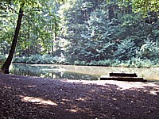

* * *

* * *

* * *

Der Tännichtgrund erstreckt sich auf Oberwarthaer und Niederwarthaer Flur und bildet zugleich die westliche Stadtgrenze Dresdens. Gebildet wird das Tal durch den Tännichtgrundbach, der ca. 300
Meter nördlich der Autobahnraststätte "Dresdner Tor" auf Kaufbacher Flur entspringt. Von dort fließt er in nördlicher Richtung und mündet in Niederwartha in den [Lotzebach](../../../west/oberwartha/strassen_oberwartha/lotzebachstrasse/). Bis heute konnte der Bach seinen natürlichen Verlauf weitgehend bewahren. Lediglich der letzte Abschnitt bis zur
Mündung in die Elbe verschwand im Zusammenhang mit dem Eisenbahnbau um 1875.

Die umliegenden Wälder des Tännichtgrundes dienten einst als Jagdrevier des sächsischen Hofes. Noch heute erinnert eine historische Jagdsäule an diese Zeit.
Solche Säulen dienten früher zur Abgrenzung der einzelnen Jagdreviere. Außerdem war das Tal einst Standort zweier Wassermühlen, von denen sich heute nur noch die untere an der Niederwarthaer [Tännichtgrundstraße](../../../west/niederwartha/strassen_niederwartha/) als Gebäude erhalten hat. Ende
des 19. Jahrhunderts entwickelte sich der Tännichtgrund zum beliebten Ausflugsziel. Vor allem der Oberwarthaer Klostergutsbesitzer Fritz Arndt setzte sich für den
Ausbau von Wegen und Aussichtspunkten in der Umgebung seines Heimatortes ein. Am Himmelfahrtstag 1929 wurde ihm zu Ehren an der Gertrud-Quelle am
Poetenweg ein Gedenkstein aufgestellt. Die Finanzierung des Denkmals übernahm der Verschönerungsverein Cossebaude und der Volksbildungsverein Oberwartha. Die Gertrud-Quelle selbst verdankt ihren Namen Gertrud
Arndt, der Ehefrau des Gutsbesitzers.

Steinbruch: Zur Gewinnung des im Tännichtgrund anliegenden Gesteins beantragte der Unternehmer Rudolph Stein nach
1890 eine Genehmigung für den Abbau, welche 1896 von der Königlichen Amtshauptmannschaft Dresden-Altstadt
auch gewährt wurde. Wenig später entstand ein großer Steinbruch sowie ein Steinbrecherwerk zur Gewinnung von
Schotter und Grundbausteinen. 1903 wurde Adolf Schütze neuer Steinbruchbesitzer. Bereits1906 wurde der Betrieb
jedoch wieder eingestellt. Heute erinnern neben dem Bruch selbst nur noch einige Mauerreste an das Unternehmen.

Tännichtmühle:

Die Tännichtmühle wurde 1553  in der Nähe des großen Steinbruchs vom Weistropper Rittergutsbesitzer Bernhardt
von Rothschütz erbaut. In alten Urkunden ist sie auch als Weistropper Mühle bzw. Teufelsmühle erwähnt. Erster namentlich bekannter Müller war Georg Winckler, der die Wassermühle um 1688 besaß. 1709 kam sie in den Besitz
des legendenumwobenen "Teufelsmüller" Andreas Reiff. Reiff war Sohn des Wilsdruffer Ratsmüllers und befasste sich
neben seiner beruflichen Tätigkeit auch mit der Wünschelrutengängerei. Außerdem soll er durch “Zauberei” und
"Mummenschanz" dem Weistropper Pfarrer und mehreren Dorfbewohnern Schaden zugefügt haben, weshalb man ihm ein Bündnis mit dem Teufel nachsagte. Aus dieser Zeit stammt auch der Name Teufelsmühle.

Nach dem Tod Andreas Reiffs übernahm 1726 sein Bruder Johann Caspar die Mühle. 1824 erwarb der Pächter Lorenz das abgelegene Anwesen. Wirtschaftliche Gründe und hohe Schulden veranlassten ihn, das Mühlengebäude
1853 gemeinsam mit seinem Bruder in Brand zu stecken. Allerdings konnte das Feuer schnell gelöscht werden. Erst ein erneuter Brand setzte im Jahr 1872 der Geschichte der Mühle ein Ende. Heute erinnert nur noch der
Mühlsteg an sie.

* * *

 \[ [Nord](../../../nord/)\] \[ [Nordwest](../../../nordwest/)\] \[ [Neustadt](../../../neustadt/)\] \[ [Nordost](../../../nordost/)\]
 \[ [West](../../../west/)\] \[ [Zentrum](../../../zentrum/)\] \[ [Südwest](../../../sudwest/)\] \[ [Süd](../../../sud/)\] \[ [Südost](../../../sudost/)\] \[ [Ost](../../../ost/)\] \[ [Register](../../../Register/register.html)\] \[ [Kontakt](../../../Kontakt/kontakt.html)\] \[ [Impressum](../../../impressum/)\]
