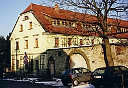

* * *

**Gemeindesiegel von Omsewitz**

* * *

Omsewitz wurde von slawischen Siedlern gegründet und 1317 erstmals als
Omasuwitz (= Leute eines Omaz) urkundlich erwähnt. Volkstümlich wird der Ortsname auch mit der Ameise (mundartlich: Omse) in Verbindung gebracht, die
deshalb das Gemeindewappen zeigt. Im Mittelalter unterstand der Ort einem als [Burgstädtel](../../west/omsewitz/burgstadtel/) bezeichneten  benachbarten Vorwerk. Dieses burgartige Herrengut,
oberhalb des Omsewitzer Grundes gelegen, gehörte ab 1317 dem Archidiakon von Nisan, der es dem Meißner Dom stiftete. 1390/92 erwarb das Domkapitel auch Teile des Bauerndorfes. Dadurch waren die Bewohner zu regelmäßigen
Zinszahlungen an die Meißner Bischöfe verpflichtet. Hinzu kamen Jagd- und Waffendienste für die sächsischen Kurfürsten. Erst im 17. Jahrhundert wurden diese durch Geldzahlungen ersetzt. Nach
Auflösung des Vorwerks kam Omsewitz 1559 zum kurfürstlichen Amt Dresden. 1745 waren im Ort preußische Soldaten im Zusammenhang mit der Schlacht bei Kesselsdorf einquartiert. Dabei kam es auch zu Schäden an Fluren
und Gebäuden, woran noch heute einige Schlusssteine der Gehöfte in Altomsewitz erinnern.

Jahrhundertelang blieb die Landwirtschaft wichtigster Wirtschaftszweig des Ortes. 1787 entstand am Lehmberg eine
Ziegelei. Während der Napoleonischen Kriege lagerten in und um Omsewitz französische Soldaten, was zu erneuten
Kontributionen und Plünderungen führte. Mitte des 19. Jahrhunderts siedelten sich mehrere Gärtnereien an. Bis 1900
entstanden außerdem vier moderne Dampfziegeleien, welche die reichen Lehmvorkommen der Region ausbeuteten. Zu
diesem Zeitpunkt  bestand der Ort nur aus dem Dorfkern Altomsewitz und den erwähnten Gewerbebetrieben. 1905
wurde das benachbarte Burgstädtel nach Omsewitz eingemeindet. In der Folgezeit entstanden einige Wohngebäude an der Warthaer und Gompitzer Straße.

Nach dem Ersten Weltkrieg entwickelte sich die kleine Gemeinde zum Dresdner Wohnvorort. 1919 gründete sich ein
“Ausschuss zur Förderung der Lehmbauweise im Freistaat Sachsen”, welcher in den Jahren 1920-22 eine der ersten
Lehmhaussiedlungen im Dresdner Raum errichtete.  In den Zwanziger Jahren folgten weitere neue Wohnsiedlungen mit
Zwei- und Dreifamilienhäusern. Die gewachsene Einwohnerzahl führte schließlich zur Aufnahme von Verhandlungen
über eine Eingemeindung in die nahe Großstadt. Seit dem 15. Oktober 1930 gehört der Ort als Stadtteil zu Dresden.
Auf Omsewitzer Flur befinden sich auch Teile des zwischen 1979 und 1986 entstandenen Neubaugebietes Gorbitz.

[_Weiterführende Literatur und Quellen_](../../impressum/quellenverzeichnis/)

 \[ [Home](../../index.html)\] \[ [Nord](../../nord/)\] \[ [Nordwest](../../nordwest/)\] \[ [Neustadt](../../neustadt/)\] \[ [Nordost](../../nordost/)\] \[ [West](../../west/)\] \[ [Zentrum](../../zentrum/)\] \[ [Südwest](../../sudwest/)\] \[ [Süd](../../sud/)\]
 \[ [Südost](../../sudost/)\] \[ [Ost](../../ost/)\] \[ [Register](../../Register/register.html)\] \[ [Kontakt](../../Kontakt/kontakt.html)\] \[ [Impressum](../../impressum/)\]
