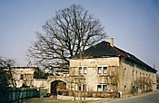
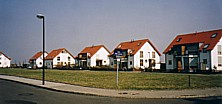

* * *

* * *

Burgstädtel entstand im Mittelalter als Vorwerk über dem Omsewitzer Grund
und wurde 1317 erstmals als Herrengut “Borchelage minor” erwähnt. Zuvor befand sich hier bereits eine frühgeschichtliche Wehranlage, der der Ort seinen
Namen verdankt. Im gleichen Jahr stiftete der Besitzer, der Archidiakon von Nisani, das Gut dem Meißner Dom. Eng verbunden war dieses Vorwerk mit dem benachbarten Bauerndorf [Omsewitz](../../../west/omsewitz/). Das Lehngut kam 1435 in den Besitz
der Dresdner Bürgerfamilie Kundige und gehörte seit 1511 der Familie Merbitz.

Nach Auflösung des Vorwerks entwickelte sich Burgstädtel zu einem kleinen
Bauerndorf, welches nur aus wenigen Gehöften bestand und 1890 76 Einwohner hatte. 1905 wurde Burgstädtel mit dem benachbarten Omsewitz vereinigt und kam 1930 zu Dresden. An der ab 1906 Burgstädtler Straße, seit 1931
Altburgstädtel genannten Straße sind noch einige historische Gehöfte erhalten geblieben. Im Grundstück Nr. 18
befinden sich die Reste einer frühgeschichtlichen Wehranlage. Am Gut Altburgstädtel 7 ist ein Renaissanceportal sehenswert.

Nach 1990 wurden Teile eines ehemaligen Gärtnereigeländes als Standort eines kleinen Wohnparks _(Foto)_ gewählt.
In den Folgejahren entstanden hier mehrere Einfamilienhäuser, wobei zur Erschließung auch zwei neue Straßen angelegt wurden. Eine trägt heute den Namen Neuburgstädtel und erinnert so an das benachbarte Dorf.

 \[ [Home](../../../index.html)\] \[ [Nord](../../../nord/)\] \[ [Nordwest](../../../nordwest/)\] \[ [Neustadt](../../../neustadt/)\] \[ [Nordost](../../../nordost/)\] \[ [West](../../../west/)\] \[ [Zentrum](../../../zentrum/)\] \[ [Südwest](../../../sudwest/)\] \[ [Süd](../../../sud/)\] \[ [Südost](../../../sudost/)\] \[ [Ost](../../../ost/)\] \[ [Register](../../../Register/register.html)\] \[ [Kontakt](../../../Kontakt/kontakt.html)\] \[ [Impressum](../../../impressum/)\]
