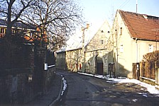
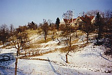

## Adalbert-Stifter-Weg

Der heutige Adalbert-Stifter-Weg erhielt 1933 zunächst den Namen Walter-Flex-Weg. Flex (1887-1917) nahm am Ersten
Weltkrieg als Freiwilliger teil und verfasste später einige Romane und Schriften, in denen er das Soldatenleben glorifizierte,
was ihn zu einem der “Vorzeigeautoren” des Dritten Reiches machte. Am 27. September 1945 wurde die Straße nach dem österreichischen Erzähler und Maler Adalbert Stifter (1805-1868) benannt, der vor allem durch seine Novellen bekannt
wurde.

## Altomsewitz

Die frühere Dorfstraße wurde
nach der Eingemeindung des Ortes 1931 Altomsewitz genannt. Zu diesem Zeitpunkt wurden noch acht Gehöfte landwirtschaftlich genutzt. Zu den bis heute erhaltenen und historisch interessanten Gütern gehören die Höfe
Altomsewitz Nr. 2 (von 1783), Nr. 7, Nr. 11 (1768) und Nr. 16 (1787). Schlusssteine weisen auf die Bauzeit der Häuser hin und zeugen von der Vergangenheit des früheren Bauerndorfes. Jüngstes Gut ist der 1792 erbaute
Bauernhof Altomsewitz Nr. 9, welcher bereits aus Ziegeln gebaut wurde. Heute dienen die meisten Gehöfte nur noch Wohnzwecken und wurden in den letzten Jahren saniert.

Zum Dorfkern gehört auch die historische Gaststätte [“Kümmelschänke”](../../../west/omsewitz/strassen_omsewitz/kummelschanke/), die heute ein Kulturzentrum des Vereins “Omse
e.V.” beherbergt. Gegenüber steht der “Pietschhof” (Nr. 11), dessen Geschichte sich bis 1768 zurückverfolgen lässt. 1922
erwarb die Stadt Dresden dieses Gehöft und richtete hier ein Kinderheim ein. Später dienten die Gebäude als Lagerräume,
danach bis 2009 als Domizil des Vereins FachWerkHof Omsewitz. Künftig sollen hier Wohnungen entstehen. Im Dreiseithof
Altomsewitz Nr. 18 wurde 2002 durch den Verein “Lebensraum” ein Kindergarten eröffnet, der nach den Prinzipien der Waldorf-Pädagogik Rudolf Steiners arbeitet.

_Des wilden Sturmes Wuth_

_Riß mir die Scheune nieder_

_Auf Gott gesetzt den Muth_

_Bauet ich dieselbe wieder_

_Johann Gottlieb Ludewig am 24. May 1830_

**Inschrift an der Scheune des Gehöfts Altomsewitz 11**

## Am Querfeld

Die an der Ortsgrenze zu Ockerwitz verlaufende und deshalb Grenzstraße genannte Straße erhielt 1931 die Bezeichnung Am Querfeld. Der Name ist von einer alten Flurbezeichnung abgeleitet.

## Am Steinigt

Auch diese Straße erhielt ihren Namen Am Steinigt nach einem Flurnamen. Vor 1931 hieß sie Podemuser Straße.
Namensgeber der um 1905 so benannten Straße war das Dorf [Podemus](../../../west/mobschatz/podemus/), welches seit 1999 ebenfalls als Stadtteil zu Dresden gehört. Seit 1899 befindet sich hier die Gärtnerei Kühne.

## Brentanostraße

Die im Zusammenhang mit dem Bau einer neuen Siedlung angelegte Brentanostraße erhielt ihren Namen am 6. Oktober 1933
nach dem Dichter Clemens Brentano (1778-1842), der als einer der wichtigsten Vertreter der deutschen Romantik gilt und vor allem durch seine Balladen und Volkslieder bekannt wurde.

## Freiheit

Die auf Omsewitzer und Briesnitzer Flur verlaufende Südstraße erhielt am 17. August 1931 den Namen Freiheit, nachdem hier einige Siedlungshäuser entstanden waren. Der genaue Grund der Namensgebung ist unklar, vermutlich jedoch mit dem Wunsch der Siedler nach Freiheit auf dem eigenen Grund und Boden in Zusammenhang zu bringen.Zuvor wurde sie nach ihrer Verlaufsrichtung Südstraße genannt. 1960 entstand hier ein Kindergarten,der von Otto Buchwitz aus Mitteln seines Lenin-Friedenspreises finanziert wurde und deshalb später seinen Namen trug.

Ziegelwerk Omsewitz: Ende des 19. Jahrhunderts hatten sich in diesem Gebiet mehrere Ziegeleien angesiedelt, welche sich im Besitz von Heinrich Kühne (Nr. 26), Friedrich Woßlick (Nr. 24) und Franz Faust (Nr. 22) befanden. 1920 schlossen sich die Unternehmen zur Dampfziegelwerke Deutscher & Co. KG zusammen, welche 1925 in der Dresdner Baugemeinschaft e. GmbH aufging. Das vor allem im Siedlungsbau tätige Unternehmen wurde nach dem Zweiten Weltkrieg verstaatlicht und
gehörte bis zu seiner Schließung 1958 zum VEB Ziegelwerke Dresden. 2017 begann auf dem Areal der Bau einer kleinen Wohnsiedlung mit Doppelhäusern und einem MFH.

## Ginsterstraße

Die Ginsterstraße entstand beim Bau des Neubaugebietes Gorbitz nördlich der Coventrystraße, liegt jedoch bereits auf
Omsewitzer Flur. Am 29. August 1986 erhielt sie, ebenso wie zahlreiche weitere Straßen des Stadtviertels, ihren Namen nach einer Pflanzenart.

## Gompitzer Straße

Die Gompitzer Straße führt durch Omsewitz und Leutewitz und erhielt ihren Namen westlich des Abzweigs nach Burgstädtel bereits 1905. 1926 wurde dieser auch auf die frühere Dresdner Straße im östlichen Teil des Ortskerns übertragen. Im Zuge der Eingemeindung von Omsewitz 1930 erhielt wenig später auch die dortige Dresdner Straße den Namen Gompitzer Straße. Nach dem Ersten Weltkrieg entstanden hier einige Mehrfamilienhäuser, denen in den 1930er Jahren Siedlungshäuser folgten.

## Hagebuttenweg

Der Hagebuttenweg entstand Anfang der 1980er Jahre im Zusammenhang mit dem Bau des zweiten Bauabschnittes des Neubaugebietes Gorbitz nördlich der Coventrystraße. Ebenso wie auch benachbarte Straßen erhielt er seinen Namen nach einer Strauchart, der zur Familie der Wildrosen gehörenden Hagebutte.

## Harthaer Straße

Die Harthaer Straße wurde als ringförmige Erschließungsstraße angelegt und am 29. August 1986 nach dem Kurort Hartha, heute ein Ortsteil von Tharandt, benannt. Hier befindet sich das "Gorbitz-Center", eines von mehreren großen Einkaufscentern im Neubaugebiet Gorbitz. Das von Supermärkten und kleineren Läden sowie Arztpraxen genutzte Gebäude wurde 2015 an einen Investor verkauft und umgebaut.

## Korianderweg

Die kurze Sackgasse entstand 2011 als Planstraße zur Erschließung eines neuen Wohngebietes an der Gompitzer Straße. 2012 erhielt sie auf Beschluss des Ortsbeirates Cotta den Namen Korianderweg. Vorgabe war die Benennung nach einem Gewürzkraut in Anlehnung an den benachbarten Liebstöckelweg.

## Liebstöckelweg

Der Liebstöckelweg wurde 2009 im Zusammenhang mit dem Bau einer kleinen Wohnsiedlung zwischen Gompitzer und
Lise-Meitner Straße angelegt. Für die Namensgebung waren auch die Namen Rosmarinweg bzw. Johanna-Wiegand-Straße im Gespräch, welche wegen
Verwechslungsgefahr bzw. der ungeklärten Rolle der Mathematikerin in der NS-Zeit abgelehnt wurden.

## Lise-Meitner-Straße

Die Lise-Meitner-Straße entstand im Zusammenhang mit dem Bau des Neubaugebietes Gorbitz auf Omsewitzer Flur und wurde 1986 zunächst nach der P
olitikerin Olga Körner benannt. Olga Körner (1887-1969) gehörte ab 1921 der KPD an, engagierte sich im antifaschistischen Widerstand und übernahm nach 1945 verschiedene politische Funktionen in der
Bezirksleitung Dresden der KPD und SED.

1993 wurde die Olga-Körner-Straße nach der österreichischen Physikerin Lise Meitner (1878-1968) umbenannt. Sie leitete
ab 1918 die Physikabteilung des Kaiser-Wilhelm-Institutes in Berlin und forschte auf dem Gebiet der Radio- und Kernchemie. Gemeinsam mit Otto Hahn entdeckte sie das chemische Element Protactinium. Nach Emigration wegen ihrer
jüdischen Herkunft lebte Lise Meitner in Schweden und Großbritannien und wurde 1966 als erste Frau mit dem Enrico- Fermi-Preis ausgezeichnet

Nachdem an der Südseite der Straße bereits in den 1980er Jahren mehrgeschossige Plattenbauten errichtet worden waren,
entstanden 2008 auf dem Areal einer ehemaligen Gärtnerei 38 Einfamilien- und Doppelhäuser. Erschlossen wird die kleine Siedlung durch zwei neue Zufahrtsstraßen.

## Martin-Opitz-Straße

Die Martin-Opitz-Straße wurde 1933 angelegt und nach dem Dichter und Literaturhistoriker Martin Opitz (1597-1639)
benannt. Opitz arbeitete ab 1637 als polnisch-königlicher Hofhistoriograph und schrieb das Libretto der ersten deutschen
Oper “Daphne” von Heinrich Schütz. Im Wohnhaus Martin-Opitz-Straße 19 hatte ab 1948 Lina Franziska Fehrmann, das als “Fränzi” bekannt gewordene Modell der “Brücke”-Maler, ihren letzten Wohnsitz.

## Omsewitzer Grund

Der Weg verbindet die Dorfkerne von Omsewitz und Leutewitz und durchquert dabei das vom Omsewitzer Abzugsgraben durchflossene Wiesental. Die offizielle Bezeichnung Omsewitzer Grund
ist 1935 erstmals in den Stadtplänen verzeichnet. Hier befand sich einst ein Brunnen zur Trinkwasserversorgung beider Orte. 1903 erwarb die Gemeinde Leutewitz die
Wasserrechte im Grund und ließ von dort eine Leitung in den Dorfkern legen.

Der durch den Grund fließende Wasserlauf beginnt ca. 50 Meter nördlich des Straßenabzweigs Am Querfeld / Roitzscher
Straße und wird vom Gompitzer Graben, einem nur periodisch wasserführenden Bach gespeist. Insgesamt ist der Omsewitzer Graben ca. 2,7 km lang und durchquert dabei die Gemarkungen Omsewitz, Leutewitz und Cotta. Ab der Straße
Altleutewitz wird er auch Wasserschöpfe genannt und fließt seit Ende des 19. Jahrhunderts in einem steinernen Gewölbe zur Elbe, wo er in der Nähe des Haltepunktes Cotta mündet.

**_Foto:_** _Im Omsewitzer Grund unterhalb von Burgstädtel_

## Reuningstraße

Die Reuningstraße wurde 1936 nach dem Rechtswissenschaftler und Volkswirt Dr. Theodor Reuning (1807-1876) benannt.
Reuning gilt als einer der Mitbegründer der nach wissenschaftlichen Grundsätzen betriebenen Landwirtschaft in Sachsen und
führte als Geschäftsführer des landwirtschaftlichen Hauptvereins Sachsen moderne Methoden der Düngung und Melioration ein.

## Roitzscher Straße

Die bereits in den 20er Jahren angelegte Straße erhielt zunächst den Namen Siedlerstraße, da hier eine Kleinhaussiedlung mit
Ein- und Zweifamilienhäusern entstanden war. 1953 wurde sie nach dem Dorf Roitzsch bei Wilsdruff in Roitzscher Straße umbenannt.

## Ziegeleistraße

Die Ziegeleistraße entstand in den 20er Jahren und erhielt ihren Namen, da sie in Richtung der Omsewitzer Ziegelei führte. 1928/29 entstand hier eine Siedlung mit mehreren Wohnhäusern.

[Omsewitz auf OpenStreetMap](https://www.openstreetmap.org/search?query=Dresden+Omsewitz)

* * *

 \[ [Home](../../../index.html)\] \[ [Nord](../../../nord/)\] \[ [Nordwest](../../../nordwest/)\] \[ [Neustadt](../../../neustadt/)\] \[ [Nordost](../../../nordost/)\] \[ [West](../../../west/)\] \[ [Zentrum](../../../zentrum/)\] \[ [Südwest](../../../sudwest/)\] \[ [Süd](../../../sud/)\] \[ [Südost](../../../sudost/)\] \[ [Ost](../../../ost/)\] \[ [Register](../../../Register/register.html)\] \[ [Kontakt](../../../Kontakt/kontakt.html)\] \[ [Impressum](../../../impressum/)\]
