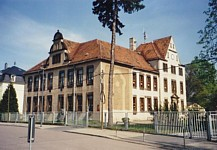

* * *

**Gemeindesiegel von Stetzsch**

* * *

**Schulen in Stetzsch:**

Das Gebiet um den heutigen Stadtteil Stetzsch war bereits in der Ur- und Frühgeschichte
besiedelt und gehört zu den ältesten Siedlungsräumen im Dresdner Elbtal. Bedeutende Funde wurden nach 1900 an der Flurgrenze zu Mobschatz gemacht, woran noch der Straßenname [Am Urnenfeld](../../west/stetzsch/strassen_stetzsch/) erinnert. Später siedelten sich hier Slawen an, die das kleine
Bauerndorf gründeten, welches 1266 erstmals als “Steiz” urkundlich erwähnt wurde. Der Name ist vom sorbischen Wort staja = Stall, Gehöft abgeleitet. Stetzsch unterstand bis
1559 dem bischöflichen Dingstuhl zu Briesnitz und kam dann an das Amt Dresden. Zwischen 1568 und 1828 waren die ansässigen Bauern dem Kammergut Ostra
dienstverpflichtet.Der eigentliche Dorfanger besteht nur aus der kurzen Gasse Altstetzsch am Elbufer und war einst mit einer Plänermauer umgeben. Die Siedlung wurde durch
Schutzdämme gegen die häufigen Elbehochwasser gesichert, da Stetzsch mit nur 103 m ü. NN bis 1999 der tiefstgelegene Punkt im Stadtgebiet war. Trotz dieser Maßnahmen wurde
der Ort häufig überschwemmt, so in den Jahren 1784 und 1845 sowie zuletzt 2002.

Schwere Flurschäden entstanden auch während des Siebenjährigen Krieges, in dem die bewaldeten Talhänge zum
Bau von Befestigungen fast völlig abgeholzt wurden. 1856 zerstörte ein Dorfbrand einen Teil des Ortes. Bis ins 19. Jahrhundert dominierte die Landwirtschaft, an die noch einige Bauernhöfe in [Altstetzsch](../../west/stetzsch/strassen_stetzsch/) erinnern _(Fotos)_. Die Fluren
des Dorfes waren ab 1667 Jagdrevier des Kurprinzen, was immer wieder zu Konflikten zwischen Landesherr und Dorfgemeinschaft führte. Ab 1737 gab es eine Elbfähre nach Kaditz, welche erst 1959 stillgelegt wurde.

Mit dem Bau der [Dresden - Berliner Eisenbahn](../../zentrum/friedrichstadt/dresden_-_berlin/) über Stetzscher Flur erhielt Stetzsch 1875 Bahnanschluss, was zu einem schnellen Anstieg der Einwohnerzahl führte. Schrittweise wurde die Landwirtschaft durch
Gartenbaubetriebe, Baufirmen und Kleingewerbe abgelöst. In diesem Zusammenhang entstanden zahlreiche neue Mietshäuser an der Meißner Landstraße. Am 1. April 1921 kam der Ort zu Dresden. Nach der
Eingemeindung entstand 1926/27 im Auftrag des Allgemeinen Sächsischen Siedlerverbands eine Holzhaussiedlung an der Flensburger Straße. Die 11 Doppel- und sieben Vierfamilienhäuser mit insgesamt 50 Wohnungen wurden
von der Niedersedlitzer Firma Höntsch & Co. gebaut und stehen seit 1991 unter Denkmalschutz.

Schule:

Das erste Schulhaus entstand 1878 für den Schulverband Stetzsch - Mobschatz. Nachdem dieses zu klein geworden war, wurde zunächst 1897 ein Anbau, 1902 unmittelbar daneben ein größerer Schulneubau errichtet. 1912 folgte nach Plänen des Architekten Curt Herfurth die Turnhalle, die zugleich als Jugendheim diente. Mit der Eingemeindung von Stetzsch wurde die Schule 1921 als 77. Volksschule ins Dresdner Schulnetz eingegliedert. Zu DDR-Zeiten nutzte die 77. Polytechnische Oberschule das Gebäude. In den 1970er Jahren erhielt sie nach einem kommunistischen Widerstandskämpfer den Namen “Oswald Rentzsch”. Heute befindet sich hier die 77. Grundschule “An den Seegärten”.

Elbebad:

Nach dem Vorbild anderer Elbanlieger errichtete die Gemeinde Stetzsch 1914 unterhalb des Dorfkerns ein Elbebad
mit zwei großen Gemeinschaftsbassins und hölzernen Umkleidekabinen. Das Elbebahnen-Bad Stetzsch war in den Sommermonaten zwischen Juni und September geöffnet und wurde auch von den Bewohnern aus Briesnitz und
Kemnitz gern besucht. Trotz des guten Zuspruchs musste das Stetzscher Elbebad Ende der Zwanziger Jahre aus wirtschaftlichen Gründen geschlossen werden.

[_Weiterführende Literatur und Quellen_](../../impressum/quellenverzeichnis/)

 \[ [Home](../../index.html)\] \[ [Nord](../../nord/)\] \[ [Nordwest](../../nordwest/)\] \[ [Neustadt](../../neustadt/)\] \[ [Nordost](../../nordost/)\] \[ [West](../../west/)\] \[ [Zentrum](../../zentrum/)\] \[ [Südwest](../../sudwest/)\] \[ [Süd](../../sud/)\]
 \[ [Südost](../../sudost/)\] \[ [Ost](../../ost/)\] \[ [Register](../../Register/register.html)\] \[ [Kontakt](../../Kontakt/kontakt.html)\] \[ [Impressum](../../impressum/)\]
