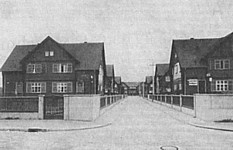
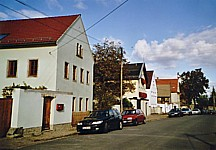
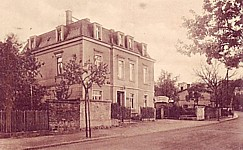
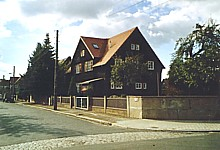
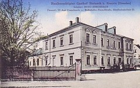
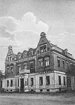

Die Alsenstraße, kurz zuvor als Planstraße Z angelegt, wurde 1926 nach der im Kleinen Belt gelegenen Insel Alsen benannt. Diese gehörte bis 1920 zu Schleswig-Holstein, musste infolge des Versailler Vertrages jedoch an Dänemark abgetreten werden.Die Gebäude wurden 1926/27 für den Allgemeinen Sächsischen Siedlerverband von der Firma Höntsch & Co. in Holzbauweise errichtet und stehen seit 1991 unter Denkmalschutz.

**_Foto:_** _Die Stetzscher Holzhaussiedlung um 1934_

Altstetzsch bildet den Dorfplatz (Anger) des früheren Bauerndorfes. Bis zur Eingemeindung wurde dieser Platz als Gustav-Merbitz-Platz bezeichnet. Namensgeber war der frühere Gemeindevorstand Gustav Merbitz (1835–1913). Am 19. Februar 1926 erfolgte die offizielle Umbenennung in Altstetzsch. Gleichzeitig erhielt die frühere Bismarckstraße den Namen Gustav-Merbitz-Straße.

Die Gebäude zu Seiten des gassenartigen Angers erhielten ihr Aussehen meist nach dem letzten großen Dorfbrand 1856 und lassen die ursprüngliche Dorfanlage noch gut erkennen. Nach Einstellung der Landwirtschaft wurden die Häuser heute nur noch zu Wohnzwecken und für kleine Gewerbebetriebe genutzt. Auch der um 1900 erbaute frühere Gasthof Stetzsch dient heute als Autowerkstatt und Wohnhaus. Die unter Denkmalschutz stehenden Gehöfte wurden in den letzten Jahren zum Großteil saniert.

Im Grundstück Altstetzsch Nr. 1 haben sich noch Reste der Plänermauer erhalten, die früher das Dorf umschloss. Bemerkenswert sind auch die Gehöfte Altstetzsch Nr. 5 und Nr. 11, letzteres mit einer klassizistischen Fassade. Eine für den Dorfkern ungewöhnliche Dachgestaltung weist Nr. 7 auf. Diese entstand beim Wiederaufbau nach dem Dorfbrand 1856. Völlig neu aufgebaut wurde hingegen das Wohnhaus Nr. 13, welches sich in seiner Kubatur an einem 1968 abgebrannten Vorgänger im Fachwerkstil orientiert.

_Es steige Gottes Sonne segnend auf und nieder,_

_und wirken hier vereint des Hauses Glieder._

_Wo Menschen und Tier wetteifernd gehen ein und aus,_

_Es blühe Gottes Segen für dieß Haus._

_Und trägt man mich dereinst als Wirth zum Thor hinaus, Dann ist gebaut in jener Welt mein Haus._

**Inschrift am Haus Altstetzsch 11**

Die Straße wurde früher Schulstraße genannt, da sich hier das 1877/78 errichtete erste Stetzscher [Schulhaus](../../../west/stetzsch/) befand. 1926 erfolgte die Umbenennung in Am Urnenfeld. Mit der Namensgebung soll an die hier um 1900 gemachten archäologischen Funde erinnert werden. Auf dem Areal war damals ein großer Urnenhain der frühen Eisenzeit entdeckt worden, der der Billendorfer Kultur (800 bis 400 v. Chr.) zugerechnet wird. Mit den Grabbeigaben konnte die vorslawische Besiedlung der Region nachgewiesen werden. Bemerkenswertestes Gebäude ist neben dem Schulhaus die um 1910 erbaute Villa Am Urnenfeld 15. Im heute nur noch als Wohnhaus genutzten Haus Am Urnenfeld 31, unmittelbar neben der Bahnstrecke gelegen, befand sich vor 1945 das Restaurant und Café "Zum Bahnschlösschen" _(Foto)_.

Die Brabschützer Straße wurde nach dem Ersten Weltkrieg zur Erschließung eines neuen Wohngebiets angelegt und am 29. Oktober 1925 nach dem nahegelegenen Ort Brabschütz benannt. Zuvor trug sie kurzzeitig den Namen Grünweg. Seit 1999 ist auch [Brabschütz](../../../west/mobschatz/brabschutz/) als Teil der Ortschaft Mobschatz ein Stadtteil von Dresden.

Die Ende des 19. Jahrhunderts angelegte Straße in der Nähe der Elbwiesen hieß ursprünglich Schanzenstraße, wurde jedoch nach der Eingemeindung zur Vermeidung von Verwechslungen 1926 in Buhnenstraße umbenannt. Beide Namen erinnern an die Befestigung des Elbufers mittels Buhnen und Dämmen, um die Siedlung Stetzsch vor Hochwasser zu schützen.

Die Straße entstand 1926 durch Zusammenlegung der früheren Gohliser und Kemnitzer Straße in Stetzsch und der Dresdner Straße in Kemnitz. Die amtliche Benennung erfolgte am 26. Februar 1926. Ihren Namen erhielt sie nach der Stadt Flensburg in Schleswig-Holstein. 1926/27 errichte die Firma Höntsch & Co. an der Flensburger Straße eine Holzhaussiedlung für den Allgemeinen Sächsischen Siedlerverband mit elf Zwei- und sieben Vierfamilienhäusern. Die Siedlung (Nr. 41-61 b)steht heute unter Denkmalschutz. Auf dem Gelände einer früheren Gärtnerei (Nr. 23-29) wurden 2010/11 mehrere Einfamilienhäuser gebaut.

**_Foto:_** _Holzhaussiedlung an der Flensburger Straße_

Die frühere Bismarckstraße, heute Gustav-Merbitz-Straße, wurde am 19. Februar 1926 nach dem Stetzscher Schul- und Kirchenvorstand Gustav Merbitz (1835-1913) benannt. Merbitz war viele Jahre Gemeindevorstand des Ortes und erwarb sich dabei große Verdienste um die Entwicklung des Ortes. Bereits zu Lebzeiten hatte die Gemeinde ihm zu Ehren den Dorfplatz benannt. Gustav Merbitz wohnte im Haus Meißner Straße Nr. 63.

Im Haus Gustav-Merbitz-Straße 2, unmittelbar am Dorfplatz gelegen, befand sich einst der Gasthof Stetzsch _(Foto)_. Das als "Realberechtigter Gasthof zu Stetzsch" gegründete Lokal besaß neben den Restaurationsräumen auch einen großen Saal, der nach dem Ersten Weltkrieg zeitweise auch als Kino "Tonbild-Theater" mit ca. 200 Plätzen genutzt wurde. Heute befinden sich im ehemaligen Gasthof eine Autowerkstatt sowie Wohnungen.

Die Miltitzer Straße trägt ihren Namen seit 1926 nach dem kleinen Ort Miltitz in der Nähe von Meißen. Zuvor wurde sie
Florastraße genannt, da sich hier einige Gärtnereien befanden. Der Gartenbau entwicklte sich seit dem 19. Jahrhundert zum wichtigsten Wirtschaftszweig des Ortes.

Die Podemusstraße erhielt ihren Namen nach dem kleinen Ort [Podemus](../../../west/mobschatz/podemus/) oberhalb des Zschonergrundes, der seit 1999 als Stadtteil zu Dresden gehört. Vor der Eingemeindung wurde sie bis 1926 Lindenstraße genannt.

Lindenhof: 1889 entstand auf der Podemusstraße 9 der Gasthof “Lindenhof”, anfangs “Lindenhotel” genannt. Mit Anbau eines Saales entwickelte er sich zum beliebten Tanz- und
Versammlungslokal. Nach 1945 nutzten kommunale Behörden die früheren Gasträume. 1997 wurde der Lindenhof als Hotel und Restaurant wiedereröffnet. In diesem Zusammenhang erfolgte
auch eine teilweise Rekonstruktion der historischen Ausmalung und Deckengestaltung. Seit Juli 2015 wird der frühere Gasthof als Unterkunft für Asylbewerber genutzt.

Die Straße wurde 1924 angelegt und Seegärten genannt, da sich hier der niedrigste Punkt des Dresdner Stadtgebietes
befindet. Das Gelände war in der Vergangenheit häufig überschwemmt, was zur Entstehung kleiner Elblachen führte. Die
heute zum Großteil verlandeten Tümpel sind Teil des Landschaftsschutzgebietes Elbtal. Zwischen 1921 und 1925 entstand an
den Seegärten eine Wohnanlage des Kleinwohnungs-Bauvereins Dresden. Die vom Hellerauer Vorbild inspirierten Reihenhäuser wurden von Prof. Dr. Otto Schubert entworfen und blieben bis heute fast unverändert erhalten.

Ursprünglich wurde diese 1905 angelegte Straße Bahnstraße genannt, da sie unmittelbar an den Gleisen der Eisenbahnstrecke entlangführte. 1926 erfolgte
nach dem Ort Wildberg bei Meißen die Umbenennung in Wildbergstraße.

Die Straße Zum Tierheim erhielt ihren Namen 1994, da sie zum Dresdner Tierheim führt. Das vor allem mit Spenden des
Tierschutzvereins finanzierte Heim bietet herrenlosen Hunden, Katzen und Kleintieren ein Domizil und wurde in den 90er Jahren erweitert und modernisiert. In unmittelbarer Nähe befindet sich seit
1998 Dresdens einziger privater Tierfriedhof.

[Stetzsch auf OpenStreetMap](https://www.openstreetmap.org/search?query=Dresden+Stetzsch)

* * *

 \[ [Home](../../../index.html)\] \[ [Nord](../../../nord/)\] \[ [Nordwest](../../../nordwest/)\] \[ [Neustadt](../../../neustadt/)\] \[ [Nordost](../../../nordost/)\] \[ [West](../../../west/)\] \[ [Zentrum](../../../zentrum/)\] \[ [Südwest](../../../sudwest/)\] \[ [Süd](../../../sud/)\] \[ [Südost](../../../sudost/)\] \[ [Ost](../../../ost/)\] \[ [Register](../../../Register/register.html)\] \[ [Kontakt](../../../Kontakt/kontakt.html)\] \[ [Impressum](../../../impressum/)\]
