* * *

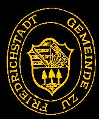

**Gemeindesiegel von Friedrichstadt**

* * *

* * *

**Kultureinrichtungen in der Friedrichstadt**

****

Die Geschichte der Friedrichstadt begann am 25. Juli 1670, als der damalige Kurfürst Johann Georg II. in einer Bekanntmachung dazu aufforderte, sich an der zum Ostravorwerk führenden Straße anzusiedeln und
dort neue Häuser zu bauen. Eine Siedlung hatte es hier bereits im 12. Jahrhundert gegeben. 1206 wurde dieses Dorf [Ostra](../../zentrum/friedrichstadt/ostra/), welches aus einem Herrengut und
mehreren Bauernhöfen bestand, erstmals als “Ostrov” urkundlich erwähnt. Ursprünglich befand sich der Ort im Besitz der Meißner Bischöfe, wurde jedoch 1550 von Kurfürst August erworben. 1568 ließ dieser die Einwohner
umsiedeln, um hier das [Ostravorwerk](../../zentrum/friedrichstadt/ostragehege/) als landwirtschaftlichen Großbetrieb zur Versorgung der Stadt Dresden einzurichten. An dieses erinnert noch heute der Flurname Ostragehege.

Um die Besiedlung der zunächst “Neustadt-Ostra” genannten Vorstadt zu befördern, wurden allen Bauwilligen unentgeltlich Grundstücke überlassen und weitere Vergünstigungen wie Gewerbe- und Steuerfreiheit
zugesagt. Das stieß jedoch auf den Widerstand des Dresdner Rates und der Handwerkerinnungen, die in der neuen Siedlung eine bedrohliche Konkurrenz sahen und deshalb den Zuzug boykottierten. Stattdessen erwarben
wohlhabende Dresdner Bürger, Adlige und Hofbeamte die Flächen, um hier ihre Sommergärten anzulegen. So gab es auch 20 Jahre später nur wenige Gebäude in der Friedrichstadt. Zu den wenigen gewerblichen Unternehmen
gehörte die 1678 von Johann Daniel Craft gegründete Wollmanufaktur. 1692 eröffnete an der [Schäferstraße](../../zentrum/friedrichstadt/strassen_friedrichstadt/schaferstrasse/) eine Salpeterhütte, der 1718 die Wachsbleiche des Barons von Blumenthal folgte.

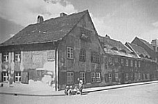Nachdem 1720 das Manteuffelsche Brauhaus seinen Betrieb aufgenommen
hatte, nahm die Siedlungstätigkeit weiter zu. Entlang der Weißeritz sowie zwischen [Friedrichstraße](../../zentrum/friedrichstadt/strassen_friedrichstadt/friedrichstrasse/) und Schäferstraße entstanden einfache vorstädtische
Wohngebäude, die aus strategischen Gründen nicht unterkellert und nur in Holz- bzw. Fachwerkbauweise gebaut werden durften **_(Foto:_** _Adlergasse)_. Erst nach
Aufhebung dieses Verbotes wurden ab 1734 an der Friedrichstraße erste Steinhäuser mit Barockfassaden errichtet. 1720 ließ August der Starke für die am Hof tätigen Katholiken den [Inneren Katholischen Friedhof](../../zentrum/friedrichstadt/strassen_friedrichstadt/friedrichstrasse/innerer_katholischer_friedhof/) anlegen, welcher
wegen seiner zahlreichen Grabstätten prominenter Persönlichkeiten zu den bedeutendsten Kulturdenkmalen der Stadt gehört. Im 19. Jahrhundert kam der [Äußere Katholische Friedhof](../../zentrum/friedrichstadt/ausserer_katholischer_friedhof/) an der Bremer Straße hinzu.

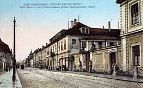Bedeutendstes historisches Bauwerk der Friedrichstadt ist das [Marcolinipalais](../../zentrum/friedrichstadt/strassen_friedrichstadt/friedrichstrasse/marcolinipalais/), welches seit 1849 als [Städtisches Krankenhaus](../../zentrum/friedrichstadt/strassen_friedrichstadt/friedrichstrasse/marcolinipalais/krankenhaus_friedrichstadt/) genutzt wird _(Foto)_. Unter
Mitwirkung des Baumeisters Johann Christoph Knöffel ließ der sächsische Minister Brühl 1736 ein schon vorhandenes kleines Sommerpalais zu einer Schlossanlage
ausbauen. Zum Areal gehörte auch ein weitläufiger Park mit Wasserspielen und Skulpturen, der für Feste genutzt wurde. 1774 erwarb Graf Camillo Marcolini das
Palais, ließ es von Hofbaumeister Johann Daniel Schade erweitern und mit Plastiken und Wandmalereien ausgestalten. In den Räumen kam es am 28. Juni 1813 zu dem
historisch bedeutsamen Treffen zwischen Napoleon und dem österreichischen Minister Fürst Metternich, in dessen Ergebnis sich Österreich den Verbündeten anschloss und damit Napoleons Niederlage einleitete.

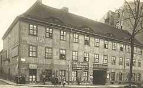Im Umfeld des Marcolinipalais entwickelte sich eine kleine Siedlung, die um 1730 zu Ehren des sächsischen Kurprinzen Friedrich August II. den Namen Friedrichstadt bekam, ohne jedoch das formale Stadtrecht zu erhalten. Auch die Namensgebung erfolgte zunächst nur umgangssprachlich, so dass sich noch bis 1743 sowohl die Bezeichnungen “Friedrichstadt” als auch “Neustadt Ostra” in den Urkunden finden. Allerdings besaß der Ort einen eigenen Marktplatz (heute [Hohenthalplatz](../../zentrum/friedrichstadt/strassen_friedrichstadt/hohenthalplatz/)) _( **Foto:** Hohenthalplatz 5)_ und ab 1728 eine nach Plänen Pöppelmanns errichtete Kirche ( [Matthäuskirche](../../zentrum/friedrichstadt/strassen_friedrichstadt/friedrichstrasse/matthauskirche/)). Das rechtwinklige Straßennetz entstand nach einem einheitlichen Bebauungsplan von 1729. Schöpfer dieses Plans war der
Ingenieur-Offizier Christian Friedrich Erndl. Für die Wohnhäuser waren einheitliche Traufhöhen vorgeschrieben und maximal drei Geschosse erlaubt, wobei diese zunächst aus strategischen Gründen nur in Fachwerkbauweise ausgeführt werden durften. Erst die Bauordnung vom 27. August 1734 erlaubte auch den Bau massiver Steinhäuser.

Trotz einiger wohlhabender Grundstücksbesitzer und mehrerer Gewerbebetriebe blieb die Friedrichstadt eine relativ
arme Vorstadt. Anfang 1835 erfolgte die Einbeziehung in den städtischen Gemeindebezirk. Gemäß einer Forderung der Kreisdirektion wurde diese im Mai 1836 durch einen förmlichen Rezess bestätigt und nach Zustimmung der
Kommunrepräsentanten und des Dresdner Rates am 7. September 1836 rechtskräftig. Da die Friedrichstadt jedoch weiterhin durch die Weißeritz vom übrigen Stadtgebiet getrennt und nur über eine einzige Brücke im Verlauf der
Friedrichstraße erreichbar war, behielt sie auch danach noch lange eine gewisse Eigenständigkeit, die erst 1893 mit Verlegung der Weißeritz und dem Ausbau der [Weißeritzstraße](../../zentrum/friedrichstadt/strassen_friedrichstadt/weisseritzstrasse/) auf dem ehemaligen Flußbett endete.

Nach
Umwidmung des Ostravorwerks in einen Betrieb der Milchwirtschaft, weiteren gewerblichen Ansiedlungen und
zunehmender Bautätigkeit wandelte sich die Friedrichstadt Mitte des 19. Jahrhunderts zum Arbeiterwohnort. Allerdings
lebten hier zeitweise auch bekannte Dresdner Persönlichkeiten, wie der Komponist Richard Wagner und der Bildhauer
Ernst Hähnel, die ihre Wohnräume im Marcolinipalais hatten, sowie der Erbauer der ersten deutschen Lokomotive Andreas Schubert. Der im ehemaligen Ostragut wohnende Vermessungsingenieur Moritz Preßler entwarf, unter dem
Eindruck der schweren Hochwasserkatastrophe 1845, Pläne für eine umfassende Umgestaltung der Friedrichstadt. 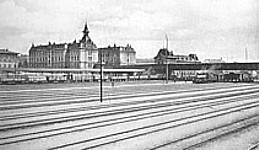Diese sahen u.a. eine Verlegung der Weißeritzmündung nach Cotta vor. Auf dem gewonnenen Gelände sollten neue Bahnanlagen entstehen. Außerdem regte Preßler den Bau des [Alberthafens](../../zentrum/friedrichstadt/alberthafen/) und die Anlage eines Friedrichstädter [Rangierbahnhofes](../../zentrum/friedrichstadt/dresden_-_berlin/rangierbahnhof/) _(Foto)_ an. Zwischen 1873 und 1894 wurden diese Planungen in leicht veränderter Form in die Realität umgesetzt. 1878 erklärte der Rat der Stadt Dresden die Friedrichstadt
per Ortsgesetz zum Fabrikbezirk. Der einstige Vorort war damit endgültig zu einem wichtigen wirtschaftlichen Zentrum Dresdens geworden. Zu den hier ansässigen Unternehmen gehörten die Eisenbahnwerkstätten (später
Reichsbahnausbesserungswerk), die Bienertsche [Hafenmühle](../../zentrum/friedrichstadt/alberthafen/), der [Städtische Vieh- und Schlachthof](../../zentrum/friedrichstadt/ostragehege/schlachthof/), die [Zigarettenfabrik Yenidze](../../zentrum/friedrichstadt/strassen_friedrichstadt/weisseritzstrasse/yenidze/), das Dresdner [Kühlhaus](../../zentrum/friedrichstadt/strassen_friedrichstadt/weisseritzstrasse/) und die Nähmaschinenfabrik [Seidel & Naumann](../../west/cotta/strassen_cotta/hamburger_strasse/seidel___naumann/). 1890 eröffnete die
“Deutsche Straßenbahngesellschaft in Dresden” ihre Pferdebahnlinie von Striesen bis zur Friedrichstraße, womit die Friedrichstadt Straßenbahnanschluss erhielt. 1897 erfolgte die Elektrifizierung dieser Strecke.

Der zentrumsnahe und von gewerblichen Unternehmen durchsetzte Stadtteil entwickelte sich nun schnell zum dichtbesiedelten Arbeiterwohnort, was zur Anlage neuer Straßen und zum Bau zahlreicher neuer Wohngebäude führte.
Gleichzeitig erstarkte die organisierte Arbeiterbewegung, die sich regelmäßig in einem der zahlreichen Lokale des Stadtteils traf. Als Treffpunkt bekannt war vor allem das [“Keglerheim”](../../zentrum/friedrichstadt/strassen_friedrichstadt/friedrichstrasse/) an der Weißeritzstraße, nicht zuletzt durch den
tragischen Ausgang einer Versammlung am 25. Januar 1933, bei der neun Arbeiter von Polizisten erschossen wurden.
Trotz aller Bemühungen verschiedener sozialer und politischer Organisationen blieb die Friedrichstadt bis 1945 ein
Wohngebiet der ärmeren Bevölkerungsschichten, was zur spöttischen Bezeichnung “Topflappenviertel” führte. Von
diesem Milieu angezogen ließen sich auch einige Künstler in der Friedrichstadt nieder. 1905 wurde in einem ehemaligen Ladenlokal auf der [Berliner Straße](../../zentrum/friedrichstadt/strassen_friedrichstadt/berliner_strasse/) die Künstlergruppe “Brücke” gegründet, der u.a. Erich Heckel, Ernst Ludwig
Kirchner und Karl-Schmidt-Rottluff angehörten.

Die nicht zuletzt durch ihre Verkehrsanlagen strategisch wichtige Friedrichstadt war während des Zweiten Weltkriegs
wiederholt das Ziel alliierter Bomber, die über 440 Gebäude des Stadtteils zerstörten. Zu den Opfern der Luftangriffe gehörten das katholische [Stift St. Michael](../../zentrum/friedrichstadt/strassen_friedrichstadt/friedrichstrasse/st_-michael-kapelle/) auf der Friedrichstraße sowie die Matthäuskirche, welche erst 1974 wieder
aufgebaut werden konnte. Im Mittelpunkt des Wiederaufbaus standen jedoch die Verkehrsanlagen und gewerblichen
Betriebe des Stadtteils, während die verbliebene Wohnsubstanz weitgehend vernachlässigt wurde. Pläne aus den 1960er
Jahren sahen sogar den fast vollständigen Abriss aller Altbauten zugunsten von sechs- bis sechzehngeschossigen
Wohnblocks vor. Weitere Flächen waren als Gewerbestandort bzw. Sportpark vorgesehen. Obwohl 1976-78 Teile der [Berliner Straße](../../zentrum/friedrichstadt/strassen_friedrichstadt/berliner_strasse/) im Rahmen eines städtebaulichen Modellprojektes gründlich saniert wurden, verfielen andere
Wohnviertel immer mehr, was 1988/89 zu Flächenabrissen an der Schäfer- und Weißeritzstraße führte.

1990 begann auch in der Friedrichstadt die schrittweise Sanierung verfallener Gebäude sowie die Schließung von
Baulücken. 1993 wurde dafür ein Denkmalpflegeplan aufgestellt und die Friedrichstadt zum Sanierungsgebiet erklärt.
Auch im gewerblichen Bereich kam es zu einschneidenden Veränderungen. Das Gelände des Schlachthofes wurde
Standort des neuen Messegeländes, der Alberthafen modernisiert und zum Logistikzentrum umgestaltet. Große Teile der
Friedrichstadt warten jedoch bis heute auf eine Neugestaltung. Ein nach 1990 zwischen Seminar- und Friedrichstraße
geplantes Stadtteilzentrum mit Läden und einem Großkino kam bislang nicht zustande. Größere Wohnviertel sind künftig
auf dem Areal der ehemaligen Spirituosenfabrik Bramsch und dem Grundstück des früheren Ostravorwerks geplant.

Schulen in der Friedrichstadt:

Armenschulen: Obwohl die Bevölkerung der Friedrichstadt seit Beginn des 18. Jahrhunderts deutlich gewachsen war,
besaß die Vorstadt zunächst lediglich einige Armen- und Winkelschulen. Die älteste nachweisbare Schule wurde 1704
vom Schneider Daniel Pretzsch gegründet, der bis zu 60 Kinder in Lesen und Schreiben sowie Religion unterrichtete.
1717 entstand unter Aufsicht der Kirchenleitung des St.-Annen-Kirche eine Armenschule. Erstmals wurden hier Knaben
und Mädchen gemeinsam auch im Rechnen unterrichtet 1731 eröffnete mit finanzieller Unterstützung des Dresdner
Superintendenten Löscher die “Lingkesche Armenschule” ihre Türen. Wenig später folgte die ebenfalls von privaten
Spendern finanzierte “Johnische Armenschule”. Außerdem gab es ab 1729 eine Gemeindeschule im Ort. Da diese vom Kantor der Matthäuskirche geleitet wurde, bezeichnete man sie auch als Kantoratsschule. Wegen des ständigen
Zuwachses an Einwohnern und des hohen Anteils an ärmeren Familien erwiesen sich diese Schulen jedoch bereits Mitte des 18. Jahrhunderts als unzureichend

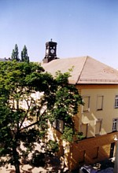48\. Volksschule:
Anfang der 1780er Jahre setzte der Kurfürst eine von Oberkonsistorialrat Dr. Rädler geleite Kommission für das Schulwesen in Friedrichstadt ein. Geplant war eine mit
einem Seminar für angehende Lehrer verbundene Real- und Armenschule, in der neben Lesen, Schreiben, Rechnen und Religion auch Naturwissenschaften unterrichtet werden
sollten. Mit Hilfe wohlhabender Stifter, vor allem der Familie von Hohenthal   gelang es ab 1784, einen regelmäßigen Schulbetrieb zu organisieren. Zunächst fand dieser in angemieteten
Räumen am Hohenthalplatz, ab 1785 in einem neu errichteten Schulhaus auf der damaligen Badergasse (Seminarstraße 11) statt. Neben fünf Klassenräumen gab es auch einen Saal mit
eingebauter Orgel sowie ein Arbeitsschulhaus, in dem die Schüler einfache Tätigkeiten wie Flachsspinnen, Strohflechten und Näh- und Stickarbeiten erlernen konnten. Die Eröffnung
dieser Realschule erfolgte am 31. Oktober 1785. Zwei Jahre später entstand in diesem Gebäude das erste sächsische [Lehrerseminar](../../zentrum/friedrichstadt/lehrerbildungsseminar/).

Trotz mehrfacher Umbauten und Namenswechsel blieb das historische Gebäude im Hof des Schulkomplexes zwischen
Seminar- und Wachsbleichstraße bis heute seiner Zweckbestimmung treu und ist damit ältestes noch genutztes Dresdner
Schulhaus. Der schlichte Bau weist über den Eingängen und Fenstern mehrere Reliefs und Inschriften auf und trägt einen Dachreiter _(Foto)_
. Ab 1838 wurde diese Schule als 4. Distriktschule, ab 1841 als 3. Bürgerschule bezeichnet. 1920 wurde sie schließlich zur 48. Volksschule (heute 48. Grundschule).

Schulmuseum:
Da das alte Schulhaus Mitte des 19. Jahrhunderts zu klein geworden war, entschloss man sich um 1870 für einen Ergänzungsbau. Das sogenannte “Jungenhaus” in der Straßenfront der Seminarstraße (Nr. 11) und die
angrenzende Turnhalle stammen aus dem Jahr 1871 und wurden später ebenfalls von der 48. Grundschule genutzt. Hier
hat seit 2006 das neue Dresdner Schulmuseum seinen Sitz, in welchem neben historischen Unterrichtsmaterialien auch
original eingerichtete Klassenzimmer der Kaiserzeit, der Zwanziger und Dreißiger Jahre und der DDR-Zeit zu sehen
sind. Außerdem besitzt das Museum eine große Sammlung historischer Unterrichtsmaterialien, die größte sächsische
Schulbuchbibliothek sowie eine Ausstellung zur Geschichte der Berufsausbildung, vor allem im Gastronomiegewerbe.
Schulmuseen hatte es in Dresden bereits bis 1945 in der Südvorstadt und danach von 1986 bis 1992 am Zoo gegeben.

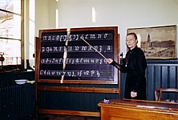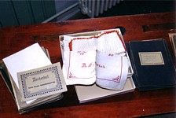

**_Fotos:_** _im neuen Dresdner Schulmuseum_

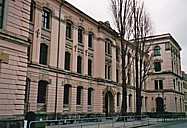17\. Volksschule: 1881 wurde an der benachbarten Wachsbleichstraße 6 ein weiteres Schulhaus errichtet. Die Planungen lieferte das Städtische Hochbauamt unter Leitung
von Theodor Friedrich. Der repräsentative Bau entstand im Stil des Historismus und ist baulich mit einer Turnhalle im Innenhof verbunden. Zur Einweihung am 27. April 1881
besaß die Schule insgesamt 16 Klassen mit 694 Schülern. Bis 1918 wurde sie als XVII. Bezirksschule, danach als 17.Volksschule bezeichnet.

Nach 1945 befand sich hier die nach einem Antifaschisten benannte 17. Polytechnische Oberschule “Christian Beham”. Im Zuge der Neustrukturierung des sächsischen Schulwesens entstand 1992 die 17.
Mittelschule, die das Gebäude bis zu ihrer Auflösung 1998 nutzte. Seit 2003 befindet sich im Haus eine Außenstelle der
Berufsschule für angehende Gastronomen. Diese trägt nach dem früheren Obermeister der Dresdner Köche-Innung und Begründer der gastronomischen Berufsausbildung seit 2008 den Namen “Ernst Lößnitzer”

3\. Bezirksschule: Die bereits 1841 gegründete III. Bezirksschule bezog 1848 einen an der Bräuergasse 1 errichteten Neubau.
Der Schulbezirk erfasste die Kinder aus dem Gebiet zwischen Schäferstraße, Grüner Straße und Ostra-Allee. Die Einweihung erfolgte am 28. Juli 1848. Bereits um 1880 genügte dieses Schulgebäude jedoch nicht mehr den
Anforderungen, weshalb die Schule am 27. April 1881 an der Wachsbleichstraße einen Neubau erhielt. Nachdem ab 1888 an der Fröbelstraße eine weitere Schule zur Verfügung stand, übernahm 1888 das [Friedrichstädter Krankenhaus](../../zentrum/friedrichstadt/strassen_friedrichstadt/friedrichstrasse/marcolinipalais/krankenhaus_friedrichstadt/) das Gebäude und nutzte es als Hautklinik, später als Schwesternschule (Haus L).

21\. Bezirksschule: Die XXI. Bezirksschule wurde am 27. April 1888 für die stark angewachsene Bevölkerung der Friedrichstadt und des benachbarten Löbtaus an der Fröbelstraße 1 - 3 eröffnet. Der Gebäudekomplex bestand aus zwei Haupt- und zwei Nebengebäuden, jeweils für Mädchen und Knaben, sowie einer Turnhalle im Hof. Ab 1910 gab es hier zudem die III. Fach- und Fortbildungsschule, ab 1911 zusätzlich Filialen der 3., 17. und 36. Bezirksschule. Mit der Neugliederung des sächsischen Schulwesens nach dem Ersten Weltkrieg entstand die 3. Volksschule, die nun alle Gebäude gleichzeitig nutzte. Zeitweise war auch eine Dienststelle des Städtischen Kohlenamtes sowie von 1925 bis 1938 eine Berufsschule für Mädchen mit untergebracht. Im Hintergebäude der Fröbelstraße 3 gab es ab 1931 einen kommunalen Kinderhort.

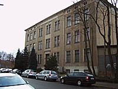Im Zuge der Ausgrenzung der jüdischen Bevölkerung wurden auf Weisung der Nationalsozialisten ab 1935 auch in Dresden spezielle Schulen gegründet. Diese mussten alle jüdischen Kinder Dresdens besuchen, nachdem ihnen der Besuch der deutschen Volksschulen und Höheren Schulen verboten worden war. Eine dieser Schulen befand sich ab 1938 im Hinterhaus Fröbelstraße 1. Hier wurden vor allem ältere und Berufsschüler unterrichtet. Die Einrichtung existierte bis 1939 und wurde dann zur Zeughausstraße 1 verlegt. Ab 1940 diente die Turnhalle als Arbeitslager für polnische Zwangsarbeiter, weitere Räume wurden von der Fachgewerbeschule der Dresdner Malerinnung belegt. Außerdem nutzte ab 1943 die aus Löbtau ausgelagerte 36. Volksschule die Gebäude.

Beim Luftangriff 1945 wurden die Schulgebäude auf der Fröbelstraße schwer beschädigt bzw. zerstört. Erhalten blieb lediglich das frühere Mädchenschulhaus (Fröbelstraße 1), welches bis 1991 Sitz der Einkaufs- und Liefergenossenschaft des Elektrohandwerks war. Außerdem lagerten die Staatstheater hier einen Teil ihres Fundus. Künftig soll das Areal jedoch wieder als Schulstandort genutzt werden. Dafür ist die Sanierung des noch vorhandenenSchulhauses und dessen Erweiterung durch moderne Neubauten vorgesehen. Geplanter Eröffnungstermin für die 153. Grundschule ist 2018.

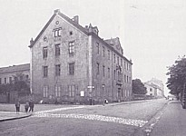Freimaurerinstitut:
Diese private Armenschule entstand 1771/72 als Reaktion auf eine Hungersnot und wurde von den Dresdner Freimaurerlogen “Zu den drei Schwertern” und “Zu den wahren Freunden” (später “Asträa zur grünenden Raute”)
finanziert. Entgegen den ursprünglichen Absichten wandelte man die Schule 1843 in eine Heimschule um, die nur noch von Knaben besucht werden konnte. Zu den
Schülern gehörten u. a. der durch seine Lokomotive “Saxonia” bekannt gewordene Ingenieur Johann Andreas Schubert sowie der Maler Ferdinand Rayski.

Zwischen 1849 und 1875 wurden nach Plänen von Ottomar Glöckner mehrere neue Schulgebäude errichtet, die sich um einen zur Wachsbleichstraße hin offenen Hof gruppierten. Da das alte Schulgelände
an der Institutsgasse trotz dieser Erweiterungen Ende des 19. Jahrhunderts nicht mehr den Anforderungen genügte, wurde das Freimaurerinstitut 1899 nach [Striesen](../../ost/striesen/) verlegt. Heute hat in diesem Gebäude die Kreuzschule ihr Domizil. Die
früheren Schulgebäude in der Friedrichstadt verfielen wenig später dem Abbruch.

**_Bild:_** _Lehr- und Erziehungsinstitut für Knaben Dresden-Friedrichstadt_

3\. Katholische Bezirksschule:
Mit dem Übertritt August des Starken zum Katholizismus 1697 war in Dresden ein Dresden ein Zuwachs an katholischen Gläubigen zu verzeichnen, die für ihre Kinder die Unterrichtung in speziellen
Schulen forderten. Anfangs gab es lediglich eine Lateinschule am Kapellknabeninstitut, bevor man auf dem Areal des [Katholischen Krankenstifts](../../zentrum/friedrichstadt/strassen_friedrichstadt/friedrichstrasse/st_-michael-kapelle/) eine reguläre Schule einrichtete. Sie befand sich im Vordergebäude des Grundstücks
Friedrichstraße 50 und existierte bis 1912 als 3. Katholische Bezirksschule. Nach Verlegung der Schule in einen Neubau zur [Bünaustraße](../../sudwest/lobtau/) übernahm die katholische Hilfsschule die Räume und unterrichtete hier sprach- und
entwicklungsgestörte sowie lernbehinderte Kinder. 1937 wurde die Einrichtung wie alle konfessionsgebundenen Schulen durch die Nationalsozialisten aufgelöst.

Volksbibliothek: Am 3. September 1875 wurde im Gebäude der 3. Bezirksschule auf der Bräuergasse 1 durch den ein
Jahr zuvor gegründeten „Gemeinnützigen Verein zur Förderung der sittlichen, geistigen und ökonomischen Interessen der
Bevölkerung Dresdens“ die erste Dresdner Volksbibliothek eröffnet. Innerhalb weniger Jahre wuchs der Bücherbestand
durch Schenkungen und Ankauf auf ca. 1800 Bände an. Die Bibliothek wechselte in der Folgezeit mehrmals ihren Standort und befand sich bis zur Auflösung des Vereins 1909 auf der Seminarstraße.

[_Weiterführende Literatur und Quellen_](../../impressum/quellenverzeichnis/)

**Wer kann helfen?**

**Die Interessengemeinschaft “Historische Friedrichstadt sucht**
**neue Mitglieder, welche sich mit Geschichte und Gegenwart des Stadtteils befassen möchten. Gesucht werden Hobby-Historiker, Heimatkundler, Fotografen und Denkmalpfleger**
**für die Aufarbeitung und Vervollständigung der Geschichtsunterlagen. Treffpunkt ist jeden 3. Donnerstag im Monat ab 17 Uhr im Dachgeschoss des “Riesa efau” auf der**
**Adlergasse 13. Kontakt: Erich Riedel, Tel. 0351-2164291**

 \[ [Home](../../index.html)\] \[ [Nord](../../nord/)\] \[ [Nordwest](../../nordwest/)\] \[ [Neustadt](../../neustadt/)\] \[ [Nordost](../../nordost/)\] \[ [West](../../west/)\] \[ [Zentrum](../../zentrum/)\] \[ [Südwest](../../sudwest/)\] \[ [Süd](../../sud/)\]
 \[ [Südost](../../sudost/)\] \[ [Ost](../../ost/)\] \[ [Register](../../Register/register.html)\] \[ [Kontakt](../../Kontakt/kontakt.html)\] \[ [Impressum](../../impressum/)\]
