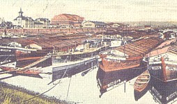
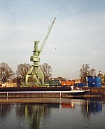
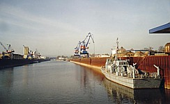
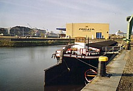
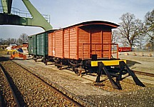
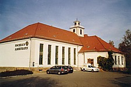
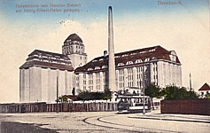
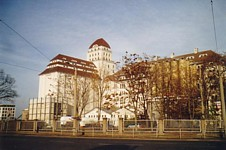
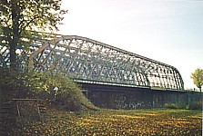

* * *

* * *

* * *

Der Dresdner Alberthafen wurde zwischen 1891 und 1895 am Rande der
Friedrichstadt angelegt. Zuvor standen der Elbschiffahrt in Dresden lediglich die 1822 bzw. 1861/64 angelegten Kais am Altstädter und Neustädter Elbufer sowie die Winterhäfen in [Loschwitz](../../../nordost/loschwitz/) und [Pieschen](../../../nordwest/pieschen/) zur Verfügung. Da diese jedoch ebenso wenig wie der 1872/76 angelegte [Neustädter Hafen](../../../neustadt/leipziger_vorstadt/) dem gewachsenen Verkehrsaufkommen genügten, entschloss sich
der sächsische Staat zum Neubau eines Elbhafens im Ostragehege. Bereits 1850 hatte der sächsische Ingenieur Friedrich Karl Preßler einen Plan zur grundlegenden Neuordnung der Verkehrsanlagen der Stadt vorgelegt, der
neben dem Bau eines Zentralbahnhofes in der Friedrichstadt auch die Anlage eines Hafens mit Umschlagmöglichkeit zur Eisenbahn vorsah.

1890/91 griff man Preßlers Idee wieder auf. Auf einem Gelände von knapp
15 Hektar entstand ein 1.100 m langes und 150 m breites Hafenbecken. Die Höhe der Kaimauern orientierte sich am damals höchsten bekannten Wasserstand der Elbe vom 31. März 1845 und sollte den Hafen vor
Überflutungen bei künftigem Hochwasser schützen. Ebenfalls dem Hochwasserschutz diente die zeitgleich entstandene Flutrinne zwischen Friedrichstadt und Ostragehege. Geleitet wurde das ganze Projekt von der
Generaldirektion der Sächsischen Staatseisenbahnen unter Oberfinanzrat Peters. Die Gesamtkosten beliefen sich auf ca. 2,5 Millionen Mark.

Die Bauarbeiten erfolgten mit Hilfe von dampfbetriebenen Trockenbaggern, die insgesamt
1,5 Millionen m³ Erdmassen aus dem Becken beförderten. Der Abraum wurde per Feldbahn abtransportiert und zum Aufschütten des Ablaufberges für den Friedrichstädter [Rangierbahnhof](../../../zentrum/friedrichstadt/dresden_-_berlin/rangierbahnhof/) verwendet. Nach fast vierjähriger Bauzeit konnte der Nordkai des
König-Albert-Hafens am 1. November 1895, der Südkai am 1. August 1896 eingeweiht werden. An beiden Kais waren Kräne stationiert, die die Güter vom Schiff auf die Bahn und
umgekehrt transportierten. Außerdem errichtete man mehrere Speicher, Lagerschuppen und die für den Betrieb des Hafens erforderlichen Verwaltungsgebäude. Weitere Bauten wurden
durch die hier niedergelassenen privaten Speditionen und Handelsunternehmen geschaffen. Namenspatron wurde der regierende sächsische König.

Die Hauptaufgabe des König-Albert-Hafens war der Umschlag von Gütern für die Stadt Dresden. Dominierend waren dabei Getreide und Mehl, ferner auch Erze, Tabak, Holz und Baustoffe. Außerdem nutzte man das Hafenbecken als
Liegeplatz für Schiffe in den Wintermonaten. In den Anfangsjahren gab es hier sogar öffentliche Veranstaltungen wie
das 24. Verbandsfest des Deutschen Schwimmverbandes im August 1910. Nach dem Ersten Weltkrieg kam es zu organisatorischen Veränderungen, da die bisherige sächsische Staatsbahn, zu der auch der Alberthafen gehörte, vom
Deutschen Reich übernommen wurde. Die Hafenanlagen blieben jedoch weiterhin im Besitz des Landes Sachsen, welches 1931 die Sächsische Elbhafen-Betriebsgesellschaft gründete. Diese ließ die veralteten technischen Anlagen
erneuern, weitere Lagerhallen erbauen und das Gleisnetz umgestalten.

Auch der strategisch bedeutsame Alberthafen war während des Zweiten Weltkrieges Ziel alliierter Luftangriffe, die zur Zerstörung mehrerer Speicher,
dreier Ladekräne und einiger Schiffe führten. Teile der erhaltenen Anlagen, u.a. sechs moderne Kräne und Gleise der Hafenbahn wurden 1946 als Reparationsleistungen durch die Sowjetunion demontiert, was zu weiteren
Betriebseinschränkungen führte. Der zunächst von der SMAD beschlagnahmte Alberthafen gehörte seit 1950 zur Deutschen Schiffahrts- und Umschlagbetriebszentrale (DSU) und war damit faktisch ein
Volkseigener Betrieb (ab 1957 VEB Binnenhäfen Oberelbe). 1955 und 1965 konnten zwei moderne Portalkräne in Betrieb genommen werden, die die Leistungsfähigkeit des Hafens deutlich
erhöhten. Weitere erforderliche Erhaltungsarbeiten unterblieben jedoch, bedingt durch die wirtschaftliche Situation in
der DDR und den zu verzeichnenden Rückgang des Frachtaufkommens auf den Binnenwasserstraßen zugunsten des Straßentransports.

Nach 1990 begannen im Alberthafen umfangreiche Umbau- und Modernisierungsmaßnahmen. Das für heutige Bedürfnisse überdimensionierte Hafenbecken wurde ab 1997 teilweise verfüllt. Auf den so gewonnenen Flächen
siedelten sich verschiedene Logistikunternehmen sowie Firmen der Baustoffbranche an. Platz entstand auch für die
benötigten Umschlagplätze vom Schiff auf den Lkw, während gleichzeitig die Gleisanlagen reduziert wurden. Für den
Containerumschlag wurden 1999 zwei moderne Portalkräne aufgestellt. Im ehemaligen Verwaltungsgebäude an der
Ostseite befindet sich seit einigen Jahren die beliebte Fischgaststätte “Fischhaus Alberthafen”. Unweit davon erinnern
der historische Elbeschleppkahn “Waltraut” von 1913, ein Ladekran (Bj. 1964) und einige Güterwagen aus der Zeit um 1910 an die Geschichte des Dresdner Elbhafens.

**_Fotos:_** _historischer Lastkahn und Güterwagen im Alberthafen_

Einzelne Gebäude und Anlagen im Alberthafen:

Verwaltungsgebäude und Lagerhallen am Südkai:
Der aus zwei durch einen Zwischenbau verbundene Gebäude bestehende Sitz der Hafenverwaltung entstand 1895 an der Südseite des Hafenbeckens. Ebenso wie verschiedene
weitere Bauten erhielt das Haus eine repräsentative Klinkerfassade und baukünstlerischen Schmuck. Daneben stehen
noch einige Lagerhallen aus der Frühzeit des Alberthafens. Diese befanden sich ursprünglich im Besitz der Dresdner
Elblagerhaus-Aktiengesellschaft. 1905 erfolgte durch das gleiche Unternehmen der Bau eines dreigeschossigen Speichers, der in Anlehnung an die vorhandene Bebauung ebenfalls mit Klinkern verkleidet wurde. Am 6. Juli 1910
zerstörte ein Großbrand eines dieser Lagerhäuser. Als Reaktion auf die Katastrophe wurden die Brandschutzeinrichtungen verbessert und eine eigene Hafenfeuerwache eingerichtet.

Westlich des Verwaltungsgebäudes befindet sich ein weiterer Großspeicher, der um 1912 ebenfalls im Auftrag der
Elblagerhaus AG errichtet wurde. Der viergeschossige Ziegel-Stahlbeton-Bau besitzt verschiedene Ladeluken und entstand vermutlich unter Mitwirkung des Stadtbaurates Hans Erlwein. 1930 wurde auf dem Nachbargrundstück ein
großes Kühlhauses zur Aufbewahrung verderblicher Güter erbaut.

Speicher am Nordkai: Die aus einem fensterlosen Silogebäude, einem etwas niedrigeren Anbau und einem Treppenturm
bestehende Anlage der Dresdner Transport- und Lagerhaus AG stammt aus dem Jahr 1905 und diente ebenfalls der Aufbewahrung von Getreide und anderen Schüttgüttern. Weitere Lagerhäuser und -plätze wurden von den hier
ansässigen Firmen genutzt, zu denen u.a. die Speicherei- und Speditions AG, die Elblagerhaus AG, die Firma G. E. Müller und die Firma Altmann gehörten.

Neues Verwaltungsgebäude:
Das zu den jüngeren Gebäuden im Hafengelände zählende Haus wurde 1955 errichtet und erhielt im leicht barockisierenden Stil einen Dachreiter. In der ehemaligen Betriebskantine befindet sich heute die für ihre
Fischspezialitäten bekannte Gaststätte “Fischhaus Alberthafen”.

**_Foto:_** _Fischhaus Alberthafen_

Hafenmühle: Die moderne Großmühle der Bienertschen Mühlenwerke entstand 1912-14 am Südrand des Hafenbeckens des Alberthafens. Anlass
für den Bau waren Pläne der sächsischen Staatsbahn für den Ausbau der Bahnstrecke nach Chemnitz, der eine weitere Entwicklung der Plauener [Bienertmühle](../../../sud/plauen/bienertmuhle/) unmöglich gemacht hätte. Die Besitzer des Betriebes, Erwin und
Theodor Bienert entschieden sich deshalb für einen weiteren Standort, der  zugleich ein bequemes Ausladen des Getreides vom Schiff aus ermöglichte.
Als Verbindung zur Bienertmühle Plauen wurde zusätzlich eine elektrische Güterstraßenbahn in Betrieb genommen.

Der Eisenbetonbau mit dem knapp 64 Meter hohen Siloturm wurde nach Entwürfen von William Lossow und Hans
Max Kühne durch die Baufirma Johann Odorico erbaut und bildet bis heute das weithin sichtbare Wahrzeichen des Alberthafens. Im Inneren erhielt das Gebäude moderne Transport-, Mahl- und Abfüllanlagen, darunter eine
pneumatische Sauganlage zum Ausladen von Getreide. Über Bandförderer und einen 100 Meter langen Tunnel wurde das Korn direkt zum Siloturm befördert, der ein Fassungsvermögen von 130.000 Tonnen besitzt. Die eigentliche
Vermahlung erfolgte mit Hilfe durch Dampfmaschinen angetriebener Walzenstühle. Zum Gesamtkomplex der Hafenmühle gehörte deshalb auch ein zweigeschossiges Maschinenhaus sowie ein Kesselhaus mit Kohlenlager.

Im Zweiten Weltkrieg wurde die Anlage nur leicht beschädigt und konnte ihre Produktion deshalb schon bald wieder aufnehmen. 1958 mussten die privaten
Eigentümer der Hafenmühle eine staatliche Beteiligung aufnehmen, 1972 wurde die Bienertmühle komplett verstaatlicht. Bei laufender Produktion erfolgte ab
1984 eine Rekonstruktion der technischen Anlagen. Seit 1992 gehört sie zur Dresdner Mühlen GmbH (heute KG) und kann am Tag ca. 300 Tonnen Weizen und 100 Tonnen Roggen verarbeiten. Das Gebäude wurde 1996/97 äußerlich
denkmalgerecht wiederhergestellt und technisch auf den aktuellen Stand gebracht.

Hafenbahn: Zur Anbindung des neuen Elbhafens entstand, ausgehend vom zeitgleich eröffneten [Rangierbahnhof Friedrichstadt](../../../zentrum/friedrichstadt/dresden_-_berlin/rangierbahnhof/), eine Zweigbahn, die unter der Hamburger Straße hindurch zum Hafengelände geführt wurde. An der Einfahrt des Hafens befinden sich zwei 1893/95 nach Entwürfen von Bernhard Krüger errichtete Eisengitterbrücken für den Eisenbahn- und Straßenverkehr (433 Meter lang - _Foto links_). Die Gleisanlagen verlaufen von dort weiter entlang des Nord- und des Südkais und ermöglichen ein unkompliziertes Verladen vom Schiff auf die Waggons und umgekehrt.

Eine Zweigstrecke verband ab 1907 den Alberthafen mit dem neuen Schlachthof im Ostragehege. Eine weitere [Verbindung](../../../Zentrum/Friedrichstadt/Dresden_-_Berlin/Anschlussbahn_Kohlebahnhof/Anschlussbahn_Kohlebahnhof.html) existierte bis 1992 parallel zur Magdeburger Straße bis zum Altstädter Elbkai. Trotz einiger Veränderungen sind die Anlagen der Hafenbahn bis heute im Wesentlichen erhalten, darunter auch der 1895 errichtete Bahnhof Alberthafen. Lediglich der Abschnitt zum Schlachthof mit der Flutrinnenbrücke wurde nach 1990 stillgelegt. Ein Abriss der Brücke erfolgte im Frühjahr 2006.

* * *

 \[ [Home](../../../index.html)\] \[ [Nord](../../../nord/)\] \[ [Nordwest](../../../nordwest/)\] \[ [Neustadt](../../../neustadt/)\] \[ [Nordost](../../../nordost/)\] \[ [West](../../../west/)\] \[ [Zentrum](../../../zentrum/)\] \[ [Südwest](../../../sudwest/)\] \[ [Süd](../../../sud/)\] \[ [Südost](../../../sudost/)\] \[ [Ost](../../../ost/)\] \[ [Register](../../../Register/register.html)\] \[ [Kontakt](../../../Kontakt/kontakt.html)\] \[ [Impressum](../../../impressum/)\]
